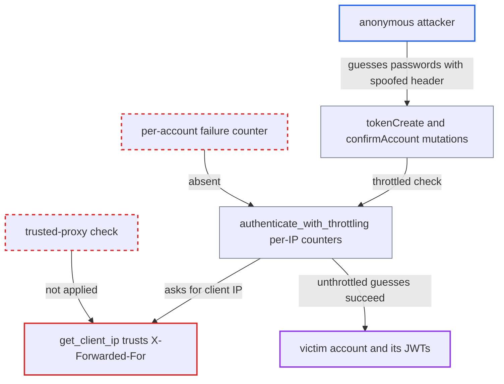

# Login throttle keyed on client-supplied X-Forwarded-For allows unlimited password guessing

| Field | Value |
|---|---|
| ID | `find_01Mn1kkTtr24JHDHMtfMLU1L` |
| Severity | **Critical** |
| Status | open |
| CWE | CWE-348 — Use of less trusted source |
| Created | 2026-10-27T21:08:00.318130Z |
| Claude Security | https://claude.ai/security/findings/find_01Mn1kkTtr24JHDHMtfMLU1L |

## Description

An anonymous internet client who knows an account's email can guess its password without being throttled. A correct guess gives that customer or staff account's login tokens. The login throttle keys its counters on the client IP from `get_client_ip()`, which trusts the client-supplied `X-Forwarded-For` header. A fresh header value on each request resets the counters.

1. **attacker** sends a `tokenCreate` mutation to `/graphql/` with a guessed password and a made-up `X-Forwarded-For` value. The attacker needs only the target's email and no login or user interaction. ([`saleor/graphql/account/mutations/authentication/create_token.py:53`](https://github.com/cx-benchmark/saleor/blob/c982006cc04c77a97def93218dedac8d715eb041/saleor/graphql/account/mutations/authentication/create_token.py#L53))
2. **`get_client_ip()`** returns the first valid IP in the `X-Forwarded-For` header. It checks no trusted proxy and falls back to `REMOTE_ADDR` only when no header entry parses as an IP address. ([`saleor/core/utils/__init__.py:57-71`](https://github.com/cx-benchmark/saleor/blob/c982006cc04c77a97def93218dedac8d715eb041/saleor/core/utils/__init__.py#L57-L71))
3. **`authenticate_with_throttling()`** builds its failure-count and block keys from that spoofed IP. The keys are `login:fail:ip:<ip>`, `login:block:ip:<ip>` and `login:fail:ip:<ip>:user:<pk>`. The new value gives empty counters, so no block is found and the password is checked. ([`saleor/account/throttling.py:21-76`](https://github.com/cx-benchmark/saleor/blob/c982006cc04c77a97def93218dedac8d715eb041/saleor/account/throttling.py#L21-L76))
4. **`authenticate_with_throttling()`** records the failed guess under the throwaway key. The delay in `get_delay_time()` never grows toward `MAX_DELAY` (3600 s), because each guess uses a new IP value. ([`saleor/account/throttling.py:21-76`](https://github.com/cx-benchmark/saleor/blob/c982006cc04c77a97def93218dedac8d715eb041/saleor/account/throttling.py#L21-L76))
5. **attacker** repeats with a new `X-Forwarded-For` value each time until a guess succeeds. A correct password makes `tokenCreate` return access and refresh JWTs for the account. ([`saleor/graphql/account/mutations/authentication/create_token.py:53`](https://github.com/cx-benchmark/saleor/blob/c982006cc04c77a97def93218dedac8d715eb041/saleor/graphql/account/mutations/authentication/create_token.py#L53))

## Assessment

The attacker is an anonymous internet client who knows the target account's email. The `tokenCreate` mutation is the entry point, and `confirmAccount` uses the same throttled password check and is affected the same way. The header is fully client-controlled when the shipped container (`Dockerfile`, uvicorn on `0.0.0.0:8000`) is reached directly. Behind common load balancers the leftmost entry stays client-controlled, because they append the peer address instead of replacing the header. Success also needs a guessable victim password, which the 8-character minimum from `MinimumLengthValidator(8)` allows. It also needs a front end that does not overwrite `X-Forwarded-For`. The attacker cannot control either condition. The same spoofing lets the attacker fill the counters of a chosen victim IP and lock that IP out of login for up to an hour. The spoofed IP is also recorded as `customer_ip_address` on payments and transactions. Setting that field explicitly requires `HANDLE_PAYMENTS`, but the header-derived default needs no permission. The setting `REAL_IP_ENVIRON` (default `REMOTE_ADDR`) is defined but never read, so operators cannot restrict which source is trusted.

Impact: The brute-force protection on customer and staff logins is fully defeated. A guessed password gives the account's JWTs, with full read and write access to its data and, for staff, its dashboard permissions. Availability impact is limited to locking chosen IPs out of login for up to 3600 s and falsifying the IP used for payment fraud checks.

## Recommendation

(1) `get_client_ip()` treats the unauthenticated `X-Forwarded-For` header as the client's identity and takes the client-supplied leftmost entry. This makes the IP used by `authenticate_with_throttling` forgeable.

Fix criteria: The IP used for throttling cannot be changed by the requesting client. It comes from `REMOTE_ADDR`, or from the `X-Forwarded-For` hop just left of a configured trusted proxy (for example through a `TRUSTED_PROXY_IPS` or hop-count setting), and any entries further left are ignored. Repeated failed `tokenCreate` requests from one peer with varying `X-Forwarded-For` headers still escalate the block and delay, and the counters accumulate on one key.

(2) The throttle has only one identity dimension, the IP. It has no per-account counter that is independent of where the request comes from, so any weakness in the IP identity bypasses it completely.

Fix criteria: A per-account failed-attempt counter and delay exist, keyed on the email or user pk and not on the client IP, so guesses against one account are bounded whatever the apparent source. N failed attempts for one email from many different IPs still trigger the account-scoped delay.

## Evidence

**https://github.com/cx-benchmark/saleor**

- [`saleor/core/utils/__init__.py:57-71`](https://github.com/cx-benchmark/saleor/blob/c982006cc04c77a97def93218dedac8d715eb041/saleor/core/utils/__init__.py#L57-L71)
- [`saleor/account/throttling.py:21-76`](https://github.com/cx-benchmark/saleor/blob/c982006cc04c77a97def93218dedac8d715eb041/saleor/account/throttling.py#L21-L76)
- [`saleor/graphql/account/mutations/authentication/create_token.py:53`](https://github.com/cx-benchmark/saleor/blob/c982006cc04c77a97def93218dedac8d715eb041/saleor/graphql/account/mutations/authentication/create_token.py#L53)
- [`saleor/graphql/account/mutations/account/confirm_account.py:125`](https://github.com/cx-benchmark/saleor/blob/c982006cc04c77a97def93218dedac8d715eb041/saleor/graphql/account/mutations/account/confirm_account.py#L125)
- [`saleor/settings.py:828-830`](https://github.com/cx-benchmark/saleor/blob/c982006cc04c77a97def93218dedac8d715eb041/saleor/settings.py#L828-L830)
- [`Dockerfile:67`](https://github.com/cx-benchmark/saleor/blob/c982006cc04c77a97def93218dedac8d715eb041/Dockerfile#L67)
- [`saleor/graphql/payment/mutations/payment/checkout_payment_create.py:343`](https://github.com/cx-benchmark/saleor/blob/c982006cc04c77a97def93218dedac8d715eb041/saleor/graphql/payment/mutations/payment/checkout_payment_create.py#L343)
- [`saleor/graphql/payment/mutations/transaction/utils.py:66-70`](https://github.com/cx-benchmark/saleor/blob/c982006cc04c77a97def93218dedac8d715eb041/saleor/graphql/payment/mutations/transaction/utils.py#L66-L70)

