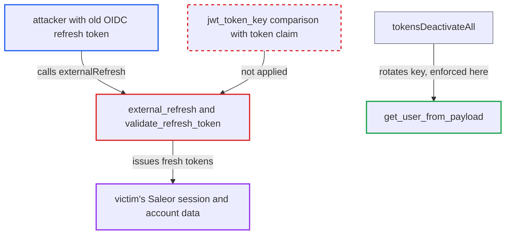

# OIDC externalRefresh ignores jwt_token_key, so tokensDeactivateAll cannot revoke OIDC sessions

| Field | Value |
|---|---|
| ID | `find_01P4jUrRMvi8nsaAGbxxTc93` |
| Severity | **Critical** |
| Status | open |
| CWE | CWE-613 — Insufficient session expiration |
| Created | 2026-10-27T21:17:54.021111Z |
| Claude Security | https://claude.ai/security/findings/find_01P4jUrRMvi8nsaAGbxxTc93 |

## Description

Someone who holds a user's OIDC refresh token can keep getting valid Saleor access tokens after the user runs `tokensDeactivateAll`. Only the victim's own privileges are exposed. This needs the OIDC plugin active with refresh enabled and a token stolen earlier. `external_refresh` and `validate_refresh_token` never compare the token's `token` claim with the user's current `jwt_token_key`.

1. **attacker** obtains a victim's OIDC refresh token. The report gives a leaked cookie, a shared or lost device, or a storefront XSS as examples.
2. **victim or operator** runs `tokensDeactivateAll`. This rotates the user's `jwt_token_key`, which is the only revocation mechanism and the only code that rotates that key. It kills the access tokens. ([`saleor/graphql/account/mutations/authentication/deactivate_all_user_tokens.py:13-27`](https://github.com/cx-benchmark/saleor/blob/c982006cc04c77a97def93218dedac8d715eb041/saleor/graphql/account/mutations/authentication/deactivate_all_user_tokens.py#L13-L27))
3. **attacker** calls `externalRefresh` with the old refresh token. The call uses `pluginId` "mirumee.authentication.openidconnect" and the old token as `refreshToken`. The handler `external_refresh` takes the token from the input or the `refreshToken` cookie. ([`saleor/plugins/openid_connect/plugin.py:415-475`](https://github.com/cx-benchmark/saleor/blob/c982006cc04c77a97def93218dedac8d715eb041/saleor/plugins/openid_connect/plugin.py#L415-L475))
4. **`validate_refresh_token`** accepts the token after checking only signature and CSRF. It checks neither the `type`, the `owner` nor the `token` claim holding the old `jwt_token_key`. The refresh JWT also has no Saleor expiry, because `create_jwt_refresh_token` sets `exp_delta=None`. ([`saleor/plugins/openid_connect/utils.py:655-706`](https://github.com/cx-benchmark/saleor/blob/c982006cc04c77a97def93218dedac8d715eb041/saleor/plugins/openid_connect/utils.py#L655-L706))
5. **`external_refresh`** exchanges the embedded IdP refresh token and finds the user by email. `get_user_from_token` looks the user up by email and `can_login` only, so the rotated key plays no part. ([`saleor/plugins/openid_connect/utils.py:613-622`](https://github.com/cx-benchmark/saleor/blob/c982006cc04c77a97def93218dedac8d715eb041/saleor/plugins/openid_connect/utils.py#L613-L622))
6. **`external_refresh`** issues new access and refresh tokens. They are signed with the user's current `jwt_token_key`, so the revoked session works again. ([`saleor/plugins/openid_connect/plugin.py:415-475`](https://github.com/cx-benchmark/saleor/blob/c982006cc04c77a97def93218dedac8d715eb041/saleor/plugins/openid_connect/plugin.py#L415-L475))

## Assessment

The attacker needs a victim's OIDC refresh token obtained earlier, for example from a leaked cookie, a shared or lost device, or a storefront XSS. The OIDC plugin must be active with refresh enabled, which is the default once the plugin is on. The victim or an operator then runs `tokensDeactivateAll`. The attacker needs no other privileges and sends the request over the network.

Impact: The attacker keeps the victim's Saleor session after the platform's own revocation step. That exposes the victim's PII and orders. For a staff account that logs in through OIDC it also exposes the staff permissions. Access stays within the victim's own privileges. It ends when the IdP refresh token expires or is revoked, or when the Saleor user is deactivated. The victim is not locked out.

## Recommendation

`external_refresh` and `validate_refresh_token` accept any Saleor-signed OIDC refresh JWT. They do not compare its `token` claim with the user's current `jwt_token_key`, and they skip the `type` and `owner` checks. Rotating the key therefore does not revoke OIDC refresh tokens.

Fix criteria: An OIDC refresh JWT is honoured only if it has type `refresh` and its owner is this plugin. Its user must resolve to an active user whose current `jwt_token_key` equals the token's `token` claim. The user from the refreshed ID token must also be the user the refresh JWT was issued to. Verify this: after `tokensDeactivateAll`, `externalRefresh` with an OIDC refresh token issued earlier fails and issues no tokens.

## Evidence

**https://github.com/cx-benchmark/saleor**

- [`saleor/plugins/openid_connect/plugin.py:415-475`](https://github.com/cx-benchmark/saleor/blob/c982006cc04c77a97def93218dedac8d715eb041/saleor/plugins/openid_connect/plugin.py#L415-L475)
- [`saleor/plugins/openid_connect/utils.py:655-706`](https://github.com/cx-benchmark/saleor/blob/c982006cc04c77a97def93218dedac8d715eb041/saleor/plugins/openid_connect/utils.py#L655-L706)
- [`saleor/plugins/openid_connect/utils.py:613-622`](https://github.com/cx-benchmark/saleor/blob/c982006cc04c77a97def93218dedac8d715eb041/saleor/plugins/openid_connect/utils.py#L613-L622)
- [`saleor/plugins/openid_connect/utils.py:387-399`](https://github.com/cx-benchmark/saleor/blob/c982006cc04c77a97def93218dedac8d715eb041/saleor/plugins/openid_connect/utils.py#L387-L399)
- [`saleor/graphql/account/mutations/authentication/deactivate_all_user_tokens.py:13-27`](https://github.com/cx-benchmark/saleor/blob/c982006cc04c77a97def93218dedac8d715eb041/saleor/graphql/account/mutations/authentication/deactivate_all_user_tokens.py#L13-L27)
- [`saleor/core/jwt.py:125-137`](https://github.com/cx-benchmark/saleor/blob/c982006cc04c77a97def93218dedac8d715eb041/saleor/core/jwt.py#L125-L137)

