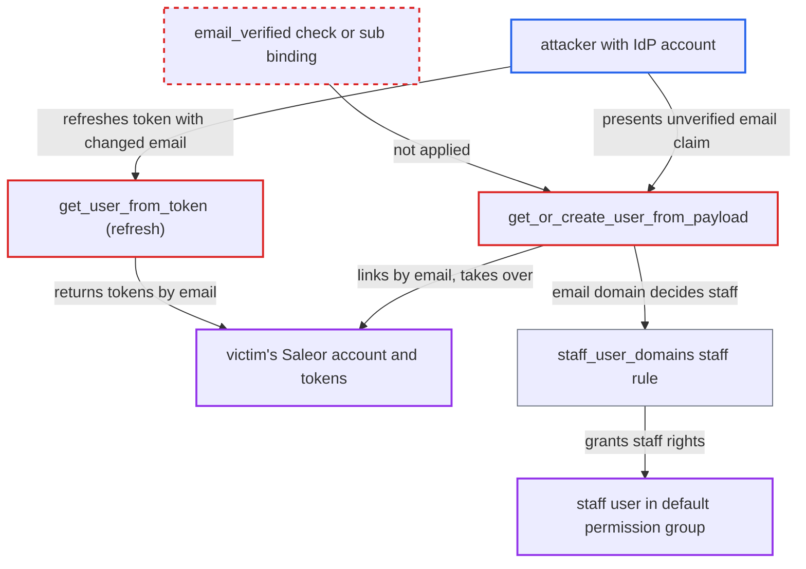

# OIDC links identity provider accounts to existing Saleor users by unverified email claim

| Field | Value |
|---|---|
| ID | `find_01B7Q6pk6tFxFsfXexvULSkA` |
| Severity | **Critical** |
| Status | open |
| CWE | CWE-287 — Improper authentication |
| Created | 2026-10-27T21:16:44.834259Z |
| Claude Security | https://claude.ai/security/findings/find_01B7Q6pk6tFxFsfXexvULSkA |

## Description

An attacker with an account at the trusted identity provider (IdP) can take over any existing Saleor customer or staff account. They can also create a new staff user. They need an IdP that issues tokens with an unverified `email` claim. `get_or_create_user_from_payload` and `get_user_from_token` match accounts by that `email` and never read `email_verified`.

1. **attacker** sets the email on their IdP account to the victim's address. This works at an IdP that does not verify email, or where the attacker controls the tenant. The address is either an existing Saleor account or any address in a `staff_user_domains` domain.
2. **attacker** logs in through the normal flow from `externalAuthenticationUrl` to `externalObtainAccessTokens`. Alternatively, the attacker presents the IdP access token as a bearer token when `user_info_url` is configured. The `sub` is new to Saleor, so the lookup by stored `sub` finds no user. ([`saleor/plugins/openid_connect/utils.py:440-495`](https://github.com/cx-benchmark/saleor/blob/c982006cc04c77a97def93218dedac8d715eb041/saleor/plugins/openid_connect/utils.py#L440-L495))
3. **the function `get_or_create_user_from_payload`** falls back to `get_or_create(email=...)` and finds the victim's account. The `email_verified` claim is never read, and the account owner is not asked to confirm the link. The victim's password is also set to unusable. ([`saleor/plugins/openid_connect/utils.py:440-495`](https://github.com/cx-benchmark/saleor/blob/c982006cc04c77a97def93218dedac8d715eb041/saleor/plugins/openid_connect/utils.py#L440-L495))
4. **the function `_update_user_details`** writes the attacker's `sub` into the victim's private metadata. This permanently links the attacker's IdP identity to the victim's account. If the IdP email differs from the stored one and is not yet taken, it also rewrites `user.email` and attaches guest orders with that email to the account. ([`saleor/plugins/openid_connect/utils.py:520-545`](https://github.com/cx-benchmark/saleor/blob/c982006cc04c77a97def93218dedac8d715eb041/saleor/plugins/openid_connect/utils.py#L520-L545))
5. **the method `external_obtain_access_tokens`** sets staff status from the email domain and issues Saleor tokens. An email in a `staff_user_domains` domain makes the user staff in the default permission group, even when no account existed before. The bearer-token path in `get_user_from_oauth_access_token_in_jwt_format` applies the same rule. ([`saleor/plugins/openid_connect/plugin.py:337-364`](https://github.com/cx-benchmark/saleor/blob/c982006cc04c77a97def93218dedac8d715eb041/saleor/plugins/openid_connect/plugin.py#L337-L364))
6. **the function `get_user_from_token`** resolves the user on refresh by email alone. It does not use `sub` or `email_verified`. A refreshed ID token whose email was changed at the IdP gives tokens for whichever Saleor user holds that email. ([`saleor/plugins/openid_connect/utils.py:613-622`](https://github.com/cx-benchmark/saleor/blob/c982006cc04c77a97def93218dedac8d715eb041/saleor/plugins/openid_connect/utils.py#L613-L622))

## Assessment

The attacker is an anonymous internet user who can register at the IdP that the Saleor instance trusts, or who controls a tenant there. The IdP must issue tokens whose `email` is not verified (`email_verified` false or absent). The attacker needs no action from the victim. The attacker can go through the authorization-code flow, or send the IdP access token as a bearer token when `user_info_url` is configured. A refresh with a changed IdP email is a further route. If `staff_user_domains` is configured, an email in that domain also creates a new staff user.

Impact: The attacker gets valid Saleor access and refresh tokens for the victim. That exposes customer data, orders and addresses. For a staff victim it exposes all of that user's dashboard permissions. The victim's password becomes unusable and the attacker's IdP identity stays linked to the account. With `staff_user_domains` set, an unverified email in that domain creates a staff user in the default permission group.

## Recommendation

`get_or_create_user_from_payload` and `get_user_from_token` treat the IdP `email` claim as a trustworthy account identifier. They attach never-seen IdP identities (`sub`) to existing accounts. They also use that email for the `staff_user_domains` staff rule.

Fix criteria: An IdP identity is matched to an existing account only by `(issuer, sub)`. It may match by email only when the token or userinfo asserts `email_verified: true` and the existing account has no conflicting link. Linking to an account not created by that IdP needs an explicit, authenticated confirmation by that account. Refresh finds the user through the stored `sub` link, not by email. A token or userinfo with `email_verified` false or absent for an existing user's email is rejected, with no tokens and no metadata or password changes. Staff-domain promotion does not happen for unverified emails.

## Evidence

**https://github.com/cx-benchmark/saleor**

- [`saleor/plugins/openid_connect/utils.py:440-495`](https://github.com/cx-benchmark/saleor/blob/c982006cc04c77a97def93218dedac8d715eb041/saleor/plugins/openid_connect/utils.py#L440-L495)
- [`saleor/plugins/openid_connect/utils.py:520-545`](https://github.com/cx-benchmark/saleor/blob/c982006cc04c77a97def93218dedac8d715eb041/saleor/plugins/openid_connect/utils.py#L520-L545)
- [`saleor/plugins/openid_connect/utils.py:613-622`](https://github.com/cx-benchmark/saleor/blob/c982006cc04c77a97def93218dedac8d715eb041/saleor/plugins/openid_connect/utils.py#L613-L622)
- [`saleor/plugins/openid_connect/plugin.py:337-364`](https://github.com/cx-benchmark/saleor/blob/c982006cc04c77a97def93218dedac8d715eb041/saleor/plugins/openid_connect/plugin.py#L337-L364)
- [`saleor/plugins/openid_connect/utils.py:246-263`](https://github.com/cx-benchmark/saleor/blob/c982006cc04c77a97def93218dedac8d715eb041/saleor/plugins/openid_connect/utils.py#L246-L263)

