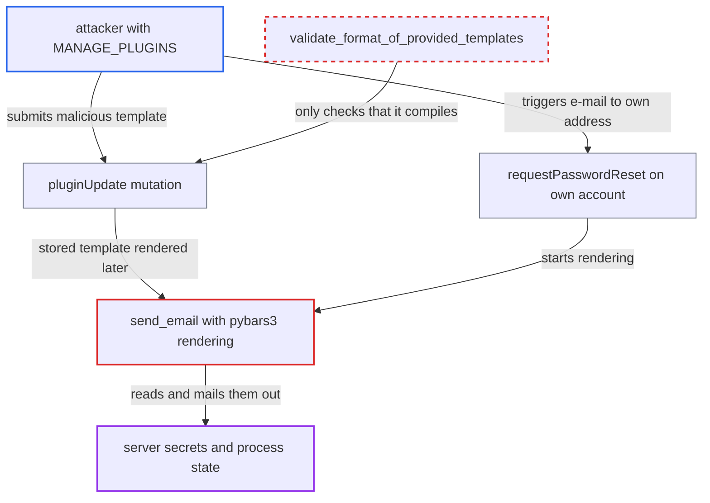

# Unsandboxed pybars3 email templates let plugin managers read server secrets

| Field | Value |
|---|---|
| ID | `find_012awx6cMR1Zf4pFbnRisiEt` |
| Severity | **Critical** |
| Status | open |
| CWE | CWE-1336 — Server-side template injection |
| Created | 2026-10-27T21:27:50.838123Z |
| Claude Security | https://claude.ai/security/findings/find_012awx6cMR1Zf4pFbnRisiEt |

## Description

A staff user or app with the `MANAGE_PLUGINS` permission can read server secrets such as `SECRET_KEY`, `RSA_PRIVATE_KEY`, database and cloud credentials, and the masked plugin passwords. The secrets arrive in an e-mail the attacker triggers for an address they control. The cause is `send_email`, which renders staff-written pybars3 templates with no restriction on the object paths they can follow. `validate_format_of_provided_templates` only checks that a template compiles.

1. **attacker with `MANAGE_PLUGINS`** sends a template with object-traversal paths through the `pluginUpdate` mutation. The mutation needs only `MANAGE_PLUGINS` and passes the raw configuration values on, for example a body for `account_password_reset` or `staff_password_reset_template` on the global admin plugin, or a subject field. ([`saleor/graphql/plugins/mutations.py:48-107`](https://github.com/cx-benchmark/saleor/blob/c982006cc04c77a97def93218dedac8d715eb041/saleor/graphql/plugins/mutations.py#L48-L107))
2. **`validate_format_of_provided_templates`** accepts the template because it compiles. No allow-list of path segments or helpers and no sandbox is applied, so paths using dunder names such as `__class__` and `__globals__` pass. ([`saleor/plugins/email_common.py:341-366`](https://github.com/cx-benchmark/saleor/blob/c982006cc04c77a97def93218dedac8d715eb041/saleor/plugins/email_common.py#L341-L366))
3. **`save_plugin_configuration`** stores the template. Template fields go into `EmailTemplate` rows and subject fields go into the plugin configuration, with no further checks. ([`saleor/plugins/user_email/plugin.py:431-470`](https://github.com/cx-benchmark/saleor/blob/c982006cc04c77a97def93218dedac8d715eb041/saleor/plugins/user_email/plugin.py#L431-L470))
4. **attacker** triggers a notification to an address they control. The attacker calls `requestPasswordReset` for an account they own, or resets their own staff password when the template is on the global admin plugin. ([`saleor/plugins/user_email/tasks.py:27-44`](https://github.com/cx-benchmark/saleor/blob/c982006cc04c77a97def93218dedac8d715eb041/saleor/plugins/user_email/tasks.py#L27-L44))
5. **`send_email`** compiles and renders the stored template with the notification payload. pybars3 tries `getattr` before dict lookup and calls any callable it resolves, so a path starting from a payload string can reach module globals, `sys.modules`, `os.environ` and `django.conf.settings`. ([`saleor/plugins/email_common.py:227-238`](https://github.com/cx-benchmark/saleor/blob/c982006cc04c77a97def93218dedac8d715eb041/saleor/plugins/email_common.py#L227-L238))
6. **password-reset task** sends the rendered subject and body to the attacker's address. The resolved secret value is written into the e-mail, which the attacker then reads. ([`saleor/plugins/user_email/tasks.py:27-44`](https://github.com/cx-benchmark/saleor/blob/c982006cc04c77a97def93218dedac8d715eb041/saleor/plugins/user_email/tasks.py#L27-L44))

## Assessment

The attacker is a staff user or an App holding `MANAGE_PLUGINS`. They need no victim action and no special deployment setting. They can use the template fields of `UserEmailPlugin` or `AdminEmailPlugin`, including subject fields. The report assumes pybars3 0.9.7 resolves path segments with a `getattr` fallback, calls resolved callables with the scope as first argument, and supports sub-expressions. This dependency behaviour is not visible in the checkout. Without sub-expressions, attribute traversal from the payload's builtin types would still work, but the leak would be limited to attribute reads.

Impact: The attacker can read environment variables and `django.conf.settings` from the server process. This includes `SECRET_KEY`, `RSA_PRIVATE_KEY`, database and cloud credentials, SMTP passwords and every plugin's masked `Password` or `Secret` fields, which is far more than `MANAGE_PLUGINS` should allow. With the JWT signing material they can forge tokens for any user, including superusers. The report does not establish any effect on availability.

Subsequent-system impact: Leaked credentials for the database, object storage, payment gateways and SMTP relay give access to those external systems.

## Recommendation

(1) `send_email` renders staff-written Handlebars templates with pybars3, which follows arbitrary Python attributes and calls any callable it finds. Writing a template therefore gives access to data on the worker.

Fix criteria: Rendering can reach only the explicit notification payload and the registered helpers. Attribute access on Python objects (`__class__`, `__globals__`, bound methods, module objects) is unreachable, and no callable other than a registered helper is ever invoked. A template such as `{{site_name.__class__}}` or a sub-expression chain renders empty or raises, and exposes no object internals in either body or subject.

(2) `validate_format_of_provided_templates` accepts any template that compiles, so dangerous constructs get saved.

Fix criteria: Templates are checked against an allow-list of path segments and helpers, or rendered in a sandbox at validation time, before they are stored. A template that uses dunder or attribute-only paths is rejected by `pluginUpdate`.

## Evidence

**https://github.com/cx-benchmark/saleor**

- [`saleor/plugins/email_common.py:227-238`](https://github.com/cx-benchmark/saleor/blob/c982006cc04c77a97def93218dedac8d715eb041/saleor/plugins/email_common.py#L227-L238)
- [`saleor/plugins/email_common.py:341-366`](https://github.com/cx-benchmark/saleor/blob/c982006cc04c77a97def93218dedac8d715eb041/saleor/plugins/email_common.py#L341-L366)
- [`saleor/plugins/user_email/plugin.py:431-470`](https://github.com/cx-benchmark/saleor/blob/c982006cc04c77a97def93218dedac8d715eb041/saleor/plugins/user_email/plugin.py#L431-L470)
- [`saleor/graphql/plugins/mutations.py:48-107`](https://github.com/cx-benchmark/saleor/blob/c982006cc04c77a97def93218dedac8d715eb041/saleor/graphql/plugins/mutations.py#L48-L107)
- [`saleor/plugins/user_email/tasks.py:27-44`](https://github.com/cx-benchmark/saleor/blob/c982006cc04c77a97def93218dedac8d715eb041/saleor/plugins/user_email/tasks.py#L27-L44)
- [`saleor/graphql/plugins/resolvers.py:15-35`](https://github.com/cx-benchmark/saleor/blob/c982006cc04c77a97def93218dedac8d715eb041/saleor/graphql/plugins/resolvers.py#L15-L35)

