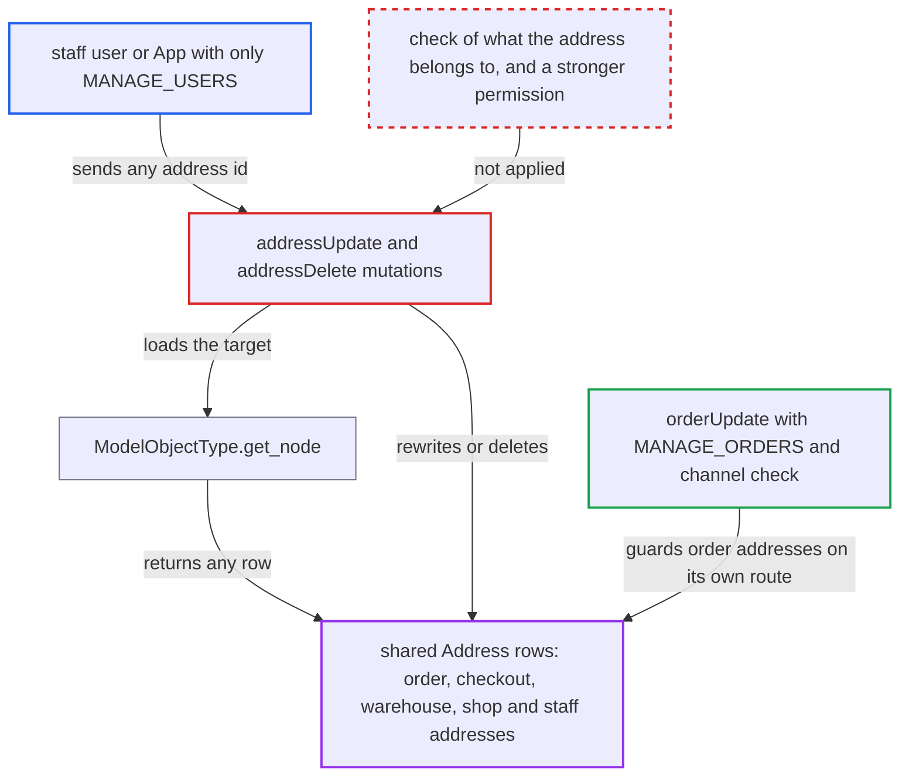

# addressUpdate/addressDelete let MANAGE_USERS rewrite or delete order, warehouse, shop and staff addresses

| Field | Value |
|---|---|
| ID | `find_01WZp3Jc78n1Wjd1EiZd9aPF` |
| Severity | **High** |
| Status | open |
| CWE | CWE-639 — Authorization bypass via user-controlled key |
| Created | 2026-10-27T21:16:16.504153Z |
| Claude Security | https://claude.ai/security/findings/find_01WZp3Jc78n1Wjd1EiZd9aPF |

## Description

A staff user or App holding only `MANAGE_USERS` can rewrite or delete addresses that belong to orders, checkouts, warehouses, the shop and staff users. This includes the shipping and billing address of any order in any channel. `check_can_edit_address` approves any `MANAGE_USERS` holder without checking what the address belongs to, and `addressUpdate` and `addressDelete` can load any row of the shared `Address` table.

1. **attacker with `MANAGE_USERS`** sends `addressUpdate` or `addressDelete` with an address id. Address ids are sequential integers, so the attacker can enumerate rows and pick order, warehouse, shop or staff addresses; both mutations require only `MANAGE_USERS`. ([`saleor/graphql/account/mutations/staff/address_update.py:12-20`](https://github.com/cx-benchmark/saleor/blob/c982006cc04c77a97def93218dedac8d715eb041/saleor/graphql/account/mutations/staff/address_update.py#L12-L20))
2. **`ModelObjectType.get_node`** loads the address row by id. It runs `Address.objects.get(pk=id)` with no ownership or type restriction, so any row of the shared table is reachable. ([`saleor/graphql/core/types/model.py:62-81`](https://github.com/cx-benchmark/saleor/blob/c982006cc04c77a97def93218dedac8d715eb041/saleor/graphql/core/types/model.py#L62-L81))
3. **`check_can_edit_address`** approves the request. It returns `True` for any requestor with `MANAGE_USERS` and never checks whether the address is in a customer's address book or belongs to an order, warehouse, the shop or a staff user. ([`saleor/graphql/account/mutations/base.py:43-61`](https://github.com/cx-benchmark/saleor/blob/c982006cc04c77a97def93218dedac8d715eb041/saleor/graphql/account/mutations/base.py#L43-L61))
4. **`BaseAddressUpdate.perform_mutation`** validates and saves the new field values on the loaded row. This check is the only authorization on this path, so an order, warehouse, shop or staff address is overwritten. ([`saleor/graphql/account/mutations/base.py:80-116`](https://github.com/cx-benchmark/saleor/blob/c982006cc04c77a97def93218dedac8d715eb041/saleor/graphql/account/mutations/base.py#L80-L116))
5. **`BaseAddressDelete.perform_mutation`** deletes the row and returns its original data. Order, checkout and shop address references are set to null, and the response echoes the deleted row's original data. ([`saleor/graphql/account/mutations/base.py:139-174`](https://github.com/cx-benchmark/saleor/blob/c982006cc04c77a97def93218dedac8d715eb041/saleor/graphql/account/mutations/base.py#L139-L174))
6. **order data** is changed without the normal order checks. The sanctioned route, `orderUpdate`, needs `MANAGE_ORDERS`, runs a channel-access check and invalidates prices; `addressUpdate` does none of this. ([`saleor/graphql/order/mutations/order_update.py:79-87`](https://github.com/cx-benchmark/saleor/blob/c982006cc04c77a97def93218dedac8d715eb041/saleor/graphql/order/mutations/order_update.py#L79-L87))

## Assessment

The attacker is a staff user or an App with `MANAGE_USERS` and no other permission. They call `addressUpdate(id: "Address:<n>", input: {...})` or `addressDelete(id: ...)` on `/graphql/` with sequential ids. No victim action is needed. Both mutations accept order, checkout, warehouse, shop company and staff addresses, which the project otherwise protects with `MANAGE_ORDERS` plus channel access, `MANAGE_PRODUCTS`, `MANAGE_SETTINGS` and `MANAGE_STAFF`.

Impact: The attacker can rewrite or delete the shipping and billing address of any order or checkout in any channel, which can redirect goods. No order event is recorded and no price is recalculated. They can also change warehouse and shop company addresses and edit staff addresses, each reserved for another permission. Confidentiality and availability effects are limited: `addressDelete` echoes the original row of the address it destroys, and deleting nulls order and shop addresses.

## Recommendation

`check_can_edit_address` authorizes on `MANAGE_USERS` alone, and its callers load any row of the shared `Address` table. A customer-scoped permission can therefore change or delete addresses of orders, checkouts, warehouses, site settings and staff users.

Fix criteria: `addressUpdate` and `addressDelete` succeed only for addresses in a user's address book. For a staff user's address, the requestor must hold `MANAGE_STAFF`. Addresses referenced by orders, checkouts, warehouses or site settings are refused (not found or permission denied) whatever the `MANAGE_USERS` status. To verify, have a requestor with only `MANAGE_USERS` try to update and delete an order's shipping address id, a warehouse address id, the shop company address id and a staff user's address id. All attempts must fail and the rows must stay unchanged.

## Evidence

**https://github.com/cx-benchmark/saleor**

- [`saleor/graphql/account/mutations/base.py:43-61`](https://github.com/cx-benchmark/saleor/blob/c982006cc04c77a97def93218dedac8d715eb041/saleor/graphql/account/mutations/base.py#L43-L61)
- [`saleor/graphql/account/mutations/base.py:80-116`](https://github.com/cx-benchmark/saleor/blob/c982006cc04c77a97def93218dedac8d715eb041/saleor/graphql/account/mutations/base.py#L80-L116)
- [`saleor/graphql/account/mutations/base.py:139-174`](https://github.com/cx-benchmark/saleor/blob/c982006cc04c77a97def93218dedac8d715eb041/saleor/graphql/account/mutations/base.py#L139-L174)
- [`saleor/graphql/account/mutations/staff/address_update.py:12-20`](https://github.com/cx-benchmark/saleor/blob/c982006cc04c77a97def93218dedac8d715eb041/saleor/graphql/account/mutations/staff/address_update.py#L12-L20)
- [`saleor/graphql/core/types/model.py:62-81`](https://github.com/cx-benchmark/saleor/blob/c982006cc04c77a97def93218dedac8d715eb041/saleor/graphql/core/types/model.py#L62-L81)
- [`saleor/order/models.py:143-156`](https://github.com/cx-benchmark/saleor/blob/c982006cc04c77a97def93218dedac8d715eb041/saleor/order/models.py#L143-L156)
- [`saleor/graphql/order/mutations/order_update.py:79-87`](https://github.com/cx-benchmark/saleor/blob/c982006cc04c77a97def93218dedac8d715eb041/saleor/graphql/order/mutations/order_update.py#L79-L87)
- [`saleor/graphql/meta/permissions.py:91-139`](https://github.com/cx-benchmark/saleor/blob/c982006cc04c77a97def93218dedac8d715eb041/saleor/graphql/meta/permissions.py#L91-L139)
- [`saleor/warehouse/models.py:294`](https://github.com/cx-benchmark/saleor/blob/c982006cc04c77a97def93218dedac8d715eb041/saleor/warehouse/models.py#L294)
- [`saleor/site/models.py:54-56`](https://github.com/cx-benchmark/saleor/blob/c982006cc04c77a97def93218dedac8d715eb041/saleor/site/models.py#L54-L56)

