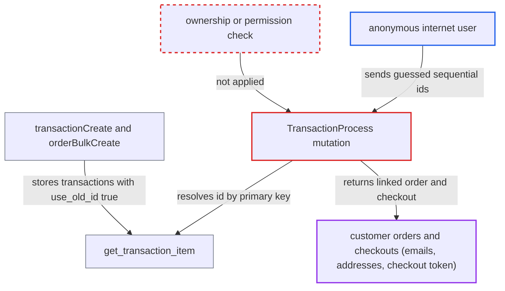

# Anonymous transactionProcess discloses any transactionCreate-made transaction by sequential pk

| Field | Value |
|---|---|
| ID | `find_0112QiecSvKvdkA6gRna85Um` |
| Severity | **High** |
| Status | open |
| CWE | CWE-639 — Insecure direct object reference |
| Created | 2026-10-27T21:23:26.407088Z |
| Claude Security | https://claude.ai/security/findings/find_0112QiecSvKvdkA6gRna85Um |

## Description

An anonymous internet user can read customer emails, billing and shipping addresses, order contents and payment details for orders and checkouts whose transaction was made through `transactionCreate` or `orderBulkCreate` with amounts. The attacker only counts up transaction numbers. The mutation `TransactionProcess` needs no permission and returns the linked order and checkout without any ownership check. `get_transaction_item` also accepts plain sequential numeric ids.

1. **the payment code** stores each new transaction with `use_old_id=True`. `TransactionCreate.create_transaction` always sets this flag, and `orderBulkCreate` calls the same function, so every such transaction can be found by its integer primary key. ([`saleor/graphql/payment/mutations/transaction/transaction_create.py:288-296`](https://github.com/cx-benchmark/saleor/blob/c982006cc04c77a97def93218dedac8d715eb041/saleor/graphql/payment/mutations/transaction/transaction_create.py#L288-L296))
2. **anonymous attacker** calls `transactionProcess` with an id built from `TransactionItem:<n>`. The `Meta` of `TransactionProcess` declares no `permissions`, so `BaseMutation.check_permissions` lets anonymous callers in. ([`saleor/graphql/payment/mutations/transaction/transaction_process.py:76-82`](https://github.com/cx-benchmark/saleor/blob/c982006cc04c77a97def93218dedac8d715eb041/saleor/graphql/payment/mutations/transaction/transaction_process.py#L76-L82))
3. **the function `get_transaction_item`** turns the all-digit id into a lookup by primary key. It queries `id=<n>` with `use_old_id=True`, so the attacker can guess `n` by counting up. ([`saleor/graphql/payment/mutations/transaction/utils.py:21-52`](https://github.com/cx-benchmark/saleor/blob/c982006cc04c77a97def93218dedac8d715eb041/saleor/graphql/payment/mutations/transaction/utils.py#L21-L52))
4. **the manual adjustment events** give the transaction a final-status event. For transactions created with amounts, `create_manual_adjustment_events` writes `AUTHORIZATION_SUCCESS` or `CHARGE_SUCCESS` events with `include_in_calculations=True`, and these types are listed by `get_final_session_statuses()`. ([`saleor/payment/utils.py:1698-1716`](https://github.com/cx-benchmark/saleor/blob/c982006cc04c77a97def93218dedac8d715eb041/saleor/payment/utils.py#L1698-L1716))
5. **the mutation `TransactionProcess`** returns the transaction and its event early. The return happens before any check that the caller owns the checkout or order or holds a permission. ([`saleor/graphql/payment/mutations/transaction/transaction_process.py:177-188`](https://github.com/cx-benchmark/saleor/blob/c982006cc04c77a97def93218dedac8d715eb041/saleor/graphql/payment/mutations/transaction/transaction_process.py#L177-L188))
6. **the type `TransactionItem`** returns the linked order and checkout to the attacker. `resolve_order` and `resolve_checkout` apply no check on who is asking. ([`saleor/graphql/payment/types.py:831-861`](https://github.com/cx-benchmark/saleor/blob/c982006cc04c77a97def93218dedac8d715eb041/saleor/graphql/payment/types.py#L831-L861))
7. **the type `Order`** returns customer data unmasked. For orders with `use_old_id` false, `userEmail`, `billingAddress` and `shippingAddress` are not obfuscated. ([`saleor/graphql/order/types.py:2163-2215`](https://github.com/cx-benchmark/saleor/blob/c982006cc04c77a97def93218dedac8d715eb041/saleor/graphql/order/types.py#L2163-L2215))

## Assessment

The attacker is anonymous and needs no login. They only need to reach `/graphql/`, which anonymous storefront users can do. The attack works only for transactions created through `transactionCreate` or `orderBulkCreate` with amounts. That covers payment apps, custom integrations, dashboard manual transactions and imported orders. The transaction id is not secret, because `TransactionItem.resolve_id` returns the token and the integer is found by counting up. The design treats the transaction token (a UUID) as the secret for this permission-less mutation, and the test `test_transaction_process_doesnt_accept_old_id` shows old ids were meant to be refused.

Impact: The attacker can bulk-read customer emails, billing and shipping addresses, order contents, amounts, PSP references and payment-method details for every affected order or checkout. A leaked `Checkout.id` and `token` work as the credential that checkout mutations accept, so a checkout that is still open can be modified. The early-return path itself writes nothing, and availability is not affected.

## Recommendation

(1) `transactionProcess` returns the resolved `TransactionItem` and its order and checkout to any caller. It does not check that the caller started the session or is entitled to it, which breaks customer data isolation.

Fix criteria: The mutation discloses or acts on a transaction only when the caller proves entitlement, by the unguessable token or by a permission such as `HANDLE_PAYMENTS`. An anonymous request with `id: TransactionItem:<pk>` for a transaction made by `transactionCreate` returns a not-found or permission error and no `transaction` object.

(2) `get_transaction_item` accepts sequential integer ids for every transaction flagged `use_old_id=True`. `TransactionCreate.create_transaction`, which `orderBulkCreate` also uses, flags every new transaction that way.

Fix criteria: Transactions created under the token-based id scheme can no longer be addressed by integer primary key from unauthenticated mutations. Iterating `TransactionItem:<n>` through `transactionProcess` returns no objects for transactions created by `transactionCreate` or `orderBulkCreate`.

## Evidence

**https://github.com/cx-benchmark/saleor**

- [`saleor/graphql/payment/mutations/transaction/transaction_process.py:177-188`](https://github.com/cx-benchmark/saleor/blob/c982006cc04c77a97def93218dedac8d715eb041/saleor/graphql/payment/mutations/transaction/transaction_process.py#L177-L188)
- [`saleor/graphql/payment/mutations/transaction/utils.py:21-52`](https://github.com/cx-benchmark/saleor/blob/c982006cc04c77a97def93218dedac8d715eb041/saleor/graphql/payment/mutations/transaction/utils.py#L21-L52)
- [`saleor/graphql/payment/mutations/transaction/transaction_create.py:288-296`](https://github.com/cx-benchmark/saleor/blob/c982006cc04c77a97def93218dedac8d715eb041/saleor/graphql/payment/mutations/transaction/transaction_create.py#L288-L296)
- [`saleor/graphql/order/bulk_mutations/order_bulk_create.py:1658-1684`](https://github.com/cx-benchmark/saleor/blob/c982006cc04c77a97def93218dedac8d715eb041/saleor/graphql/order/bulk_mutations/order_bulk_create.py#L1658-L1684)
- [`saleor/graphql/payment/mutations/transaction/transaction_process.py:76-82`](https://github.com/cx-benchmark/saleor/blob/c982006cc04c77a97def93218dedac8d715eb041/saleor/graphql/payment/mutations/transaction/transaction_process.py#L76-L82)
- [`saleor/payment/utils.py:1698-1716`](https://github.com/cx-benchmark/saleor/blob/c982006cc04c77a97def93218dedac8d715eb041/saleor/payment/utils.py#L1698-L1716)
- [`saleor/graphql/payment/types.py:831-861`](https://github.com/cx-benchmark/saleor/blob/c982006cc04c77a97def93218dedac8d715eb041/saleor/graphql/payment/types.py#L831-L861)
- [`saleor/graphql/order/types.py:2163-2215`](https://github.com/cx-benchmark/saleor/blob/c982006cc04c77a97def93218dedac8d715eb041/saleor/graphql/order/types.py#L2163-L2215)

