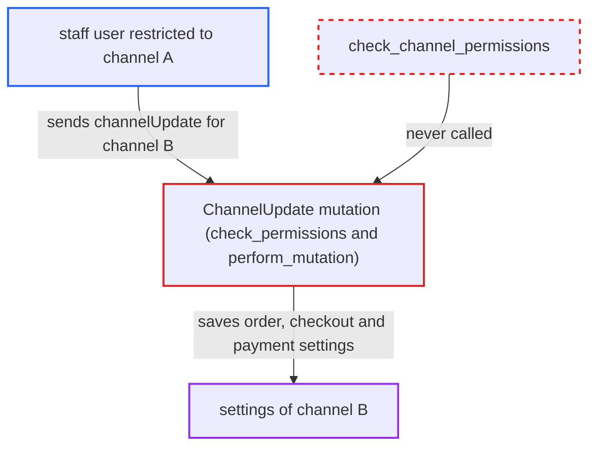

# Channel order/checkout/payment settings editable across channels by non-channel-admin staff

| Field | Value |
|---|---|
| ID | `find_01V23uAYUmc7QcKUnjqdqXKw` |
| Severity | **High** |
| Status | open |
| CWE | CWE-862 — Missing authorization |
| Created | 2026-10-27T21:20:04.299551Z |
| Claude Security | https://claude.ai/security/findings/find_01V23uAYUmc7QcKUnjqdqXKw |

## Description

A staff user restricted to one channel can change order, checkout and payment settings of other channels they have no access to. For example, they can allow unpaid orders or schedule deletion of unpaid orders. It needs a staff account with `MANAGE_ORDERS`, `MANAGE_CHECKOUTS` or `HANDLE_PAYMENTS`. `ChannelUpdate` checks only that permission and never checks the caller's channel restrictions.

1. **channel-restricted staff user** sends `channelUpdate` naming another channel's `id`. The user holds `MANAGE_ORDERS` (or `MANAGE_CHECKOUTS` / `HANDLE_PAYMENTS`) in a group with `restrictedAccessToChannels=true` limited to channel A, and targets channel B with an input containing only `orderSettings`, for example `allowUnpaidOrders: true`.
2. **`ChannelUpdate.check_permissions`** accepts the request on the per-area permission alone. When the input holds only `order_settings`, `checkout_settings` or `payment_settings`, it falls back from `MANAGE_CHANNELS` to the matching permission and never calls `cls.check_channel_permissions(info, [channel.id])`. ([`saleor/graphql/channel/mutations/channel_update.py:186-217`](https://github.com/cx-benchmark/saleor/blob/c982006cc04c77a97def93218dedac8d715eb041/saleor/graphql/channel/mutations/channel_update.py#L186-L217))
3. **`perform_mutation`** loads the channel by `id` and saves the new settings. `cls.get_instance` fetches any channel, and nothing checks that the requestor's accessible channels include it. ([`saleor/graphql/channel/mutations/channel_update.py:112-145`](https://github.com/cx-benchmark/saleor/blob/c982006cc04c77a97def93218dedac8d715eb041/saleor/graphql/channel/mutations/channel_update.py#L112-L145))
4. **`clean_input_order_settings`** copies the order settings into the channel. It copies `allow_unpaid_orders`, `automatically_confirm_all_new_orders`, `mark_as_paid_strategy`, `expire_orders_after` and `delete_expired_orders_after` onto channel B. ([`saleor/graphql/channel/mutations/utils.py:97-150`](https://github.com/cx-benchmark/saleor/blob/c982006cc04c77a97def93218dedac8d715eb041/saleor/graphql/channel/mutations/utils.py#L97-L150))
5. **attacker or a colluding customer** uses the changed channel B behaviour. With `allowUnpaidOrders` on, `checkoutComplete` creates orders without payment. With `expireOrdersAfter` and `deleteExpiredOrdersAfter` set, periodic tasks expire and then delete channel B's unpaid orders.

## Assessment

The attacker is an authenticated staff user. They hold `MANAGE_ORDERS`, `MANAGE_CHECKOUTS` or `HANDLE_PAYMENTS` in a permission group with `restrictedAccessToChannels=true` limited to channel A. They send the request over `/graphql/` and need no victim interaction. Apps already have access to all channels in Saleor's model, so the practical escalation is for channel-restricted staff. The report notes that the owner may regard channel objects as outside the documented coverage of the channel-restriction feature. The per-area permission fallback itself is intended, and the gap is the missing channel-scope check.

Impact: The attacker can rewrite channel-wide order, checkout and payment behaviour of channels outside their scope. This includes letting orders be placed without payment and scheduling expiry and deletion of unpaid orders. They do not read data they could not already see. Availability impact is limited to deletion of expired orders by the periodic task.

## Recommendation

`ChannelUpdate` authorises settings-only updates by permission alone and ignores the requestor's channel restrictions, so channel-scoped staff can alter channels they have no access to.

Fix criteria: When a requestor is authorised only via `MANAGE_ORDERS`, `MANAGE_CHECKOUTS` or `HANDLE_PAYMENTS`, the mutation verifies the target channel is among the requestor's accessible channels, as `check_channel_permissions` does, and rejects the request otherwise. A test confirms it: a staff user in a channel-restricted group with `MANAGE_ORDERS` calls `channelUpdate` on a non-accessible channel, gets a permission error, and the channel is left unmodified.

## Evidence

**https://github.com/cx-benchmark/saleor**

- [`saleor/graphql/channel/mutations/channel_update.py:186-217`](https://github.com/cx-benchmark/saleor/blob/c982006cc04c77a97def93218dedac8d715eb041/saleor/graphql/channel/mutations/channel_update.py#L186-L217)
- [`saleor/graphql/channel/mutations/channel_update.py:112-145`](https://github.com/cx-benchmark/saleor/blob/c982006cc04c77a97def93218dedac8d715eb041/saleor/graphql/channel/mutations/channel_update.py#L112-L145)
- [`saleor/graphql/channel/mutations/utils.py:97-150`](https://github.com/cx-benchmark/saleor/blob/c982006cc04c77a97def93218dedac8d715eb041/saleor/graphql/channel/mutations/utils.py#L97-L150)
- [`saleor/graphql/core/mutations.py:585-597`](https://github.com/cx-benchmark/saleor/blob/c982006cc04c77a97def93218dedac8d715eb041/saleor/graphql/core/mutations.py#L585-L597)

