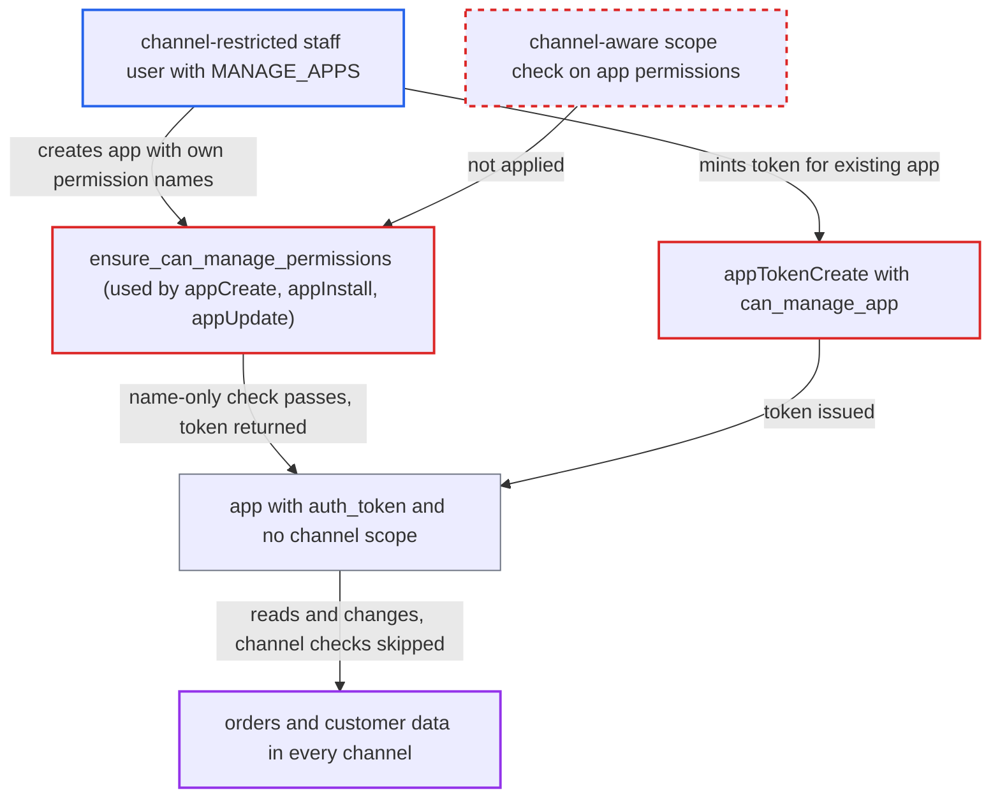

# Channel-restricted staff escape channel scope by delegating their permissions to an app

| Field | Value |
|---|---|
| ID | `find_01Lq324LQzfT7jUag2VWZFPK` |
| Severity | **High** |
| Status | open |
| CWE | CWE-269 — Privilege escalation |
| Created | 2026-10-27T21:27:16.499516Z |
| Claude Security | https://claude.ai/security/findings/find_01Lq324LQzfT7jUag2VWZFPK |

## Description

A channel-restricted staff user who holds `MANAGE_APPS` can turn their limited permissions into an app token that works in every channel. With `MANAGE_ORDERS`, that means reading and changing orders and customer personal data in other channels. The attack needs an operator-configured restricted group. The cause is that `ensure_can_manage_permissions` and `can_manage_app` compare permission names only and ignore channels.

1. **channel-restricted staff user** calls `appCreate` over `/graphql/` asking for a permission such as `MANAGE_ORDERS`. The user is in a group with `restricted_access_to_channels=True` that holds `MANAGE_APPS` and `MANAGE_ORDERS`. ([`saleor/graphql/app/mutations/app_create.py:64-99`](https://github.com/cx-benchmark/saleor/blob/c982006cc04c77a97def93218dedac8d715eb041/saleor/graphql/app/mutations/app_create.py#L64-L99))
2. **the check `ensure_can_manage_permissions`** compares the requested permission names with the requestor's permissions. It is the only scope check on permissions given to an app, and it never looks at the requestor's channel restriction. ([`saleor/graphql/app/utils.py:10-25`](https://github.com/cx-benchmark/saleor/blob/c982006cc04c77a97def93218dedac8d715eb041/saleor/graphql/app/utils.py#L10-L25))
3. **the helper `get_out_of_scope_permissions`** accepts the request because `requestor.has_perm(perm)` is true. `User.has_perm` ignores channels, so a permission limited to one channel still counts as held. ([`saleor/graphql/account/utils.py:56-64`](https://github.com/cx-benchmark/saleor/blob/c982006cc04c77a97def93218dedac8d715eb041/saleor/graphql/account/utils.py#L56-L64))
4. **the mutation `appCreate`** stores the permissions on a new app and returns a raw `auth_token`. The new app has the requested permissions with no channel limit, because the `App` model has no channel field. ([`saleor/graphql/app/mutations/app_create.py:64-99`](https://github.com/cx-benchmark/saleor/blob/c982006cc04c77a97def93218dedac8d715eb041/saleor/graphql/app/mutations/app_create.py#L64-L99))
5. **attacker** sends requests with `Authorization: Bearer` and the returned token. `check_channel_permissions` returns at once for an app, so channel-scoped mutations are allowed in any channel. ([`saleor/graphql/core/mutations.py:585-598`](https://github.com/cx-benchmark/saleor/blob/c982006cc04c77a97def93218dedac8d715eb041/saleor/graphql/core/mutations.py#L585-L598))
6. **the resolvers `resolve_orders` and `resolve_draft_orders`** return the unfiltered order queryset to the app. For staff they filter by accessible channels, but not for apps, so orders and customer data from every channel are exposed. ([`saleor/graphql/order/resolvers.py:20-52`](https://github.com/cx-benchmark/saleor/blob/c982006cc04c77a97def93218dedac8d715eb041/saleor/graphql/order/resolvers.py#L20-L52))

## Assessment

The attacker is a staff user in a permission group with `restricted_access_to_channels=True` that holds `MANAGE_APPS` and a data permission such as `MANAGE_ORDERS`. The operator must have set up such a group. The attacker calls `appCreate` with a name and `permissions:[MANAGE_ORDERS]`, then uses the returned `authToken` as a Bearer token. The same gap exists in `appInstall` and `appUpdate`. Through `appTokenCreate` the user can also mint tokens for any existing app whose permissions are a subset of their own.

Impact: For each permission the attacker holds, they gain access in every channel instead of only their assigned ones. With `MANAGE_ORDERS` they can read other channels' orders and customer personal data, and change, cancel or refund those orders. The attacker's own permission names limit the impact, and apps cannot hold `MANAGE_APPS`.

## Recommendation

`ensure_can_manage_permissions` and `can_manage_app` compare permission names only. A channel-restricted requestor can hand their permissions to an app, and apps are exempt from all channel checks.

Fix criteria: A requestor without access to all channels cannot create, install, update or mint tokens for an app holding permissions they hold only for some channels. The alternative is that apps carry and enforce a channel scope no wider than the requestor's. Verify with a user in a `restricted_access_to_channels=True` group with `MANAGE_APPS` and `MANAGE_ORDERS`. Either `appCreate`, `appInstall`, `appUpdate` and `appTokenCreate` return an out-of-scope error, or the resulting token cannot read or change orders outside that user's channels.

## Evidence

**https://github.com/cx-benchmark/saleor**

- [`saleor/graphql/app/utils.py:10-25`](https://github.com/cx-benchmark/saleor/blob/c982006cc04c77a97def93218dedac8d715eb041/saleor/graphql/app/utils.py#L10-L25)
- [`saleor/graphql/account/utils.py:56-64`](https://github.com/cx-benchmark/saleor/blob/c982006cc04c77a97def93218dedac8d715eb041/saleor/graphql/account/utils.py#L56-L64)
- [`saleor/graphql/app/mutations/app_create.py:64-99`](https://github.com/cx-benchmark/saleor/blob/c982006cc04c77a97def93218dedac8d715eb041/saleor/graphql/app/mutations/app_create.py#L64-L99)
- [`saleor/graphql/core/mutations.py:585-598`](https://github.com/cx-benchmark/saleor/blob/c982006cc04c77a97def93218dedac8d715eb041/saleor/graphql/core/mutations.py#L585-L598)
- [`saleor/graphql/order/resolvers.py:20-52`](https://github.com/cx-benchmark/saleor/blob/c982006cc04c77a97def93218dedac8d715eb041/saleor/graphql/order/resolvers.py#L20-L52)
- [`saleor/graphql/app/mutations/app_install.py:63-76`](https://github.com/cx-benchmark/saleor/blob/c982006cc04c77a97def93218dedac8d715eb041/saleor/graphql/app/mutations/app_install.py#L63-L76)
- [`saleor/graphql/app/mutations/app_update.py:49-66`](https://github.com/cx-benchmark/saleor/blob/c982006cc04c77a97def93218dedac8d715eb041/saleor/graphql/app/mutations/app_update.py#L49-L66)
- [`saleor/graphql/app/mutations/app_token_create.py:59-69`](https://github.com/cx-benchmark/saleor/blob/c982006cc04c77a97def93218dedac8d715eb041/saleor/graphql/app/mutations/app_token_create.py#L59-L69)
- [`saleor/graphql/account/mutations/permission_group/permission_group_create.py:201-234`](https://github.com/cx-benchmark/saleor/blob/c982006cc04c77a97def93218dedac8d715eb041/saleor/graphql/account/mutations/permission_group/permission_group_create.py#L201-L234)
- [`saleor/graphql/account/utils.py:90-98`](https://github.com/cx-benchmark/saleor/blob/c982006cc04c77a97def93218dedac8d715eb041/saleor/graphql/account/utils.py#L90-L98)

