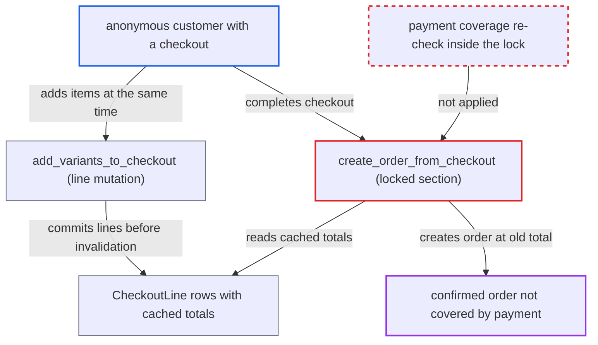

# Checkout completion trusts stale prices and pre-lock payment check, racing line mutations

| Field | Value |
|---|---|
| ID | `find_01EYa964qSBe59Q3LDzphaDL` |
| Severity | **High** |
| Status | open |
| CWE | CWE-367 — Race condition |
| Created | 2026-10-27T21:17:54.238981Z |
| Claude Security | https://claude.ai/security/findings/find_01EYa964qSBe59Q3LDzphaDL |

## Description

An anonymous customer who owns a checkout can get an order confirmed that payment does not fully cover. Either an added item is priced 0, or the total exceeds the authorized amount, even when `allow_unpaid_orders` is false. The attacker sends `checkoutComplete` and `checkoutLinesAdd` or `checkoutLinesUpdate` at the same time. The payment check runs before the row lock, and the line and price-invalidation writes are separate commits.

1. **attacker** authorizes exactly the total of a cheap item in a checkout. The payment app reports `authorize_status=FULL`, which is the only condition the completion gate looks at.
2. **attacker** sends `checkoutComplete` and `checkoutLinesAdd`/`checkoutLinesUpdate` with expensive items at the same time. The attacker needs only the checkout ID, and a mistimed attempt fails cleanly and can be retried.
3. **`_prepare_checkout_with_transactions`** accepts the checkout as paid using the in-memory checkout. It rejects only when `authorize_status != FULL` and `allow_unpaid_orders` is false, and no row lock is held yet. ([`saleor/checkout/complete_checkout.py:953-968`](https://github.com/cx-benchmark/saleor/blob/c982006cc04c77a97def93218dedac8d715eb041/saleor/checkout/complete_checkout.py#L953-L968))
4. **`add_variants_to_checkout`** commits the new or changed `CheckoutLine` rows in its own transaction. A new row keeps the default `total_price = 0`, and the `price_expiration` invalidation is saved later in a separate `checkout.save`. ([`saleor/checkout/utils.py:207-275`](https://github.com/cx-benchmark/saleor/blob/c982006cc04c77a97def93218dedac8d715eb041/saleor/checkout/utils.py#L207-L275))
5. **`create_order_from_checkout`** takes `select_for_update()` and re-fetches the checkout and its lines. It does not re-check payment coverage, and `force_update` is true only when `tax_error` is set. ([`saleor/checkout/complete_checkout.py:1620-1656`](https://github.com/cx-benchmark/saleor/blob/c982006cc04c77a97def93218dedac8d715eb041/saleor/checkout/complete_checkout.py#L1620-L1656))
6. **`_fetch_checkout_prices_if_expired`** returns the cached prices. The invalidation has not been saved yet, so `price_expiration` is still in the future and the old total is kept. ([`saleor/checkout/calculations.py:386-387`](https://github.com/cx-benchmark/saleor/blob/c982006cc04c77a97def93218dedac8d715eb041/saleor/checkout/calculations.py#L386-L387))
7. **`_create_order_from_checkout`** writes the cached total to `Order.total` and prices each order line from the cached `CheckoutLine.total_price`. The order gets the old, fully authorized total, and the added item becomes an order line priced 0. ([`saleor/checkout/complete_checkout.py:1414-1420`](https://github.com/cx-benchmark/saleor/blob/c982006cc04c77a97def93218dedac8d715eb041/saleor/checkout/complete_checkout.py#L1414-L1420))

## Assessment

The attacker is an anonymous customer, and the checkout ID is the only credential needed. They authorize a cheap item through the payment app, then send `checkoutComplete` concurrently with `checkoutLinesAdd` or `checkoutLinesUpdate`. In interleaving A, the completion takes its lock after the line commit but before the `price_expiration` invalidation save. The order keeps the old total and the new item costs 0. A quantity increase through `checkoutLinesUpdate` likewise keeps the old line total. In interleaving B, the whole line mutation commits after the pre-lock check but before the lock. Prices are then recalculated to the larger total, `update_checkout_payment_statuses` flips the status to PARTIAL without effect, and the order is still created for more than was authorized. This bypasses `allow_unpaid_orders=False`. The legacy `complete_checkout_with_payment` path re-fetches lines under its lock without forcing a recalculation, so it is open to interleaving A. Line mutations never consult `completing_started_at`/`is_checkout_locked()`, and `saleor/settings.py` sets no `ATOMIC_REQUESTS`.

Impact: The attacker gets a confirmed `UNFULFILLED` order that is marked fully authorized but holds items priced 0. In a channel that forbids unpaid orders, the order total can instead exceed the authorized amount. Stock is allocated and order webhooks fire. With the default `fulfillment_allow_unpaid=True` the order can be shipped. The report says nothing is disclosed and availability is unaffected.

## Recommendation

(1) The decision that the checkout is paid is made before the row lock. The locked section that creates the order trusts cached or recalculated prices and never compares them with the authorized or charged amount.

Fix criteria: Inside the row-locked block that creates the order, for both the transaction flow and the legacy pre-payment part, prices are current for the lines actually read. Coverage is re-evaluated against current transactions and gift-card balances. Completion aborts with `CHECKOUT_NOT_FULLY_PAID` unless coverage is FULL or `allow_unpaid_orders` is set. A test that commits a line change between the pre-check and the lock yields no order.

(2) Line mutations commit the `CheckoutLine` rows and the `price_expiration` invalidation in separate transactions. For a moment, new or changed lines carry stale or zero cached totals while the prices still look valid.

Fix criteria: No committed state exists in which a checkout's lines have changed but its cached prices are still considered valid. Either the lines and the invalidation are written atomically under the checkout lock, or line and delivery mutations are rejected while completion is in progress. A completion interleaved with `checkoutLinesAdd` never produces an order line with total 0 for a non-zero-priced variant.

## Evidence

**https://github.com/cx-benchmark/saleor**

- [`saleor/checkout/complete_checkout.py:1620-1656`](https://github.com/cx-benchmark/saleor/blob/c982006cc04c77a97def93218dedac8d715eb041/saleor/checkout/complete_checkout.py#L1620-L1656)
- [`saleor/checkout/complete_checkout.py:953-968`](https://github.com/cx-benchmark/saleor/blob/c982006cc04c77a97def93218dedac8d715eb041/saleor/checkout/complete_checkout.py#L953-L968)
- [`saleor/checkout/complete_checkout.py:1733-1747`](https://github.com/cx-benchmark/saleor/blob/c982006cc04c77a97def93218dedac8d715eb041/saleor/checkout/complete_checkout.py#L1733-L1747)
- [`saleor/graphql/checkout/mutations/checkout_lines_add.py:256-265`](https://github.com/cx-benchmark/saleor/blob/c982006cc04c77a97def93218dedac8d715eb041/saleor/graphql/checkout/mutations/checkout_lines_add.py#L256-L265)
- [`saleor/checkout/utils.py:207-275`](https://github.com/cx-benchmark/saleor/blob/c982006cc04c77a97def93218dedac8d715eb041/saleor/checkout/utils.py#L207-L275)
- [`saleor/checkout/models.py:485-499`](https://github.com/cx-benchmark/saleor/blob/c982006cc04c77a97def93218dedac8d715eb041/saleor/checkout/models.py#L485-L499)
- [`saleor/checkout/calculations.py:386-387`](https://github.com/cx-benchmark/saleor/blob/c982006cc04c77a97def93218dedac8d715eb041/saleor/checkout/calculations.py#L386-L387)
- [`saleor/checkout/complete_checkout.py:1414-1420`](https://github.com/cx-benchmark/saleor/blob/c982006cc04c77a97def93218dedac8d715eb041/saleor/checkout/complete_checkout.py#L1414-L1420)
- [`saleor/checkout/complete_checkout.py:336-349`](https://github.com/cx-benchmark/saleor/blob/c982006cc04c77a97def93218dedac8d715eb041/saleor/checkout/complete_checkout.py#L336-L349)

