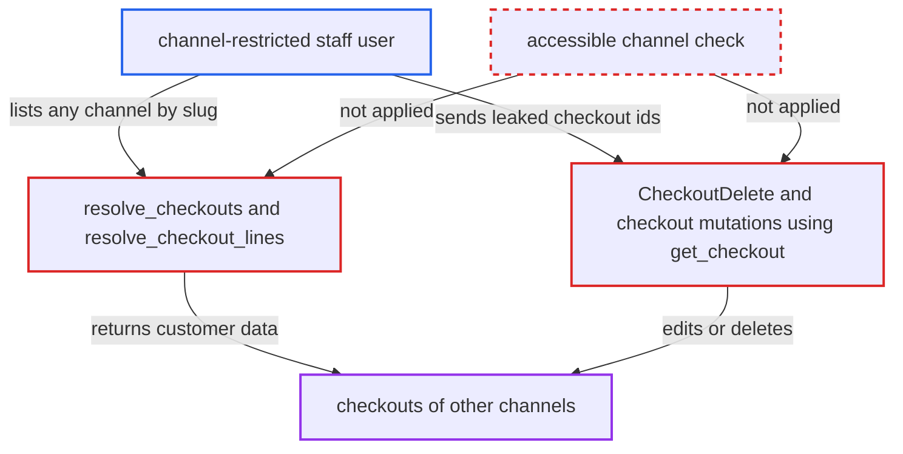

# Checkout queries and checkoutDelete ignore staff channel restrictions

| Field | Value |
|---|---|
| ID | `find_01KBees8BciUWgq6choFQ5yG` |
| Severity | **High** |
| Status | open |
| CWE | CWE-863 — Incorrect authorization |
| Created | 2026-10-27T21:23:00.884458Z |
| Claude Security | https://claude.ai/security/findings/find_01KBees8BciUWgq6choFQ5yG |

## Description

A staff user who is limited to one channel can still read and change checkouts in every other channel, and can delete them. This needs a staff account with `MANAGE_CHECKOUTS` or `HANDLE_PAYMENTS`. `resolve_checkouts`, `resolve_checkout_lines`, the inactive-channel branch of `resolve_checkout` and `CheckoutDelete` check the permission but never the user's accessible channels.

1. **channel-restricted staff user** sends a `checkouts` query naming another channel's slug. The user holds `MANAGE_CHECKOUTS` or `HANDLE_PAYMENTS` but their groups are limited to channel A, and the query asks for channel-b with fields such as `email`, `shippingAddress`, `privateMetadata` and `transactions`. ([`saleor/graphql/checkout/schema.py:70-100`](https://github.com/cx-benchmark/saleor/blob/c982006cc04c77a97def93218dedac8d715eb041/saleor/graphql/checkout/schema.py#L70-L100))
2. **the resolver `resolve_checkouts`** returns checkouts of the requested channel without checking access. It starts from `Checkout.objects.all()` and narrows only by the caller-supplied `channel` slug, and it never intersects with `get_user_accessible_channels`. ([`saleor/graphql/checkout/resolvers.py:26-32`](https://github.com/cx-benchmark/saleor/blob/c982006cc04c77a97def93218dedac8d715eb041/saleor/graphql/checkout/resolvers.py#L26-L32))
3. **the `Checkout.transactions` field** returns transaction records to the same user. Any `MANAGE_CHECKOUTS` or `HANDLE_PAYMENTS` holder gets them, although the `transactions` query withholds transactions from channels the staff user cannot access. ([`saleor/graphql/checkout/types.py:1225-1232`](https://github.com/cx-benchmark/saleor/blob/c982006cc04c77a97def93218dedac8d715eb041/saleor/graphql/checkout/types.py#L1225-L1232))
4. **staff user** reuses the listed checkout ids in public checkout mutations. `get_checkout` resolves a checkout from its id alone with no owner check, so the id works like a password for changing addresses, email, lines or delivery method. ([`saleor/graphql/checkout/mutations/utils.py:261-300`](https://github.com/cx-benchmark/saleor/blob/c982006cc04c77a97def93218dedac8d715eb041/saleor/graphql/checkout/mutations/utils.py#L261-L300))
5. **the mutation `CheckoutDelete`** deletes a checkout in a channel the user cannot access. It requires only `MANAGE_CHECKOUTS` and never calls `check_channel_permissions` for the checkout's channel. ([`saleor/graphql/checkout/mutations/checkout_delete.py:34-57`](https://github.com/cx-benchmark/saleor/blob/c982006cc04c77a97def93218dedac8d715eb041/saleor/graphql/checkout/mutations/checkout_delete.py#L34-L57))

## Assessment

The attacker is an authenticated staff user whose permission groups hold `MANAGE_CHECKOUTS` or `HANDLE_PAYMENTS` but are restricted to channel A. They send GraphQL queries to `/graphql/` and need no victim action. The listing queries are `checkouts` and `checkoutLines`, and `checkout(id:)` works for a checkout in an inactive channel for holders of `MANAGE_CHECKOUTS`, `IMPERSONATE_USER` or `HANDLE_PAYMENTS`. Private metadata is returned only with `MANAGE_CHECKOUTS`. With the listed ids the attacker can call `checkoutShippingAddressUpdate`, `checkoutEmailUpdate`, `checkoutLinesDelete` or `checkoutDelete`, and none of them checks the channel. `checkoutDelete` needs `MANAGE_CHECKOUTS`.

Impact: The attacker can bulk-read customer emails, shipping and billing addresses, lines, metadata, private metadata and payment transactions of in-progress checkouts in channels they were denied. They can alter those checkouts, for example by redirecting the shipping address before the customer completes. The changes are limited to in-progress carts. They can delete other channels' checkouts that have no transactions, which is a limited, targeted disruption.

## Recommendation

(1) `resolve_checkouts`, `resolve_checkout_lines` and the inactive-channel branch of `resolve_checkout` authorize staff on permission membership alone. They never intersect the result with the requester's accessible channels, unlike the order, payment and transaction resolvers.

Fix criteria: For a staff user, `checkouts`, `checkoutLines` and `checkout(id:)` on an inactive channel return only checkouts and lines whose `channel_id` is among the user's accessible channels. A `channel` slug outside that set is refused. Apps keep the access they have today, as in `resolve_orders`. Verify that a staff user restricted to channel A gets no channel-B checkouts, lines or transactions from these queries.

(2) `CheckoutDelete`, and any other checkout mutation gated by a staff permission, does not check the target checkout's channel against the requester's accessible channels.

Fix criteria: Staff-permission-gated checkout mutations refuse a checkout whose channel the requesting staff user cannot access, as order mutations do. Verify that `checkoutDelete` run by a staff user restricted to channel A on a channel-B checkout returns a permission error and leaves the checkout intact.

## Evidence

**https://github.com/cx-benchmark/saleor**

- [`saleor/graphql/checkout/resolvers.py:26-32`](https://github.com/cx-benchmark/saleor/blob/c982006cc04c77a97def93218dedac8d715eb041/saleor/graphql/checkout/resolvers.py#L26-L32)
- [`saleor/graphql/checkout/resolvers.py:19-23`](https://github.com/cx-benchmark/saleor/blob/c982006cc04c77a97def93218dedac8d715eb041/saleor/graphql/checkout/resolvers.py#L19-L23)
- [`saleor/graphql/checkout/schema.py:70-100`](https://github.com/cx-benchmark/saleor/blob/c982006cc04c77a97def93218dedac8d715eb041/saleor/graphql/checkout/schema.py#L70-L100)
- [`saleor/graphql/checkout/types.py:1225-1232`](https://github.com/cx-benchmark/saleor/blob/c982006cc04c77a97def93218dedac8d715eb041/saleor/graphql/checkout/types.py#L1225-L1232)
- [`saleor/graphql/payment/schema.py:115-122`](https://github.com/cx-benchmark/saleor/blob/c982006cc04c77a97def93218dedac8d715eb041/saleor/graphql/payment/schema.py#L115-L122)
- [`saleor/graphql/checkout/mutations/checkout_delete.py:34-57`](https://github.com/cx-benchmark/saleor/blob/c982006cc04c77a97def93218dedac8d715eb041/saleor/graphql/checkout/mutations/checkout_delete.py#L34-L57)
- [`saleor/graphql/checkout/resolvers.py:47-75`](https://github.com/cx-benchmark/saleor/blob/c982006cc04c77a97def93218dedac8d715eb041/saleor/graphql/checkout/resolvers.py#L47-L75)
- [`saleor/graphql/checkout/mutations/utils.py:261-300`](https://github.com/cx-benchmark/saleor/blob/c982006cc04c77a97def93218dedac8d715eb041/saleor/graphql/checkout/mutations/utils.py#L261-L300)
- [`saleor/graphql/order/resolvers.py:20-42`](https://github.com/cx-benchmark/saleor/blob/c982006cc04c77a97def93218dedac8d715eb041/saleor/graphql/order/resolvers.py#L20-L42)
- [`saleor/graphql/core/mutations.py:584-598`](https://github.com/cx-benchmark/saleor/blob/c982006cc04c77a97def93218dedac8d715eb041/saleor/graphql/core/mutations.py#L584-L598)

