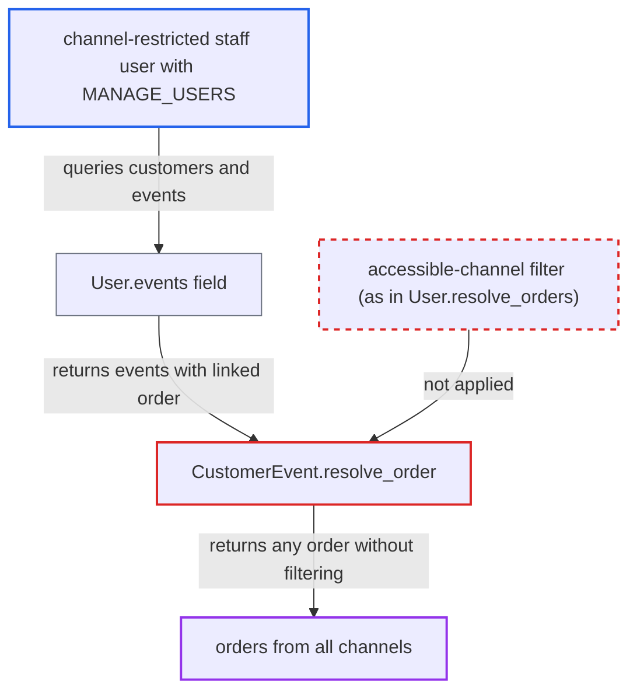

# CustomerEvent.order returns orders from channels the staff user is excluded from

| Field | Value |
|---|---|
| ID | `find_01EMmsQci1sJRmTuPMTDH9Dm` |
| Severity | **High** |
| Status | open |
| CWE | CWE-285 — Missing authorization |
| Created | 2026-10-27T21:43:19.406355Z |
| Claude Security | https://claude.ai/security/findings/find_01EMmsQci1sJRmTuPMTDH9Dm |

## Description

A channel-restricted staff user can read orders from channels they are barred from. Exposed data includes customer identity, addresses, phone numbers, order contents, totals and payment references. The attacker needs a staff account with `MANAGE_USERS`. The flaw is in `CustomerEvent.resolve_order`, which returns the linked order with no channel or permission check.

1. **restricted staff user** queries customers with their events and each event's order. The user belongs to a group with `restricted_access_to_channels=True` for channel A and holds `MANAGE_USERS`, and runs `customers { edges { node { events { order { ... } } } } }`. ([`saleor/graphql/account/types.py:584-588`](https://github.com/cx-benchmark/saleor/blob/c982006cc04c77a97def93218dedac8d715eb041/saleor/graphql/account/types.py#L584-L588))
2. **the field `User.events`** returns the customer's `CustomerEvent` rows. The field only requires `MANAGE_USERS` or `MANAGE_STAFF`, so the caller passes, and it applies no channel restriction. ([`saleor/graphql/account/types.py:584-588`](https://github.com/cx-benchmark/saleor/blob/c982006cc04c77a97def93218dedac8d715eb041/saleor/graphql/account/types.py#L584-L588))
3. **the resolver `CustomerEvent.resolve_order`** loads the linked order by `root.order_id` and returns it as a full `Order`. It uses `OrderByIdLoader` with no channel filter and no permission check, unlike `User.resolve_orders`, which drops orders from inaccessible channels. ([`saleor/graphql/account/types.py:306-316`](https://github.com/cx-benchmark/saleor/blob/c982006cc04c77a97def93218dedac8d715eb041/saleor/graphql/account/types.py#L306-L316))
4. **the order-placing code** has already linked an order to a `CustomerEvent` of type `PLACED_ORDER` for every order placed by a registered customer. `NOTE_ADDED_TO_ORDER` events are linked to orders as well, so nearly every registered customer's order can be reached this way. ([`saleor/order/events.py:320-327`](https://github.com/cx-benchmark/saleor/blob/c982006cc04c77a97def93218dedac8d715eb041/saleor/order/events.py#L320-L327))
5. **the `Order` field resolvers** return the order's data to the staff user. Most fields, such as `lines`, `total`, `shippingAddress`, `payments` and `transactions`, have no permission gate. A few are gated on `MANAGE_ORDERS`, and none re-applies the channel restriction. ([`saleor/graphql/order/types.py:2163-2196`](https://github.com/cx-benchmark/saleor/blob/c982006cc04c77a97def93218dedac8d715eb041/saleor/graphql/order/types.py#L2163-L2196))

## Assessment

The attacker is a staff user in a group with `restricted_access_to_channels=True` for one channel, for example customer support for channel A. The user holds `MANAGE_USERS`. `MANAGE_ORDERS` is not required, but it additionally unlocks a few gated fields such as `events` and `grantedRefunds` on the order. The attacker sends a normal GraphQL query to the internet-facing `/graphql/` endpoint that walks customers, their events and each event's order.

Impact: The attacker can read, across all channels, the orders of every registered customer. This includes identities, billing and shipping addresses, phone numbers, order contents, totals, payment references and card fragments. Order ids and numbers can also be used in other id-based lookups. The flaw is read-only: there is no write path, and integrity and availability are not affected.

## Recommendation

`CustomerEvent.resolve_order` gives the related `Order` to anyone who can read the customer's events. It does not apply the requesting staff user's accessible-channel restriction that `User.orders` enforces.

Fix criteria: For a staff requester whose groups restrict channel access, `CustomerEvent.order` resolves to `null` (or a permission error) when the order's `channel_id` is not in `get_user_accessible_channels`, consistent with `User.orders`. Apps and unrestricted staff are unaffected. Querying `customers { events { order { id } } }` as a restricted staff user returns no orders from excluded channels.

## Evidence

**https://github.com/cx-benchmark/saleor**

- [`saleor/graphql/account/types.py:306-316`](https://github.com/cx-benchmark/saleor/blob/c982006cc04c77a97def93218dedac8d715eb041/saleor/graphql/account/types.py#L306-L316)
- [`saleor/graphql/account/types.py:584-588`](https://github.com/cx-benchmark/saleor/blob/c982006cc04c77a97def93218dedac8d715eb041/saleor/graphql/account/types.py#L584-L588)
- [`saleor/graphql/account/types.py:838-900`](https://github.com/cx-benchmark/saleor/blob/c982006cc04c77a97def93218dedac8d715eb041/saleor/graphql/account/types.py#L838-L900)
- [`saleor/order/events.py:320-327`](https://github.com/cx-benchmark/saleor/blob/c982006cc04c77a97def93218dedac8d715eb041/saleor/order/events.py#L320-L327)
- [`saleor/account/events.py:63-77`](https://github.com/cx-benchmark/saleor/blob/c982006cc04c77a97def93218dedac8d715eb041/saleor/account/events.py#L63-L77)
- [`saleor/graphql/order/types.py:2163-2196`](https://github.com/cx-benchmark/saleor/blob/c982006cc04c77a97def93218dedac8d715eb041/saleor/graphql/order/types.py#L2163-L2196)

