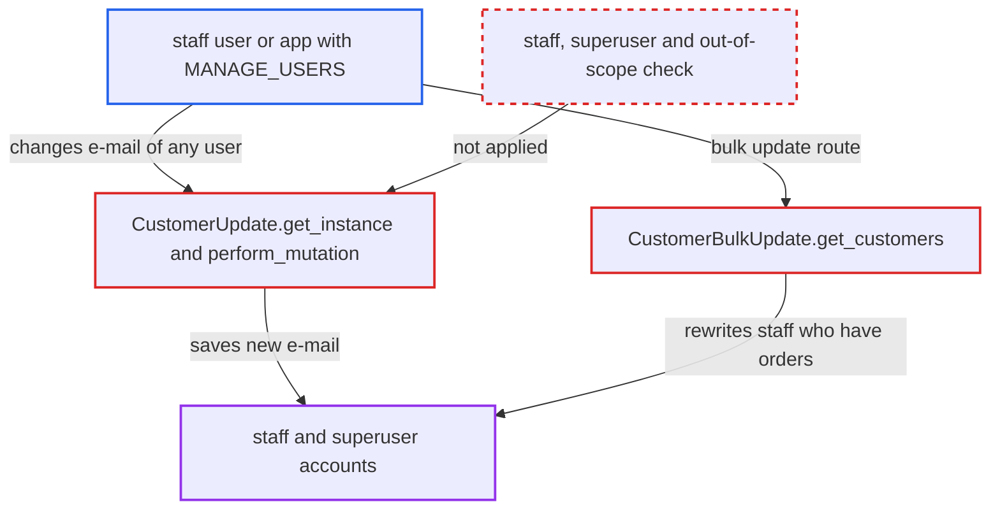

# customerUpdate lets MANAGE_USERS holders change staff and superuser e-mail, enabling takeover

| Field | Value |
|---|---|
| ID | `find_01BsSVw3WCVwCTsv8t9qByq1` |
| Severity | **High** |
| Status | open |
| CWE | CWE-863 — Improper Authorization |
| Created | 2026-10-27T21:10:25.290008Z |
| Claude Security | https://claude.ai/security/findings/find_01BsSVw3WCVwCTsv8t9qByq1 |

## Description

A staff user or app holding only the `MANAGE_USERS` permission can take over any staff or superuser account, which gives them every permission. They change the target's e-mail with `customerUpdate`, then use password reset to get in. The cause is that `CustomerUpdate` loads any user and never checks whether the target is staff or a superuser, or outranks the requestor.

1. **attacker with `MANAGE_USERS`** sends `customerUpdate` with a superuser's ID and a new e-mail. The mutation only requires `AccountPermissions.MANAGE_USERS`, and user IDs are sequential integers, so they are easy to guess. ([`saleor/graphql/account/mutations/staff/customer_update.py:31-62`](https://github.com/cx-benchmark/saleor/blob/c982006cc04c77a97def93218dedac8d715eb041/saleor/graphql/account/mutations/staff/customer_update.py#L31-L62))
2. **the method `get_instance`** loads the target from all users. It queries `models.User.objects.all()` with no `is_staff` or `is_superuser` filter, so a staff or superuser account is returned. ([`saleor/graphql/account/mutations/staff/customer_update.py:240-252`](https://github.com/cx-benchmark/saleor/blob/c982006cc04c77a97def93218dedac8d715eb041/saleor/graphql/account/mutations/staff/customer_update.py#L240-L252))
3. **the method `perform_mutation`** applies the input and saves the new e-mail on the privileged account. It never checks the target's staff or superuser status or the requestor's scope, and `get_out_of_scope_users` is not called. ([`saleor/graphql/account/mutations/staff/customer_update.py:136-208`](https://github.com/cx-benchmark/saleor/blob/c982006cc04c77a97def93218dedac8d715eb041/saleor/graphql/account/mutations/staff/customer_update.py#L136-L208))
4. **attacker** calls `requestPasswordReset` with the new address. This mutation accepts any active user, and the reset notification is sent to `user.email`, which is now the attacker's mailbox. ([`saleor/account/notifications.py:42-68`](https://github.com/cx-benchmark/saleor/blob/c982006cc04c77a97def93218dedac8d715eb041/saleor/account/notifications.py#L42-L68))
5. **attacker** calls `setPassword` with the received token, then `tokenCreate`. This logs the attacker in as the superuser. No action by the victim is needed.

## Assessment

The attacker is a staff user or an App that holds only `MANAGE_USERS`, described as "Manage customers.". They send `customerUpdate` with the ID of a superuser and an attacker-controlled e-mail, then run the normal password-reset flow. This needs an e-mail plugin or app that delivers password resets, which is the normal setup. A second way in is `customerBulkUpdate`, whose `CustomerBulkUpdate.get_customers` uses `User.objects.customers()`. That reaches only staff who have placed an order. Without the reset step, the attacker can still set `isActive: false` or change the login e-mail to lock staff and superusers out. They can also rewrite staff private metadata.

Impact: The attacker can take over a superuser account and so gain every permission. That means customer personal data, orders, app tokens and private metadata, plus full write access to the catalog, orders, payments, permission groups and staff. Even without the takeover, they can lock out staff and superusers or rewrite staff private metadata.

## Recommendation

(1) `CustomerUpdate.get_instance` and `CustomerBulkUpdate.get_customers` pick their targets without excluding staff or superuser accounts. A customer-management permission can therefore modify privileged accounts.

Fix criteria: A requestor holding `MANAGE_USERS` but not `MANAGE_STAFF` cannot modify any user with `is_staff=True` or `is_superuser=True` through `customerUpdate` or `customerBulkUpdate`. `customerUpdate(id: <superuser>, input: {email})` and the bulk equivalent return an error. The staff account's `email`, `is_active`, `is_confirmed` and private metadata stay unchanged.

(2) When the customer path updates sensitive fields (`email`, `is_active`) of a privileged user, it applies no requestor-scope check and no superuser guard. `StaffUpdate` applies both.

Fix criteria: Any change to the e-mail or active state of a user whose permissions exceed the requestor's is refused, as `StaffUpdate` refuses it. A superuser's e-mail cannot be re-pointed through the customer mutations.

## Evidence

**https://github.com/cx-benchmark/saleor**

- [`saleor/graphql/account/mutations/staff/customer_update.py:240-252`](https://github.com/cx-benchmark/saleor/blob/c982006cc04c77a97def93218dedac8d715eb041/saleor/graphql/account/mutations/staff/customer_update.py#L240-L252)
- [`saleor/graphql/account/mutations/staff/customer_update.py:31-62`](https://github.com/cx-benchmark/saleor/blob/c982006cc04c77a97def93218dedac8d715eb041/saleor/graphql/account/mutations/staff/customer_update.py#L31-L62)
- [`saleor/graphql/account/mutations/staff/customer_update.py:136-208`](https://github.com/cx-benchmark/saleor/blob/c982006cc04c77a97def93218dedac8d715eb041/saleor/graphql/account/mutations/staff/customer_update.py#L136-L208)
- [`saleor/graphql/core/mutations.py:519-533`](https://github.com/cx-benchmark/saleor/blob/c982006cc04c77a97def93218dedac8d715eb041/saleor/graphql/core/mutations.py#L519-L533)
- [`saleor/graphql/account/mutations/base.py:177-245`](https://github.com/cx-benchmark/saleor/blob/c982006cc04c77a97def93218dedac8d715eb041/saleor/graphql/account/mutations/base.py#L177-L245)
- [`saleor/graphql/account/mutations/staff/staff_update.py:71-78`](https://github.com/cx-benchmark/saleor/blob/c982006cc04c77a97def93218dedac8d715eb041/saleor/graphql/account/mutations/staff/staff_update.py#L71-L78)
- [`saleor/graphql/account/mutations/base.py:441-483`](https://github.com/cx-benchmark/saleor/blob/c982006cc04c77a97def93218dedac8d715eb041/saleor/graphql/account/mutations/base.py#L441-L483)
- [`saleor/graphql/account/resolvers.py:76-113`](https://github.com/cx-benchmark/saleor/blob/c982006cc04c77a97def93218dedac8d715eb041/saleor/graphql/account/resolvers.py#L76-L113)
- [`saleor/account/notifications.py:42-68`](https://github.com/cx-benchmark/saleor/blob/c982006cc04c77a97def93218dedac8d715eb041/saleor/account/notifications.py#L42-L68)
- [`saleor/graphql/account/bulk_mutations/customer_bulk_update.py:355-376`](https://github.com/cx-benchmark/saleor/blob/c982006cc04c77a97def93218dedac8d715eb041/saleor/graphql/account/bulk_mutations/customer_bulk_update.py#L355-L376)

