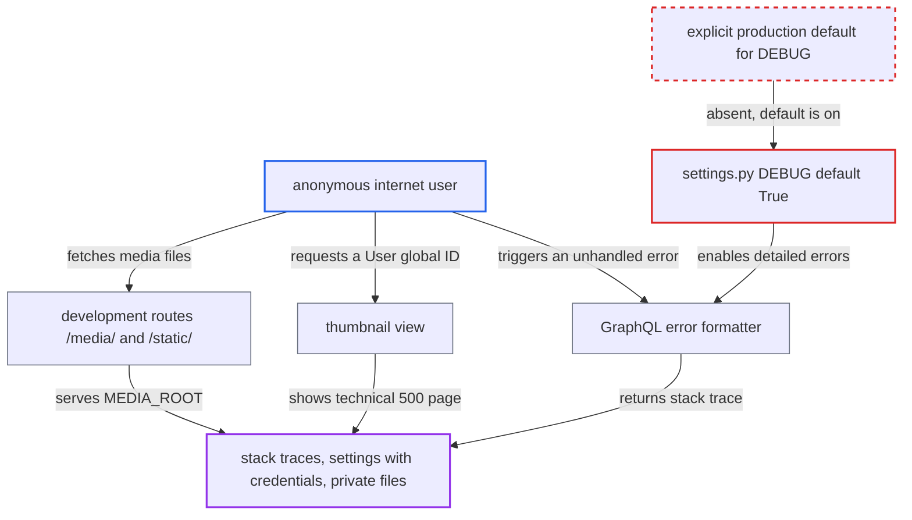

# DEBUG defaults to True; production image ships in debug mode unless operator opts out

| Field | Value |
|---|---|
| ID | `find_016Hcse3247NLEsmWWVmwtU6` |
| Severity | **High** |
| Status | open |
| CWE | CWE-1188 — Insecure default |
| Created | 2026-10-27T21:16:44.757945Z |
| Claude Security | https://claude.ai/security/findings/find_016Hcse3247NLEsmWWVmwtU6 |

## Description

An anonymous internet user can read internal error details, source code and server settings from a deployment of the shipped image. The settings can include broker, cache and email URLs with embedded credentials. This happens whenever the operator never sets `DEBUG`. `saleor/settings.py` defaults `DEBUG` to `True`, and the `Dockerfile` does not set it.

1. **operator** deploys the production image without setting `DEBUG`. The `Dockerfile` sets no `DEBUG` variable and starts uvicorn, so nothing makes the operator choose a mode. ([`Dockerfile:47-67`](https://github.com/cx-benchmark/saleor/blob/c982006cc04c77a97def93218dedac8d715eb041/Dockerfile#L47-L67))
2. **settings module** turns debug mode on by default. `DEBUG = get_bool_from_env("DEBUG", True)` is true unless the environment explicitly says false or 0. ([`saleor/settings.py:86`](https://github.com/cx-benchmark/saleor/blob/c982006cc04c77a97def93218dedac8d715eb041/saleor/settings.py#L86))
3. **anonymous client** sends a GraphQL query that causes an unhandled exception. With `DEBUG` on, the error formatter returns the raw exception message and the full stack trace in `extensions.exception.stacktrace` instead of `Internal Server Error`. ([`saleor/graphql/utils/__init__.py:302-318`](https://github.com/cx-benchmark/saleor/blob/c982006cc04c77a97def93218dedac8d715eb041/saleor/graphql/utils/__init__.py#L302-L318))
4. **anonymous client** requests the thumbnail URL with a global ID such as `User:123`. The ID passes `from_global_id_or_error`, but the `uuid` lookup raises an uncaught `ValidationError`, so Django serves its technical 500 page with the settings dump, source lines and frame locals. Django hides values only by key name, so URLs that embed credentials are shown in clear. ([`saleor/thumbnail/views.py:95-108`](https://github.com/cx-benchmark/saleor/blob/c982006cc04c77a97def93218dedac8d715eb041/saleor/thumbnail/views.py#L95-L108))
5. **anonymous client** requests files under `/media/`. The development-only routes are mounted while `DEBUG` is on and serve the whole `MEDIA_ROOT`. With the default `PRIVATE_FILE_STORAGE = FileSystemStorage`, private files are stored there too. ([`saleor/urls.py:55-63`](https://github.com/cx-benchmark/saleor/blob/c982006cc04c77a97def93218dedac8d715eb041/saleor/urls.py#L55-L63))
6. **browser and network** sends the `refreshToken` cookie over plain HTTP. With `DEBUG` on, the cookie is set with `secure=False`, and `SECURE_SSL_REDIRECT` is not enabled, so a network attacker can capture the token. ([`saleor/core/middleware.py:25-37`](https://github.com/cx-benchmark/saleor/blob/c982006cc04c77a97def93218dedac8d715eb041/saleor/core/middleware.py#L25-L37))

## Assessment

The attacker is any anonymous user who can reach a deployment of the shipped image where the operator left `DEBUG` at its default. No login or victim action is needed. The routes in are a GraphQL query that causes an unhandled exception, a request to `/thumbnail/<base64('User:123')>/128/`, and requests to `/media/`. A network attacker on a plaintext connection can also capture the `refreshToken` cookie. The only startup checks (`settings.py:103-110` and `core/jwt_manager.py:79-85, 203-212`) fire when `DEBUG` is false, so they push operators to leave it on. Other behaviour tied to the flag is also relaxed: `core/jwt_manager.py` writes an unencrypted RSA signing key to disk, `settings.py` generates a random `SECRET_KEY`, and `core/management/commands/cleardb.py` runs without `--force`.

Impact: The attacker can read stack traces, source lines, frame locals and server settings, including connection URLs that commonly embed credentials. The attacker can also fetch files under `MEDIA_ROOT`, including private storage with the default configuration. A network attacker can capture the refresh-token cookie sent over plain HTTP. The report establishes no availability impact.

## Recommendation

(1) The Django debug flag defaults to enabled, so every control that depends on `DEBUG` being off is disabled unless the operator opts out. These include error redaction, the cookie `Secure` flag, the SSL redirect, the development-only routes and the key and secret checks.

Fix criteria: `DEBUG` is off unless explicitly enabled, or startup refuses to serve when `DEBUG` is unset outside development (for example, the shipped image sets `DEBUG=False`). With no `DEBUG` variable set, an unhandled GraphQL error returns only `Internal Server Error` with no stacktrace. `/thumbnail/<User:123>/128/` returns a plain 500 without settings. `/media/` and `/` are not routed. The `refreshToken` cookie carries `Secure`.

(2) Security behaviours such as error redaction, cookie flags and development routes are tied to the general `DEBUG` flag instead of their own settings. One mistaken default therefore disables all of them.

Fix criteria: Error-detail exposure and cookie security no longer weaken just because `DEBUG` is on in a networked deployment. The API error redaction and the `Secure` cookie flag hold regardless of `DEBUG`, or are governed by explicit settings whose defaults are secure.

## Evidence

**https://github.com/cx-benchmark/saleor**

- [`saleor/settings.py:86`](https://github.com/cx-benchmark/saleor/blob/c982006cc04c77a97def93218dedac8d715eb041/saleor/settings.py#L86)
- [`Dockerfile:47-67`](https://github.com/cx-benchmark/saleor/blob/c982006cc04c77a97def93218dedac8d715eb041/Dockerfile#L47-L67)
- [`saleor/graphql/utils/__init__.py:302-318`](https://github.com/cx-benchmark/saleor/blob/c982006cc04c77a97def93218dedac8d715eb041/saleor/graphql/utils/__init__.py#L302-L318)
- [`saleor/thumbnail/views.py:95-108`](https://github.com/cx-benchmark/saleor/blob/c982006cc04c77a97def93218dedac8d715eb041/saleor/thumbnail/views.py#L95-L108)
- [`saleor/core/middleware.py:25-37`](https://github.com/cx-benchmark/saleor/blob/c982006cc04c77a97def93218dedac8d715eb041/saleor/core/middleware.py#L25-L37)
- [`saleor/urls.py:55-63`](https://github.com/cx-benchmark/saleor/blob/c982006cc04c77a97def93218dedac8d715eb041/saleor/urls.py#L55-L63)
- [`saleor/settings.py:211-212`](https://github.com/cx-benchmark/saleor/blob/c982006cc04c77a97def93218dedac8d715eb041/saleor/settings.py#L211-L212)
- [`saleor/settings.py:103-110`](https://github.com/cx-benchmark/saleor/blob/c982006cc04c77a97def93218dedac8d715eb041/saleor/settings.py#L103-L110)
- [`saleor/core/jwt_manager.py:79-85`](https://github.com/cx-benchmark/saleor/blob/c982006cc04c77a97def93218dedac8d715eb041/saleor/core/jwt_manager.py#L79-L85)
- [`saleor/core/management/commands/cleardb.py:43-44`](https://github.com/cx-benchmark/saleor/blob/c982006cc04c77a97def93218dedac8d715eb041/saleor/core/management/commands/cleardb.py#L43-L44)

