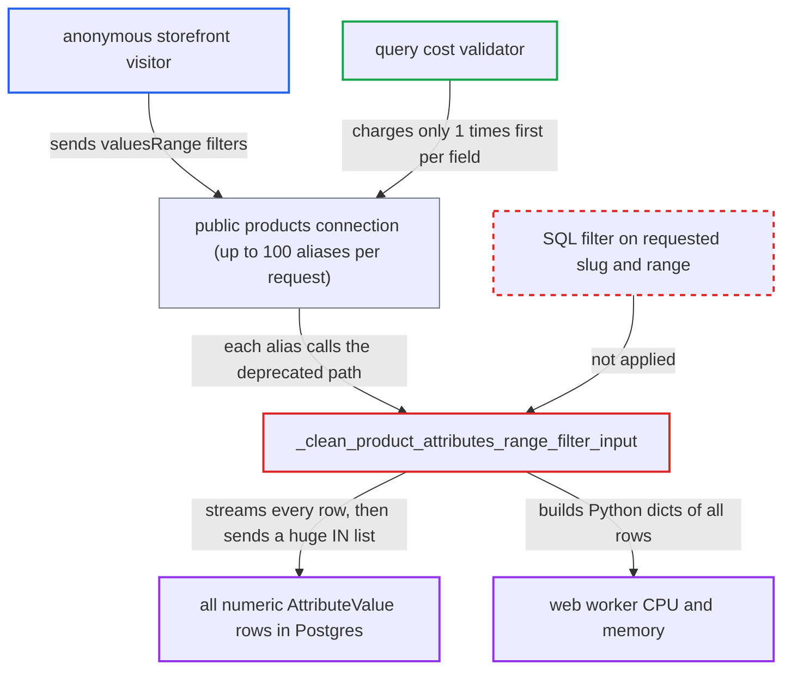

# Deprecated valuesRange attribute filter loads every numeric attribute value per anonymous request

| Field | Value |
|---|---|
| ID | `find_01FKff6JKXnrbHivYg52nsZq` |
| Severity | **High** |
| Status | open |
| CWE | CWE-405 — Resource consumption amplification |
| Created | 2026-10-27T21:45:29.921782Z |
| Claude Security | https://claude.ai/security/findings/find_01FKff6JKXnrbHivYg52nsZq |

## Description

An anonymous storefront visitor can slow down or knock out the API for every channel by sending requests that use the deprecated `valuesRange` attribute filter. Only deployments holding many numeric attribute values gain much from it. The function `_clean_product_attributes_range_filter_input` loads every numeric attribute value into Python before it looks at the requested slug or range.

1. **anonymous attacker** sends one request to `/graphql/` with up to 100 aliased `products` fields. Each field carries `filter:{attributes:[{slug:"x", valuesRange:{gte:0}}]}` with `first:1`, and `resolve_products` needs no login because it falls back to the default channel for anonymous callers. ([`saleor/graphql/product/schema.py:505-531`](https://github.com/cx-benchmark/saleor/blob/c982006cc04c77a97def93218dedac8d715eb041/saleor/graphql/product/schema.py#L505-L531))
2. **attribute filter code** routes the input to the deprecated range path. Any first attribute input with a key other than `slug` or `value` is sent to the `valuesRange` handling, and `filter_attributes` passes the input on for both `filter` and `where`. ([`saleor/graphql/product/filters/product_attributes.py:391-398`](https://github.com/cx-benchmark/saleor/blob/c982006cc04c77a97def93218dedac8d715eb041/saleor/graphql/product/filters/product_attributes.py#L391-L398))
3. **`_clean_product_attributes_range_filter_input`** reads every numeric `AttributeValue` row into Python dicts. The `values_list` query is not limited to the requested slug or range and covers product, variant and page values of every NUMERIC attribute. ([`saleor/graphql/product/filters/product_attributes.py:85-124`](https://github.com/cx-benchmark/saleor/blob/c982006cc04c77a97def93218dedac8d715eb041/saleor/graphql/product/filters/product_attributes.py#L85-L124))
4. **`_clean_product_attributes_range_filter_input`** checks whether the requested slug exists only after the full load. An unknown slug raises `ValueError` only at this point, so even a made-up slug pays the full cost. ([`saleor/graphql/product/filters/product_attributes.py:254-286`](https://github.com/cx-benchmark/saleor/blob/c982006cc04c77a97def93218dedac8d715eb041/saleor/graphql/product/filters/product_attributes.py#L254-L286))
5. **`filter_products_by_attributes_values`** puts every matching value pk into `value_id__in` in the product and variant subqueries. Without `lte` the range is `gte=0` to `lte=inf`, so every non-zero value of the attribute matches and the SQL statement grows with the data. ([`saleor/graphql/product/filters/product_attributes.py:184-221`](https://github.com/cx-benchmark/saleor/blob/c982006cc04c77a97def93218dedac8d715eb041/saleor/graphql/product/filters/product_attributes.py#L184-L221))

## Assessment

The attacker is an anonymous storefront user who can reach `/graphql/`, with no login or special setting needed. They can read a numeric attribute slug from the public `attributes` query, or use any slug at all. The same path is reachable through `filter` and `where` on the public `products` connection, and through the nested `Category.products` and `Collection.products`. One request can hold up to 100 aliased `products` fields (`GRAPHQL_ALIAS_COUNT_LIMIT`, default 100), and the query cost validator charges each about `1*first`. The attack pays off only when the deployment holds many numeric attribute values.

Impact: A modest stream of these requests ties up web-worker CPU and memory and repeats full scans on the shared Postgres database. This degrades or denies the API for every channel the deployment serves. Nothing is disclosed or changed.

## Recommendation

The deprecated `valuesRange` filter loads the whole numeric `AttributeValue` table into application memory on every request. It does not restrict the query to the requested attributes and range in SQL.

Fix criteria: A `valuesRange` filter costs work proportional only to the matching values of the requested attributes. The attribute slugs and the `gte`/`lte` bounds are applied in the database query, as the `where`-path numeric range already does, or the deprecated input is rejected. Issuing the filter against a large catalogue shows SQL bounded by the requested slug and range. An unknown slug fails before any value rows are read.

## Evidence

**https://github.com/cx-benchmark/saleor**

- [`saleor/graphql/product/filters/product_attributes.py:85-124`](https://github.com/cx-benchmark/saleor/blob/c982006cc04c77a97def93218dedac8d715eb041/saleor/graphql/product/filters/product_attributes.py#L85-L124)
- [`saleor/graphql/product/filters/product_attributes.py:184-221`](https://github.com/cx-benchmark/saleor/blob/c982006cc04c77a97def93218dedac8d715eb041/saleor/graphql/product/filters/product_attributes.py#L184-L221)
- [`saleor/graphql/product/filters/product_attributes.py:254-286`](https://github.com/cx-benchmark/saleor/blob/c982006cc04c77a97def93218dedac8d715eb041/saleor/graphql/product/filters/product_attributes.py#L254-L286)
- [`saleor/graphql/product/filters/product_attributes.py:391-398`](https://github.com/cx-benchmark/saleor/blob/c982006cc04c77a97def93218dedac8d715eb041/saleor/graphql/product/filters/product_attributes.py#L391-L398)
- [`saleor/graphql/product/filters/product.py:151-154`](https://github.com/cx-benchmark/saleor/blob/c982006cc04c77a97def93218dedac8d715eb041/saleor/graphql/product/filters/product.py#L151-L154)
- [`saleor/graphql/product/schema.py:505-531`](https://github.com/cx-benchmark/saleor/blob/c982006cc04c77a97def93218dedac8d715eb041/saleor/graphql/product/schema.py#L505-L531)
- [`saleor/graphql/attribute/utils/type_handlers.py:131-132`](https://github.com/cx-benchmark/saleor/blob/c982006cc04c77a97def93218dedac8d715eb041/saleor/graphql/attribute/utils/type_handlers.py#L131-L132)
- [`saleor/graphql/attribute/types.py:505-512`](https://github.com/cx-benchmark/saleor/blob/c982006cc04c77a97def93218dedac8d715eb041/saleor/graphql/attribute/types.py#L505-L512)
- [`saleor/settings.py:899`](https://github.com/cx-benchmark/saleor/blob/c982006cc04c77a97def93218dedac8d715eb041/saleor/settings.py#L899)

