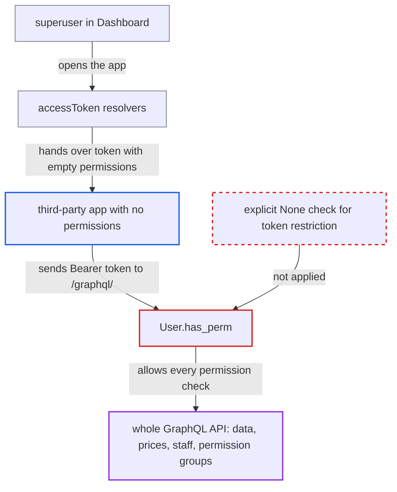

# Empty third-party token permission set gives superuser-delegated app tokens unrestricted access

| Field | Value |
|---|---|
| ID | `find_01VPH7sz6LRAnu5JdbVK3FSX` |
| Severity | **High** |
| Status | open |
| CWE | CWE-863 — Incorrect authorization |
| Created | 2026-10-27T21:13:25.881192Z |
| Claude Security | https://claude.ai/security/findings/find_01VPH7sz6LRAnu5JdbVK3FSX |

## Description

An app or dashboard extension installed with no permissions can act as a full superuser when a superuser opens it. It can read all data, change prices, and give its own App every permission. The cause is `User.has_perm`, which tests whether the token's permission set is falsy. An empty set is falsy, just like "no restriction", so a token limited to zero permissions is treated as unlimited.

1. **superuser** opens the app or a page showing its extension in the Dashboard. The Dashboard queries `accessToken`, which mints a `thirdparty` token for a staff viewer of a third-party app without MANAGE_APPS. For `AppExtension.accessToken`, no `is_staff` check is needed. ([`saleor/graphql/app/resolvers.py:32-70`](https://github.com/cx-benchmark/saleor/blob/c982006cc04c77a97def93218dedac8d715eb041/saleor/graphql/app/resolvers.py#L32-L70))
2. **`jwt.py` token minting** builds the token with an empty `permissions` claim. The claim is the overlap of the app's permissions and the user's permissions, which is `[]` for an app or extension with no permissions. `is_staff` is copied from the superuser. ([`saleor/core/jwt.py:172-199`](https://github.com/cx-benchmark/saleor/blob/c982006cc04c77a97def93218dedac8d715eb041/saleor/core/jwt.py#L172-L199))
3. **malicious app** sends the token as a Bearer token to `/graphql/`. `load_user_from_request` sees a claim that is not None and sets `effective_permissions` to an empty QuerySet. It also restores `is_staff` from the claim. ([`saleor/core/auth_backend.py:167-176`](https://github.com/cx-benchmark/saleor/blob/c982006cc04c77a97def93218dedac8d715eb041/saleor/core/auth_backend.py#L167-L176))
4. **`User.has_perm`** returns True for every permission. For an active superuser it grants everything when `not self._effective_permissions`, and an empty QuerySet is falsy, so it looks the same as no restriction. ([`saleor/account/models.py:350-357`](https://github.com/cx-benchmark/saleor/blob/c982006cc04c77a97def93218dedac8d715eb041/saleor/account/models.py#L350-L357))
5. **permission check in `permission/utils.py`** lets every `permissions=`-guarded query and mutation through. These checks all call `requestor.has_perm(perm)`, so the wrong answer applies across the whole API. ([`saleor/permission/utils.py:49-63`](https://github.com/cx-benchmark/saleor/blob/c982006cc04c77a97def93218dedac8d715eb041/saleor/permission/utils.py#L49-L63))
6. **malicious app** calls `appUpdate` and `appTokenCreate` to make the access permanent. `appUpdate` lets the app grant its own App record every permission except MANAGE_APPS, and `appTokenCreate` then issues a persistent token. ([`saleor/graphql/app/mutations/app_update.py:48-65`](https://github.com/cx-benchmark/saleor/blob/c982006cc04c77a97def93218dedac8d715eb041/saleor/graphql/app/mutations/app_update.py#L48-L65))

## Assessment

The attacker runs a third-party Saleor App installed with no permissions, or a dashboard extension that declares none. `ManifestExtensionSchema.permissions` defaults to `[]`, so this is the normal state for such an extension. The attack needs a superuser to open the app or a page showing the extension, and it needs no other action from the victim. The same flaw defeats `PasswordLoginMode.CUSTOMERS_ONLY`, a non-default setting. In that mode password-issued `access` tokens are stripped by assigning `Permission.objects.none()`, but a superuser still passes every `has_perm` check and only `is_staff` is cleared. Separately, code that tests `requestor.is_superuser` directly, such as `appUpdate`, `appTokenCreate`, `permissionGroupCreate` and `staffCreate`, ignores even a non-empty token restriction.

Impact: While the token lives, the app acts as a full superuser session. The token lasts 5 minutes by default (`JWT_TTL_APP_ACCESS`) and is re-minted on every view. It can read all customer personal data, orders, private metadata and plugin configuration. It can manage staff and permission groups, change prices and gift cards, and run destructive deletes. Through `appUpdate` and `appTokenCreate` it can make the escalation permanent.

## Recommendation

(1) `User.has_perm` cannot tell "no restriction applied" from "restricted to zero permissions", because it tests the truthiness of a QuerySet. An empty token permission set therefore removes the restriction for superusers.

Fix criteria: A third-party token whose `permissions` claim is empty grants no permissions, including to superusers. The superuser shortcut applies only when no token restriction was set, using an explicit `None` check or a separate flag. To verify, issue an `App.accessToken` for a permission-less app to a superuser. Then confirm that every `permissions=`-guarded query and mutation returns `PermissionDenied`.

(2) Authorization paths that test `requestor.is_superuser` directly ignore the third-party token's permission restriction entirely.

Fix criteria: For a request authenticated with a `thirdparty` token, superuser-only bypasses are either disabled or checked against the token's permission set. To verify, take a superuser's delegated token with permissions `[MANAGE_STAFF]`. Confirm it cannot create a permission group containing permissions outside that set.

## Evidence

**https://github.com/cx-benchmark/saleor**

- [`saleor/account/models.py:350-357`](https://github.com/cx-benchmark/saleor/blob/c982006cc04c77a97def93218dedac8d715eb041/saleor/account/models.py#L350-L357)
- [`saleor/core/auth_backend.py:167-176`](https://github.com/cx-benchmark/saleor/blob/c982006cc04c77a97def93218dedac8d715eb041/saleor/core/auth_backend.py#L167-L176)
- [`saleor/core/jwt.py:172-199`](https://github.com/cx-benchmark/saleor/blob/c982006cc04c77a97def93218dedac8d715eb041/saleor/core/jwt.py#L172-L199)
- [`saleor/graphql/app/resolvers.py:32-70`](https://github.com/cx-benchmark/saleor/blob/c982006cc04c77a97def93218dedac8d715eb041/saleor/graphql/app/resolvers.py#L32-L70)
- [`saleor/permission/utils.py:49-63`](https://github.com/cx-benchmark/saleor/blob/c982006cc04c77a97def93218dedac8d715eb041/saleor/permission/utils.py#L49-L63)
- [`saleor/graphql/app/mutations/app_update.py:48-65`](https://github.com/cx-benchmark/saleor/blob/c982006cc04c77a97def93218dedac8d715eb041/saleor/graphql/app/mutations/app_update.py#L48-L65)
- [`saleor/core/auth_backend.py:179-189`](https://github.com/cx-benchmark/saleor/blob/c982006cc04c77a97def93218dedac8d715eb041/saleor/core/auth_backend.py#L179-L189)

