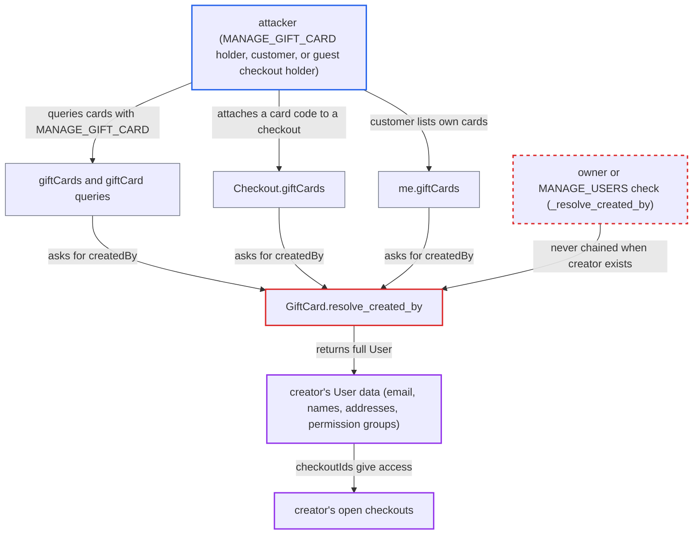

# GiftCard.createdBy returns the creator's full User without owner/MANAGE_USERS check

| Field | Value |
|---|---|
| ID | `find_01DPMNDAgM2YpNZQr1F9bidZ` |
| Severity | **High** |
| Status | open |
| CWE | CWE-862 — Missing authorization |
| Created | 2026-10-27T21:10:45.261968Z |
| Claude Security | https://claude.ai/security/findings/find_01DPMNDAgM2YpNZQr1F9bidZ |

## Description

Someone who can reach a gift card can read personal data of the person who created it. That data is the creator's name, email, postal addresses, phone numbers and open checkout IDs, and for staff creators also permission groups. The attacker needs only `MANAGE_GIFT_CARD`, a customer login, or a guest checkout with a gift card code attached. The cause is `GiftCard.resolve_created_by`, which never runs its owner/`MANAGE_USERS` check when a creator exists.

1. **attacker** gets a `GiftCard` node into a GraphQL query. This takes no `MANAGE_USERS`. The three ways in are the `giftCards`/`giftCard` queries with `MANAGE_GIFT_CARD`, `Checkout.giftCards` on a checkout the attacker holds, and `me.giftCards` for a customer. ([`saleor/graphql/checkout/types.py:1174-1175`](https://github.com/cx-benchmark/saleor/blob/c982006cc04c77a97def93218dedac8d715eb041/saleor/graphql/checkout/types.py#L1174-L1175))
2. **attacker** requests the `createdBy` field of the card with sub-fields such as `email`, `addresses` and `checkoutIds`. The report's example is `giftCards(first:100){edges{node{createdBy{email firstName lastName addresses{streetAddress1 city postalCode phone} checkoutIds}}}}` sent to `/graphql/`.
3. **the resolver `resolve_created_by`** loads the creator's `User` and returns it without any check. It defines `_resolve_created_by`, but uses it only when `root.created_by_id is None`. Otherwise it returns `UserByUserIdLoader(info.context).load(root.created_by_id)` without `.then(_resolve_created_by)`. ([`saleor/graphql/giftcard/types.py:501-513`](https://github.com/cx-benchmark/saleor/blob/c982006cc04c77a97def93218dedac8d715eb041/saleor/graphql/giftcard/types.py#L501-L513))
4. **the `User` type** resolves the sensitive fields with no further check. Fields such as `addresses` and `email` have no permission check of their own, so access to the `User` node is the only gate. ([`saleor/graphql/account/types.py:653-656`](https://github.com/cx-benchmark/saleor/blob/c982006cc04c77a97def93218dedac8d715eb041/saleor/graphql/account/types.py#L653-L656))
5. **attacker** reads the creator's data and may use the leaked `checkoutIds` to query and modify the creator's open checkouts. Checkout mutations accept the checkout ID as a bearer credential and do not check the owner.

## Assessment

The attacker needs a way to reach a `GiftCard` node, and `MANAGE_USERS` is not required. There are three routes. The first is a staff member or app that holds only `MANAGE_GIFT_CARD` and uses the `giftCards` or `giftCard` queries. The second is anyone holding a checkout, including a guest, who adds a gift card code with `checkoutAddPromoCode` and reads `Checkout.giftCards`, which has no check (gift cards are bearer instruments). The third is a customer using `me.giftCards` for cards they used or were assigned. The creator is always a real account: `gift_cards_create` sets `created_by` to the buying customer, and `GiftCardCreate` and `GiftCardBulkCreate` record the issuing staff user. No victim action is needed.

Impact: The attacker reads data that normally needs `MANAGE_USERS`: names, emails, postal addresses and phone numbers of customers who bought gift cards and of staff who issued them, plus staff permission groups. With the leaked `checkoutIds` they can also read and change the creator's open checkouts, such as addresses and lines. Orders, private metadata and card codes stay protected by their own checks, and availability is not affected.

## Recommendation

`GiftCard.resolve_created_by` loads the creator through `UserByUserIdLoader` and returns it without chaining the `_resolve_created_by` callback. The owner/`MANAGE_USERS` check therefore never runs when a creator exists.

Fix criteria: `GiftCard.createdBy` returns the `User` only when the requester is that user or holds `MANAGE_USERS`, like `resolve_assigned_to` and `resolve_user`. Otherwise it denies access or returns null. A `MANAGE_GIFT_CARD`-only staff token gets no creator `User` for a card created by someone else. An anonymous checkout holder with an attached card gets none either. A customer reading `me.giftCards` gets none either. The creator and `MANAGE_USERS` holders still receive the `User`.

## Evidence

**https://github.com/cx-benchmark/saleor**

- [`saleor/graphql/giftcard/types.py:501-513`](https://github.com/cx-benchmark/saleor/blob/c982006cc04c77a97def93218dedac8d715eb041/saleor/graphql/giftcard/types.py#L501-L513)
- [`saleor/graphql/account/types.py:653-656`](https://github.com/cx-benchmark/saleor/blob/c982006cc04c77a97def93218dedac8d715eb041/saleor/graphql/account/types.py#L653-L656)
- [`saleor/graphql/giftcard/dataloaders.py:13-29`](https://github.com/cx-benchmark/saleor/blob/c982006cc04c77a97def93218dedac8d715eb041/saleor/graphql/giftcard/dataloaders.py#L13-L29)
- [`saleor/graphql/checkout/types.py:1174-1175`](https://github.com/cx-benchmark/saleor/blob/c982006cc04c77a97def93218dedac8d715eb041/saleor/graphql/checkout/types.py#L1174-L1175)
- [`saleor/giftcard/utils.py:292-320`](https://github.com/cx-benchmark/saleor/blob/c982006cc04c77a97def93218dedac8d715eb041/saleor/giftcard/utils.py#L292-L320)

