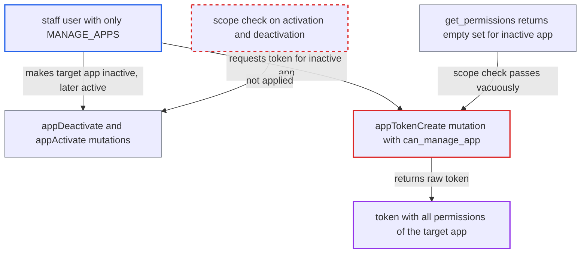

# Inactive-app scope bypass lets MANAGE_APPS staff mint tokens for apps with wider permissions

| Field | Value |
|---|---|
| ID | `find_01Xj3CCs98aCwnaxf5FzSWTQ` |
| Severity | **High** |
| Status | open |
| CWE | CWE-863 — Privilege escalation |
| Created | 2026-10-27T21:12:45.713062Z |
| Claude Security | https://claude.ai/security/findings/find_01Xj3CCs98aCwnaxf5FzSWTQ |

## Description

A staff user who holds only `MANAGE_APPS` can get a working token for any installed app, including apps with wider permissions such as `MANAGE_ORDERS`, `MANAGE_USERS`, `HANDLE_PAYMENTS` or `MANAGE_STAFF`. `can_manage_app()` takes the app's permissions from `App.get_permissions()`, which returns an empty set for an inactive app, so the scope check passes for everyone. `appDeactivate` and `appActivate` have no scope check, so the attacker can make any app inactive and then active again.

1. **attacker (staff user with only `MANAGE_APPS`)** lists the installed apps with `apps`. This gives the attacker the ID of the target app that holds wider permissions than the attacker.
2. **attacker** calls `appDeactivate` on the target app. The mutation needs only `MANAGE_APPS` and does no scope check, so any app can be made inactive. ([`saleor/graphql/app/mutations/app_deactivate.py:32-43`](https://github.com/cx-benchmark/saleor/blob/c982006cc04c77a97def93218dedac8d715eb041/saleor/graphql/app/mutations/app_deactivate.py#L32-L43))
3. **`App.get_permissions()`** returns an empty set for the now inactive app. It returns `set()` whenever `is_active` is `False`. The stored permission rows stay in place. ([`saleor/app/models.py:107-111`](https://github.com/cx-benchmark/saleor/blob/c982006cc04c77a97def93218dedac8d715eb041/saleor/app/models.py#L107-L111))
4. **`can_manage_app()`** passes the scope check for the inactive app. It calls `requestor.has_perms()` with the empty set, which is vacuously `True` for every requestor. ([`saleor/graphql/account/utils.py:101-106`](https://github.com/cx-benchmark/saleor/blob/c982006cc04c77a97def93218dedac8d715eb041/saleor/graphql/account/utils.py#L101-L106))
5. **the `appTokenCreate` mutation** creates a token for the inactive app and returns the raw token. It rejects only removed apps and relies on `can_manage_app()` for the scope check. ([`saleor/graphql/app/mutations/app_token_create.py:44-69`](https://github.com/cx-benchmark/saleor/blob/c982006cc04c77a97def93218dedac8d715eb041/saleor/graphql/app/mutations/app_token_create.py#L44-L69))
6. **attacker** calls `appActivate` on the target app. This mutation also needs only `MANAGE_APPS` and does no scope check, so the app is active again. ([`saleor/graphql/app/mutations/app_activate.py:32-43`](https://github.com/cx-benchmark/saleor/blob/c982006cc04c77a97def93218dedac8d715eb041/saleor/graphql/app/mutations/app_activate.py#L32-L43))
7. **`AppByTokenLoader`** authenticates requests that carry the minted token as the target app. It accepts any stored token of an active app, so the request runs with all permissions the app holds. ([`saleor/graphql/app/dataloaders/app.py:106-112`](https://github.com/cx-benchmark/saleor/blob/c982006cc04c77a97def93218dedac8d715eb041/saleor/graphql/app/dataloaders/app.py#L106-L112))

## Assessment

The attacker is a staff user whose only permission is `MANAGE_APPS`. They use the public `/graphql/` endpoint. No victim action is needed. The attacker lists the app IDs, deactivates the target, mints a token, then reactivates the app. `appUpdate`, `appDelete` and `appTokenDelete` share the same vacuous check for inactive apps.

Impact: The attacker acts as any installed app with every permission it holds, for example `MANAGE_ORDERS`, `MANAGE_USERS`, `HANDLE_PAYMENTS` or `MANAGE_STAFF`. That allows reading customer personal data and orders, and changing orders, payments, products and staff data. Limits: apps cannot hold `MANAGE_APPS`, and the target app's webhooks stop for the short time it is inactive. Through `appUpdate` the attacker can also edit an inactive out-of-scope app, for example by stripping its permissions with an empty list.

## Recommendation

(1) `can_manage_app()` measures an app's scope with `App.get_permissions()`, which returns an empty set for inactive apps. The management scope check therefore passes trivially for any inactive app.

Fix criteria: The scope check used by `appTokenCreate`, `appTokenDelete`, `appUpdate` and `appDelete` compares the requestor's permissions with the app's stored permissions whether or not the app is active. Check: a staff user with only `MANAGE_APPS` calling `appTokenCreate` for an inactive app that holds `MANAGE_ORDERS` gets `OUT_OF_SCOPE_APP`, as in the active-app case.

(2) `appActivate` and `appDeactivate` toggle apps whose permissions exceed the requestor's, with no scope check. This lets the attacker create the inactive state and then re-enable the minted token.

Fix criteria: No sequence of `MANAGE_APPS`-only mutations yields a working token for an app holding permissions the caller lacks. Either activation and deactivation are scope-checked, or the inactive state no longer relaxes any other management check.

## Evidence

**https://github.com/cx-benchmark/saleor**

- [`saleor/graphql/account/utils.py:101-106`](https://github.com/cx-benchmark/saleor/blob/c982006cc04c77a97def93218dedac8d715eb041/saleor/graphql/account/utils.py#L101-L106)
- [`saleor/app/models.py:107-111`](https://github.com/cx-benchmark/saleor/blob/c982006cc04c77a97def93218dedac8d715eb041/saleor/app/models.py#L107-L111)
- [`saleor/graphql/app/mutations/app_token_create.py:44-69`](https://github.com/cx-benchmark/saleor/blob/c982006cc04c77a97def93218dedac8d715eb041/saleor/graphql/app/mutations/app_token_create.py#L44-L69)
- [`saleor/graphql/app/mutations/app_deactivate.py:32-43`](https://github.com/cx-benchmark/saleor/blob/c982006cc04c77a97def93218dedac8d715eb041/saleor/graphql/app/mutations/app_deactivate.py#L32-L43)
- [`saleor/graphql/app/mutations/app_activate.py:32-43`](https://github.com/cx-benchmark/saleor/blob/c982006cc04c77a97def93218dedac8d715eb041/saleor/graphql/app/mutations/app_activate.py#L32-L43)
- [`saleor/graphql/app/dataloaders/app.py:106-112`](https://github.com/cx-benchmark/saleor/blob/c982006cc04c77a97def93218dedac8d715eb041/saleor/graphql/app/dataloaders/app.py#L106-L112)
- [`saleor/graphql/app/utils.py:28-49`](https://github.com/cx-benchmark/saleor/blob/c982006cc04c77a97def93218dedac8d715eb041/saleor/graphql/app/utils.py#L28-L49)
- [`saleor/graphql/app/mutations/app_update.py:49-66`](https://github.com/cx-benchmark/saleor/blob/c982006cc04c77a97def93218dedac8d715eb041/saleor/graphql/app/mutations/app_update.py#L49-L66)

