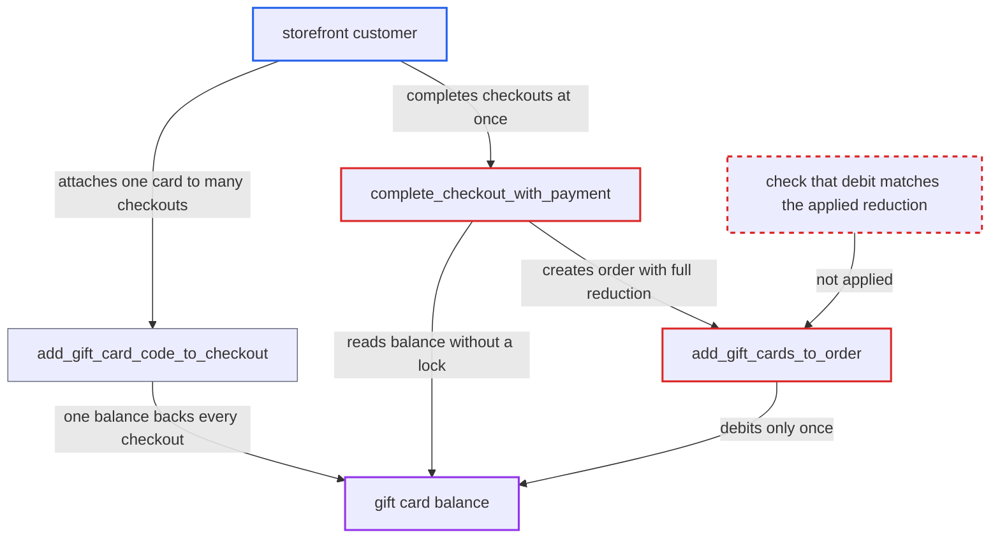

# Legacy Payment checkout completion double-spends a gift card balance across concurrent checkouts

| Field | Value |
|---|---|
| ID | `find_01KMazXWQMYkDs11Q3orNNgN` |
| Severity | **High** |
| Status | open |
| CWE | CWE-367 — Race condition |
| Created | 2026-10-27T21:17:53.949320Z |
| Claude Security | https://claude.ai/security/findings/find_01KMazXWQMYkDs11Q3orNNgN |

## Description

A storefront customer, logged in or anonymous, can get several orders each discounted by the full value of one gift card, while the card is debited only once. The shop ships goods but collects less than the order totals. It needs a channel with a legacy payment gateway and winning a timing race. The cause is in `complete_checkout_with_payment`: it reads the card balance without a lock, and `add_gift_cards_to_order` later accepts a smaller debit without any error.

1. **attacker** attaches one gift card of value `G` to two checkouts with `checkoutAddPromoCode`. `add_gift_card_code_to_checkout` only adds the card and never checks whether it is already attached to other open checkouts. This works while `channel.allow_legacy_gift_card_use` is True, which is the default. ([`saleor/giftcard/utils.py:55-84`](https://github.com/cx-benchmark/saleor/blob/c982006cc04c77a97def93218dedac8d715eb041/saleor/giftcard/utils.py#L55-L84))
2. **attacker** creates a payment of `T-G` on each checkout with `checkoutPaymentCreate`. The mutation requires the payment amount to equal the total after the gift card reduction, so each checkout is charged only `T-G`. ([`saleor/graphql/payment/mutations/payment/checkout_payment_create.py:281-289`](https://github.com/cx-benchmark/saleor/blob/c982006cc04c77a97def93218dedac8d715eb041/saleor/graphql/payment/mutations/payment/checkout_payment_create.py#L281-L289))
3. **attacker** sends `checkoutComplete` for both checkouts at the same time. A checkout with a legacy `Payment` and no `TransactionItem` goes to `complete_checkout_with_payment`. One of the two completions may instead use the transaction-API path. ([`saleor/checkout/complete_checkout.py:1744-1789`](https://github.com/cx-benchmark/saleor/blob/c982006cc04c77a97def93218dedac8d715eb041/saleor/checkout/complete_checkout.py#L1744-L1789))
4. **the function `complete_checkout_with_payment`** computes the order total in its first transaction from an unlocked balance read. `get_total_gift_cards_balance` sums `current_balance_amount` without a lock, so both checkouts see the full balance `G`. The same unlocked value lets `is_fully_paid` accept the `T-G` payment. ([`saleor/checkout/models.py:388-400`](https://github.com/cx-benchmark/saleor/blob/c982006cc04c77a97def93218dedac8d715eb041/saleor/checkout/models.py#L388-L400))
5. **the function `complete_checkout_with_payment`** commits the first transaction, then charges the payment gateway in a second one. The precomputed `order_data` stays in Python memory while the gateway call runs, and this gap is the race window. ([`saleor/checkout/complete_checkout.py:1871-1985`](https://github.com/cx-benchmark/saleor/blob/c982006cc04c77a97def93218dedac8d715eb041/saleor/checkout/complete_checkout.py#L1871-L1985))
6. **the function `_create_order`** writes `Order.total` from the stale `order_data` and then calls `add_gift_cards_to_order`. The order already carries the full reduction `G`, and no code checks what the card actually gives up. ([`saleor/checkout/complete_checkout.py:802-884`](https://github.com/cx-benchmark/saleor/blob/c982006cc04c77a97def93218dedac8d715eb041/saleor/checkout/complete_checkout.py#L802-L884))
7. **the function `add_gift_cards_to_order`** debits 0 from the already drained card and raises no error. `update_gift_card_balance` takes its `else` branch, leaves `total_price_left` uncovered and only logs, so `update_order_charge_data` marks the order fully charged. ([`saleor/order/utils.py:443-511`](https://github.com/cx-benchmark/saleor/blob/c982006cc04c77a97def93218dedac8d715eb041/saleor/order/utils.py#L443-L511))

## Assessment

The attacker is an anonymous or logged-in storefront customer holding one gift card worth `G`. The channel must have a legacy payment gateway, for example the builtin Stripe plugin. The attacker attaches the code to two checkouts, creates a payment of `T-G` on each, and sends `checkoutComplete` for both at once. Two legacy-path completions work, and so does one legacy-path plus one transaction-path completion. Two transaction-path completions on their own do not allow the double reduction. Their balance read and debit share one transaction holding the checkout row lock, and overlapping ones end in a database deadlock where one is aborted. A transaction-path completion can still drain the card for a racing legacy-path checkout. The attacker must win a timing race, but a lost race fails safely and can be retried.

Impact: The attacker can have N concurrent checkouts each receive the full gift card reduction `G` while the card is debited only once. The orders are created as fully charged and confirmed. The merchant ships goods worth `N*T` against `N*(T-G)+G` collected, a loss of `(N-1)*G` per card. Nothing is disclosed and availability is not affected.

## Recommendation

(1) The reduction applied to `Order.total` in the legacy path comes from an unlocked balance read in an earlier, already committed transaction. `add_gift_cards_to_order` silently accepts a debit smaller than that reduction, so the same balance is consumed by several orders.

Fix criteria: Order creation fails, and the payment is refunded or voided, when the amount debited from the gift cards under the row lock is less than the reduction applied to the order total. Alternatively, the total is recomputed from the locked balance and checked against the payment before the order is created. Verify that two legacy completions sharing one card, run concurrently, give at most one order with the reduction. The other must fail with no order created.

(2) A gift card can be attached to any number of open checkouts in the legacy promo-code flow, so a single balance backs several payable totals at once.

Fix criteria: A card's balance can be claimed by only one open checkout at a time. Either attaching it detaches or invalidates it on other checkouts, or completion reserves the balance atomically. Verify that two checkouts sharing one card cannot both reach payment for the gift-card-reduced total and both complete.

## Evidence

**https://github.com/cx-benchmark/saleor**

- [`saleor/order/utils.py:443-511`](https://github.com/cx-benchmark/saleor/blob/c982006cc04c77a97def93218dedac8d715eb041/saleor/order/utils.py#L443-L511)
- [`saleor/checkout/complete_checkout.py:1871-1985`](https://github.com/cx-benchmark/saleor/blob/c982006cc04c77a97def93218dedac8d715eb041/saleor/checkout/complete_checkout.py#L1871-L1985)
- [`saleor/checkout/complete_checkout.py:662-751`](https://github.com/cx-benchmark/saleor/blob/c982006cc04c77a97def93218dedac8d715eb041/saleor/checkout/complete_checkout.py#L662-L751)
- [`saleor/checkout/complete_checkout.py:802-884`](https://github.com/cx-benchmark/saleor/blob/c982006cc04c77a97def93218dedac8d715eb041/saleor/checkout/complete_checkout.py#L802-L884)
- [`saleor/checkout/models.py:388-400`](https://github.com/cx-benchmark/saleor/blob/c982006cc04c77a97def93218dedac8d715eb041/saleor/checkout/models.py#L388-L400)
- [`saleor/checkout/complete_checkout.py:1744-1789`](https://github.com/cx-benchmark/saleor/blob/c982006cc04c77a97def93218dedac8d715eb041/saleor/checkout/complete_checkout.py#L1744-L1789)
- [`saleor/graphql/payment/mutations/payment/checkout_payment_create.py:281-289`](https://github.com/cx-benchmark/saleor/blob/c982006cc04c77a97def93218dedac8d715eb041/saleor/graphql/payment/mutations/payment/checkout_payment_create.py#L281-L289)
- [`saleor/checkout/utils.py:898-920`](https://github.com/cx-benchmark/saleor/blob/c982006cc04c77a97def93218dedac8d715eb041/saleor/checkout/utils.py#L898-L920)
- [`saleor/giftcard/utils.py:55-84`](https://github.com/cx-benchmark/saleor/blob/c982006cc04c77a97def93218dedac8d715eb041/saleor/giftcard/utils.py#L55-L84)
- [`saleor/order/utils.py:479-484`](https://github.com/cx-benchmark/saleor/blob/c982006cc04c77a97def93218dedac8d715eb041/saleor/order/utils.py#L479-L484)

