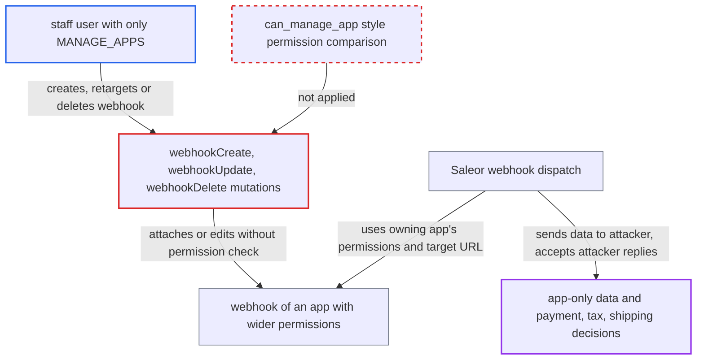

# MANAGE_APPS staff can create or retarget webhooks of apps with wider permissions

| Field | Value |
|---|---|
| ID | `find_01Y4StAdcVxLZSP9ah2Mmzv4` |
| Severity | **High** |
| Status | open |
| CWE | CWE-269 — Privilege escalation |
| Created | 2026-10-27T21:21:28.911012Z |
| Claude Security | https://claude.ai/security/findings/find_01Y4StAdcVxLZSP9ah2Mmzv4 |

## Description

A staff user holding only `MANAGE_APPS` can attach, retarget or delete webhooks on apps that have wider permissions than their own. The attacker can then receive data they may not read, such as customer details, orders and gift card codes. They can also answer payment, tax and shipping requests, which can complete orders without payment. The webhook mutations `webhookCreate`, `webhookUpdate` and `webhookDelete` skip the `can_manage_app` permission comparison that other app mutations apply.

1. **staff attacker with only `MANAGE_APPS`** lists installed apps to pick one with wider permissions. The `apps` query shows each app's permissions and webhooks, including `targetUrl`, `secretKey` and `customHeaders`, so the attacker can find a payment app or an app with `MANAGE_USERS`.
2. **staff attacker** calls `webhookCreate` with `input.app` set to the chosen app, or `webhookUpdate` to change `targetUrl` of an existing webhook. `WebhookCreate` accepts any app ID from a staff user and checks only `removed_at` and `is_active`. `WebhookUpdate.get_instance` limits the webhook to the caller's own app only when the caller is an app. ([`saleor/graphql/webhook/mutations/webhook_create.py:116-150`](https://github.com/cx-benchmark/saleor/blob/c982006cc04c77a97def93218dedac8d715eb041/saleor/graphql/webhook/mutations/webhook_create.py#L116-L150))
3. **the mutations `webhookCreate`, `webhookUpdate` and `webhookDelete`** accept the change on `MANAGE_APPS` alone. No check compares the requestor's permissions with the target app's permissions. `webhookDelete` limits access only for app callers. ([`saleor/graphql/webhook/mutations/webhook_create.py:102-105`](https://github.com/cx-benchmark/saleor/blob/c982006cc04c77a97def93218dedac8d715eb041/saleor/graphql/webhook/mutations/webhook_create.py#L102-L105))
4. **Saleor webhook dispatch** selects the attacker's webhook for events because the owning app holds the needed permission. The webhook filter looks at the permissions of the app that owns the webhook, not at who created it. ([`saleor/webhook/utils.py:27-66`](https://github.com/cx-benchmark/saleor/blob/c982006cc04c77a97def93218dedac8d715eb041/saleor/webhook/utils.py#L27-L66))
5. **Saleor async transport** renders the subscription query with the owning app's permissions and sends the result to `target_url`. The attacker's server receives data the attacker could not query with their own permissions. ([`saleor/webhook/transport/asynchronous/transport.py:129-148`](https://github.com/cx-benchmark/saleor/blob/c982006cc04c77a97def93218dedac8d715eb041/saleor/webhook/transport/asynchronous/transport.py#L129-L148))
6. **Saleor sync transport** sends transaction, tax and shipping requests to the retargeted webhook and uses the reply. For a payment app, `trigger_transaction_request` picks the app's first matching webhook, so the attacker's server can answer, for example, with `CHARGE_SUCCESS`. ([`saleor/webhook/transport/synchronous/transport.py:450-470`](https://github.com/cx-benchmark/saleor/blob/c982006cc04c77a97def93218dedac8d715eb041/saleor/webhook/transport/synchronous/transport.py#L450-L470))

## Assessment

The attacker is a staff user whose only permission is `MANAGE_APPS`. No victim action is needed. The attack works in any deployment that has at least one installed app with permissions the staff user lacks. There are three ways in. The attacker can create a webhook on such an app with `webhookCreate`. They can retarget an existing webhook, for example a payment app's, with `webhookUpdate`. They can also disable or remove other apps' webhooks with `webhookDelete`.

Impact: The attacker receives a continuous feed of data that any installed app may read, such as customer PII including private metadata, orders, gift card codes and staff accounts. By taking over a payment, tax or shipping app's synchronous webhook, they can set transaction results, tax amounts and shipping prices, so orders can complete without payment. They can read the webhook's `secretKey` and `Authorization*` custom headers, which lets them forward traffic to the real app unnoticed. Deleting or deactivating webhooks breaks the integrations that depend on them.

## Recommendation

(1) `webhookCreate`, `webhookUpdate` and `webhookDelete` authorize on `MANAGE_APPS` alone and never compare the requestor's permissions with the target app's. Other app mutations do this comparison.

Fix criteria: A staff requestor can create, modify or delete a webhook of an app only if they hold all of that app's permissions, with superusers excepted. This is the same rule as `can_manage_app` and `ensure_can_manage_permissions` used by `appTokenCreate` and `appUpdate`. A `MANAGE_APPS`-only staff user gets an `OUT_OF_SCOPE_APP`-style error from `webhookCreate` with `input.app` set to an app holding `MANAGE_USERS`. The same user gets that error from `webhookUpdate` and `webhookDelete` on that app's webhook. An app managing its own webhooks is unaffected.

(2) `eventDeliveryRetry` and the `webhook(id:)` query expose other apps' webhook `secretKey`, `customHeaders` and delivered payloads to any `MANAGE_APPS` holder. This allows transparent proxying after a retarget.

Fix criteria: Reading another app's webhook secrets, headers or payloads, and retrying its deliveries, follows the same wider-permission rule. Alternatively, the secret-bearing fields are withheld from requestors who do not hold the app's permissions. A `MANAGE_APPS`-only staff user cannot read `secretKey` or `customHeaders` of a webhook belonging to an app with permissions they lack.

## Evidence

**https://github.com/cx-benchmark/saleor**

- [`saleor/graphql/webhook/mutations/webhook_update.py:142-155`](https://github.com/cx-benchmark/saleor/blob/c982006cc04c77a97def93218dedac8d715eb041/saleor/graphql/webhook/mutations/webhook_update.py#L142-L155)
- [`saleor/graphql/webhook/mutations/webhook_create.py:116-150`](https://github.com/cx-benchmark/saleor/blob/c982006cc04c77a97def93218dedac8d715eb041/saleor/graphql/webhook/mutations/webhook_create.py#L116-L150)
- [`saleor/graphql/webhook/mutations/webhook_create.py:102-105`](https://github.com/cx-benchmark/saleor/blob/c982006cc04c77a97def93218dedac8d715eb041/saleor/graphql/webhook/mutations/webhook_create.py#L102-L105)
- [`saleor/graphql/webhook/mutations/webhook_delete.py:60-79`](https://github.com/cx-benchmark/saleor/blob/c982006cc04c77a97def93218dedac8d715eb041/saleor/graphql/webhook/mutations/webhook_delete.py#L60-L79)
- [`saleor/graphql/app/mutations/app_token_create.py:60-70`](https://github.com/cx-benchmark/saleor/blob/c982006cc04c77a97def93218dedac8d715eb041/saleor/graphql/app/mutations/app_token_create.py#L60-L70)
- [`saleor/graphql/account/utils.py:101-106`](https://github.com/cx-benchmark/saleor/blob/c982006cc04c77a97def93218dedac8d715eb041/saleor/graphql/account/utils.py#L101-L106)
- [`saleor/webhook/utils.py:27-66`](https://github.com/cx-benchmark/saleor/blob/c982006cc04c77a97def93218dedac8d715eb041/saleor/webhook/utils.py#L27-L66)
- [`saleor/webhook/transport/asynchronous/transport.py:129-148`](https://github.com/cx-benchmark/saleor/blob/c982006cc04c77a97def93218dedac8d715eb041/saleor/webhook/transport/asynchronous/transport.py#L129-L148)
- [`saleor/webhook/transport/synchronous/transport.py:450-470`](https://github.com/cx-benchmark/saleor/blob/c982006cc04c77a97def93218dedac8d715eb041/saleor/webhook/transport/synchronous/transport.py#L450-L470)

