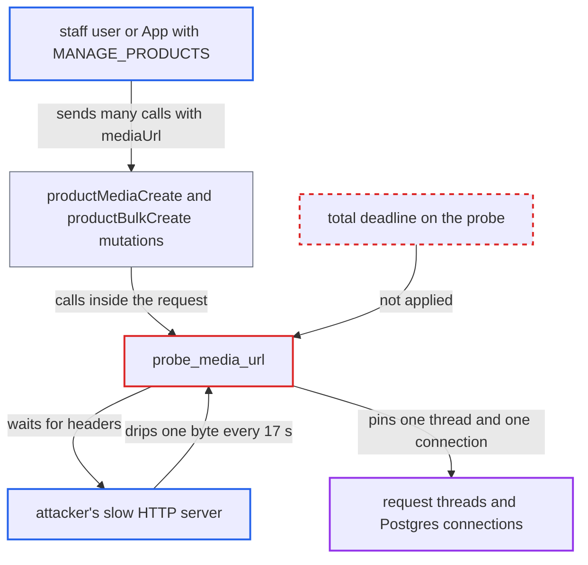

# Media URL probe runs in the web request with no time limit; slow header drip pins request threads and DB connections

| Field | Value |
|---|---|
| ID | `find_01MbQrRuGGJ5SnvHtEAcU6vR` |
| Severity | **High** |
| Status | open |
| CWE | CWE-400 — Uncontrolled resource consumption |
| Created | 2026-10-27T21:59:17.397681Z |
| Claude Security | https://claude.ai/security/findings/find_01MbQrRuGGJ5SnvHtEAcU6vR |

## Description

A staff user or App with `MANAGE_PRODUCTS` can make the Saleor API unavailable to storefront and dashboard users, and to anything else sharing its database. No data is read or changed. The attacker points media URLs at a server that sends its response very slowly. `probe_media_url` has only a per-read socket timeout and no total deadline, so each request keeps a thread and a database connection open.

1. **attacker** runs a public HTTP server that answers very slowly. It sends the status line or headers one byte every \~17 s, or loops `100 Continue` interim responses, so each socket read finishes inside the 18 s read timeout.
2. **attacker** sends many concurrent `productMediaCreate` or `productBulkCreate` calls to `/graphql/`. Each call gives a `mediaUrl` that points at the attacker's server, and the caller needs `MANAGE_PRODUCTS`. ([`saleor/graphql/product/mutations/product/product_media_create.py:92-114`](https://github.com/cx-benchmark/saleor/blob/c982006cc04c77a97def93218dedac8d715eb041/saleor/graphql/product/mutations/product/product_media_create.py#L92-L114))
3. **the mutation `productMediaCreate`** loads the product and opens the request's database connection. Authentication and `get_node_or_error` run first, and with the default `DB_CONN_MAX_AGE=0` the connection stays open until the view returns. ([`saleor/graphql/product/mutations/product/product_media_create.py:92-114`](https://github.com/cx-benchmark/saleor/blob/c982006cc04c77a97def93218dedac8d715eb041/saleor/graphql/product/mutations/product/product_media_create.py#L92-L114))
4. **the function `probe_media_url`** sends a streamed `GET` to the attacker's URL and waits for the headers. It passes only `timeout=settings.COMMON_REQUESTS_TIMEOUT`, which is `(2, 18)`, a connect timeout plus a per-read timeout, so every received byte restarts the 18 s wait and nothing limits the total time. ([`saleor/graphql/product/utils.py:90-108`](https://github.com/cx-benchmark/saleor/blob/c982006cc04c77a97def93218dedac8d715eb041/saleor/graphql/product/utils.py#L90-L108))
5. **the mutation `productBulkCreate`** probes every media URL one after another in the same request. This multiplies how long a single request is held. ([`saleor/graphql/product/bulk_mutations/product_bulk_create.py:468-475`](https://github.com/cx-benchmark/saleor/blob/c982006cc04c77a97def93218dedac8d715eb041/saleor/graphql/product/bulk_mutations/product_bulk_create.py#L468-L475))
6. **the ASGI handler** cannot free the blocked thread when the client disconnects. A disconnect cancels only the asyncio task, so the thread running `probe_media_url` keeps blocking and keeps its database connection. ([`saleor/asgi/asgi_handler.py:84-115`](https://github.com/cx-benchmark/saleor/blob/c982006cc04c77a97def93218dedac8d715eb041/saleor/asgi/asgi_handler.py#L84-L115))
7. **the server** runs out of request threads and database connections. Concurrent requests are not capped, so the attacker can exhaust the shared database's connection limit and the web pods' threads for as long as the slow response continues.

## Assessment

The attacker is a staff user or App with `MANAGE_PRODUCTS`. They run a public HTTP server that sends the status line or headers one byte every \~17 s, or repeated `100 Continue` interim responses. They then send many concurrent `productMediaCreate` calls, or `productBulkCreate` calls with many media URLs, to the public `/graphql/` endpoint. Default settings are enough. The IP filter does not block public hosts. The report assumes `requests-hardened` 1.3.0, `requests` 2.34.2 and `urllib3` 2.8.0 add IP filtering and a default per-read timeout but no total request deadline.

Impact: The attacker can exhaust the shared database's connection limit and the web pods' threads for as long as the slow response continues. The API is then denied to all storefront and dashboard users, and to anything else using that database. No data is read or modified.

## Recommendation

`probe_media_url` makes an outbound request to a caller-chosen host inside the web request. Its only protection is a per-read socket timeout with no overall deadline, so a slow server can hold the request thread and its DB connection indefinitely.

Fix criteria: Each media-URL probe, covering connect, status line, interim responses and headers, completes or fails within a fixed total wall-clock budget, however slowly the remote server sends bytes. Alternatively, the probe is moved out of the request path. Tested against a server that sends one header byte every few seconds and one that loops `100 Continue`, `productMediaCreate` returns a validation error within the budget, and the request thread and DB connection are released. `productBulkCreate` also keeps its total probing time bounded.

## Evidence

**https://github.com/cx-benchmark/saleor**

- [`saleor/graphql/product/utils.py:90-108`](https://github.com/cx-benchmark/saleor/blob/c982006cc04c77a97def93218dedac8d715eb041/saleor/graphql/product/utils.py#L90-L108)
- [`saleor/graphql/product/mutations/product/product_media_create.py:92-114`](https://github.com/cx-benchmark/saleor/blob/c982006cc04c77a97def93218dedac8d715eb041/saleor/graphql/product/mutations/product/product_media_create.py#L92-L114)
- [`saleor/graphql/product/bulk_mutations/product_bulk_create.py:468-475`](https://github.com/cx-benchmark/saleor/blob/c982006cc04c77a97def93218dedac8d715eb041/saleor/graphql/product/bulk_mutations/product_bulk_create.py#L468-L475)
- [`saleor/settings.py:1155-1158`](https://github.com/cx-benchmark/saleor/blob/c982006cc04c77a97def93218dedac8d715eb041/saleor/settings.py#L1155-L1158)
- [`saleor/asgi/asgi_handler.py:84-115`](https://github.com/cx-benchmark/saleor/blob/c982006cc04c77a97def93218dedac8d715eb041/saleor/asgi/asgi_handler.py#L84-L115)
- [`saleor/app/installation_utils.py:78-113`](https://github.com/cx-benchmark/saleor/blob/c982006cc04c77a97def93218dedac8d715eb041/saleor/app/installation_utils.py#L78-L113)

