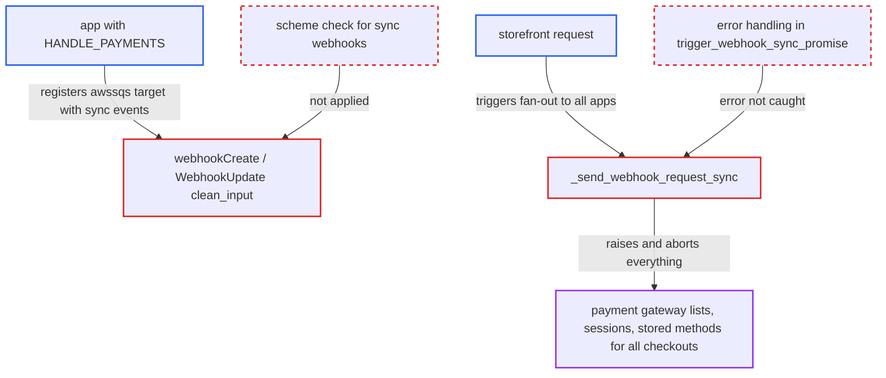

# Non-HTTP sync webhook target raises uncaught error, letting one app break store-wide payment discovery

| Field | Value |
|---|---|
| ID | `find_01YPFkar8o3ECvfTogzcui5i` |
| Severity | **High** |
| Status | open |
| CWE | CWE-248 — Uncaught exception |
| Created | 2026-10-27T21:28:08.782017Z |
| Claude Security | https://claude.ai/security/findings/find_01YPFkar8o3ECvfTogzcui5i |

## Description

An installed app holding `HANDLE_PAYMENTS` can make payment-gateway discovery, `paymentGatewayInitialize` and `storedPaymentMethods` fail for every checkout and customer in every channel. Storefronts then cannot present or start payment. The cause is that a webhook with an `awssqs://` or `gcpubsub://` `target_url` is accepted for synchronous events, and `_send_webhook_request_sync` raises an uncaught `ValueError`.

1. **malicious or compromised app** creates a webhook with a non-HTTP target and sync events. It calls `webhookCreate` with `syncEvents` of `PAYMENT_LIST_GATEWAYS` and `PAYMENT_GATEWAY_INITIALIZE_SESSION` and a `targetUrl` such as `awssqs://sqs.us-east-1.amazonaws.com/1/q`, and no check rejects the combination. ([`saleor/graphql/webhook/mutations/webhook_create.py:110-197`](https://github.com/cx-benchmark/saleor/blob/c982006cc04c77a97def93218dedac8d715eb041/saleor/graphql/webhook/mutations/webhook_create.py#L110-L197))
2. **`WebhookURLField`** accepts the `awssqs` scheme. The field allows `awssqs` and `gcpubsub` schemes for every webhook, whether or not it subscribes to synchronous events. ([`saleor/webhook/models.py:12-15`](https://github.com/cx-benchmark/saleor/blob/c982006cc04c77a97def93218dedac8d715eb041/saleor/webhook/models.py#L12-L15))
3. **storefront request** asks for `checkout.availablePaymentGateways` or calls `paymentGatewayInitialize` without `paymentGateways`. The plugin sends the sync event to every subscribed app, including the malicious one, and no victim action is needed. ([`saleor/plugins/webhook/plugin.py:3338-3400`](https://github.com/cx-benchmark/saleor/blob/c982006cc04c77a97def93218dedac8d715eb041/saleor/plugins/webhook/plugin.py#L3338-L3400))
4. **`_send_webhook_request_sync`** raises `ValueError("Unknown webhook scheme")`. It raises instead of returning a failed response, because the synchronous transport only speaks HTTP(S). ([`saleor/webhook/transport/synchronous/transport.py:117-127`](https://github.com/cx-benchmark/saleor/blob/c982006cc04c77a97def93218dedac8d715eb041/saleor/webhook/transport/synchronous/transport.py#L117-L127))
5. **`trigger_webhook_sync_promise`** lets the exception reject that webhook's promise. It has no error handling, whereas other delivery failures resolve to `None` and are skipped by callers. ([`saleor/webhook/transport/synchronous/transport.py:398-442`](https://github.com/cx-benchmark/saleor/blob/c982006cc04c77a97def93218dedac8d715eb041/saleor/webhook/transport/synchronous/transport.py#L398-L442))
6. **`WebhookPlugin`** re-raises the error from `Promise.all(...).get()`. One rejected promise aborts the whole operation and discards every other app's result. ([`saleor/plugins/webhook/plugin.py:3219-3266`](https://github.com/cx-benchmark/saleor/blob/c982006cc04c77a97def93218dedac8d715eb041/saleor/plugins/webhook/plugin.py#L3219-L3266))
7. **`availablePaymentGateways` field** fails and nulls the whole `checkout` object. The field is non-null, so the error propagates to its parent. ([`saleor/graphql/checkout/types.py:695-705`](https://github.com/cx-benchmark/saleor/blob/c982006cc04c77a97def93218dedac8d715eb041/saleor/graphql/checkout/types.py#L695-L705))

## Assessment

The attacker is an installed app that holds `HANDLE_PAYMENTS`. It uses its own token and attaches the webhook to itself. The report names no default setting. Every later storefront request that selects `checkout.availablePaymentGateways`, calls `paymentGatewayInitialize` without `paymentGateways`, or lists stored payment methods triggers the error. The same raise also breaks `SHIPPING_LIST_METHODS_FOR_CHECKOUT`, `CHECKOUT_FILTER_SHIPPING_METHODS` and, only in the deprecated `TAX_APP`-without-`taxAppId` tax configuration, `CHECKOUT_CALCULATE_TAXES`. For the two shipping events the required `MANAGE_SHIPPING` or `MANAGE_CHECKOUTS` permissions already let an app delete or exclude every shipping method, so those paths add little. The error recurs on every request, because no failure is cached and the circuit breaker is disabled by default (`BREAKER_BOARD_ENABLED=False`) and never registers it.

Impact: No data is read or changed. Payment-gateway discovery, multi-gateway session initialization and stored-payment-method listing fail for every checkout and customer in every channel, including other apps' gateways, for as long as the webhook exists. The `checkout` object resolves to null when `availablePaymentGateways` is selected, which blocks order placement for storefronts following the documented flow. A client calling `transactionInitialize` with a hard-coded gateway id still works.

## Recommendation

(1) Webhook creation and update (GraphQL mutations and manifest install) accept an `awssqs://` or `gcpubsub://` `target_url` for webhooks that subscribe to synchronous events, although the synchronous transport can only deliver over HTTP(S).

Fix criteria: Creating or updating a webhook whose events include any `WebhookEventSyncType` with a non-HTTP(S) `target_url` is rejected with a validation error in `webhookCreate`, `webhookUpdate` and manifest validation. As an app, attempt to create such a webhook: the mutation returns a `WebhookError` and no `Webhook` row is written.

(2) `_send_webhook_request_sync` raises for an unsupported scheme inside the storefront request. `trigger_webhook_sync_promise` and its fan-out callers do not catch the error, so one misconfigured or malicious app rejects the whole `Promise.all` batch.

Fix criteria: An unsupported scheme on an existing sync webhook is handled like any other failed delivery: it is recorded as FAILED, the promise resolves to `None`, and other apps' responses are still processed. Point an existing `PAYMENT_LIST_GATEWAYS` or `PAYMENT_GATEWAY_INITIALIZE_SESSION` webhook at `awssqs://...`: `checkout.availablePaymentGateways` and `paymentGatewayInitialize` still return the other apps' gateways.

## Evidence

**https://github.com/cx-benchmark/saleor**

- [`saleor/webhook/transport/synchronous/transport.py:117-127`](https://github.com/cx-benchmark/saleor/blob/c982006cc04c77a97def93218dedac8d715eb041/saleor/webhook/transport/synchronous/transport.py#L117-L127)
- [`saleor/webhook/transport/synchronous/transport.py:398-442`](https://github.com/cx-benchmark/saleor/blob/c982006cc04c77a97def93218dedac8d715eb041/saleor/webhook/transport/synchronous/transport.py#L398-L442)
- [`saleor/plugins/webhook/plugin.py:3338-3400`](https://github.com/cx-benchmark/saleor/blob/c982006cc04c77a97def93218dedac8d715eb041/saleor/plugins/webhook/plugin.py#L3338-L3400)
- [`saleor/plugins/webhook/plugin.py:3219-3266`](https://github.com/cx-benchmark/saleor/blob/c982006cc04c77a97def93218dedac8d715eb041/saleor/plugins/webhook/plugin.py#L3219-L3266)
- [`saleor/graphql/checkout/types.py:695-705`](https://github.com/cx-benchmark/saleor/blob/c982006cc04c77a97def93218dedac8d715eb041/saleor/graphql/checkout/types.py#L695-L705)
- [`saleor/webhook/models.py:12-15`](https://github.com/cx-benchmark/saleor/blob/c982006cc04c77a97def93218dedac8d715eb041/saleor/webhook/models.py#L12-L15)
- [`saleor/graphql/webhook/mutations/webhook_create.py:110-197`](https://github.com/cx-benchmark/saleor/blob/c982006cc04c77a97def93218dedac8d715eb041/saleor/graphql/webhook/mutations/webhook_create.py#L110-L197)
- [`saleor/plugins/webhook/plugin.py:2834-2880`](https://github.com/cx-benchmark/saleor/blob/c982006cc04c77a97def93218dedac8d715eb041/saleor/plugins/webhook/plugin.py#L2834-L2880)
- [`saleor/checkout/webhooks/list_shipping_methods.py:36-61`](https://github.com/cx-benchmark/saleor/blob/c982006cc04c77a97def93218dedac8d715eb041/saleor/checkout/webhooks/list_shipping_methods.py#L36-L61)

