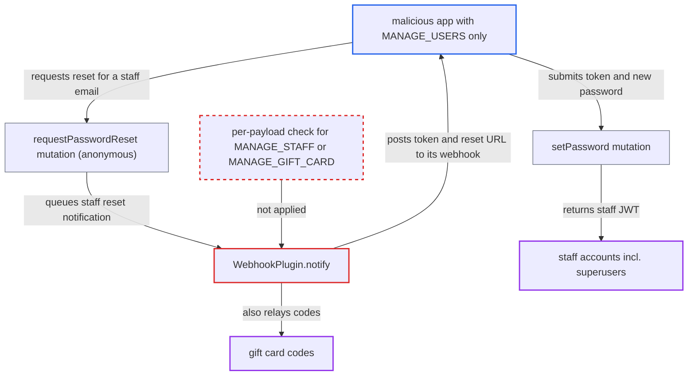

# NOTIFY_USER webhook delivers staff password-reset tokens to MANAGE_USERS-only apps

| Field | Value |
|---|---|
| ID | `find_01Wy5L1Y3MtiriGasKanxMCB` |
| Severity | **High** |
| Status | open |
| CWE | CWE-863 — Incorrect authorization |
| Created | 2026-10-27T21:16:16.426771Z |
| Claude Security | https://claude.ai/security/findings/find_01Wy5L1Y3MtiriGasKanxMCB |

## Description

An installed app that holds only the `MANAGE_USERS` permission can take over any staff account, superusers included. It can also read gift card codes. The app subscribes to the `NOTIFY_USER` webhook event and triggers a staff password reset itself. The cause is `WebhookPlugin.notify`, which sends every notification payload, including staff reset tokens and gift card codes, to `NOTIFY_USER` subscribers without checking any stronger permission.

1. **malicious app** creates a webhook for itself on `NOTIFY_USER`. The app calls `webhookCreate` with its own `targetUrl`. Any active app with `MANAGE_USERS` and a `NOTIFY_USER` (or `ANY`) webhook qualifies as a recipient, because the recipient filter uses only the one permission mapped to the event. ([`saleor/webhook/utils.py:27-67`](https://github.com/cx-benchmark/saleor/blob/c982006cc04c77a97def93218dedac8d715eb041/saleor/webhook/utils.py#L27-L67))
2. **malicious app** calls the anonymous `requestPasswordReset` with a staff email. No login is needed, so the app can trigger a staff token whenever it wants. It is limited only by `RESET_PASSWORD_LOCK_TIME`. ([`saleor/account/tasks.py:32-70`](https://github.com/cx-benchmark/saleor/blob/c982006cc04c77a97def93218dedac8d715eb041/saleor/account/tasks.py#L32-L70))
3. **the task `trigger_send_password_reset_notification`** builds a staff reset payload and passes it to `manager.notify`. With `staff=True`, `send_password_reset_notification` puts the raw `password_reset_token_generator` token and the `reset_url` into the `ACCOUNT_STAFF_RESET_PASSWORD` payload. ([`saleor/account/notifications.py:42-68`](https://github.com/cx-benchmark/saleor/blob/c982006cc04c77a97def93218dedac8d715eb041/saleor/account/notifications.py#L42-L68))
4. **the plugin `WebhookPlugin.notify`** posts the whole payload to every `NOTIFY_USER` webhook. It checks no permission per notification. `NOTIFY_USER` needs only `MANAGE_USERS`, while the dedicated `STAFF_SET_PASSWORD_REQUESTED` event for the same token needs `MANAGE_STAFF`. ([`saleor/plugins/webhook/plugin.py:2210-2235`](https://github.com/cx-benchmark/saleor/blob/c982006cc04c77a97def93218dedac8d715eb041/saleor/plugins/webhook/plugin.py#L2210-L2235))
5. **malicious app** calls `setPassword` with the staff email, the received token and a new password. `setPassword` accepts the token for staff users and sets the password. The app then gets a JWT with the full permissions of that staff account. ([`saleor/graphql/account/mutations/authentication/set_password.py:84-124`](https://github.com/cx-benchmark/saleor/blob/c982006cc04c77a97def93218dedac8d715eb041/saleor/graphql/account/mutations/authentication/set_password.py#L84-L124))

## Assessment

The attacker is the operator of a malicious or compromised installed app that holds `MANAGE_USERS` but not `MANAGE_STAFF`. The app needs only its own app token. It creates a `NOTIFY_USER` webhook with `webhookCreate` and triggers a staff reset itself, so no victim action is needed. A second way to get a staff token is `staffCreate` with a `redirectUrl`, which sends an `ACCOUNT_SET_STAFF_PASSWORD` notification through the same channel. Gift card codes (`SEND_GIFT_CARD`) reach the app the same way, for example after `giftCardResend`. The `WebhookPlugin` is built in and always active. The report says the behaviour appears inherited from upstream Saleor.

Impact: The attacker takes over any staff account, including superusers, and gains every permission that account holds. That means reading customer, order, app and configuration data and changing orders, payments, permissions and apps. The attacker can also disable users, apps and channels. Gift card codes received on the same channel can be spent.

## Recommendation

`WebhookPlugin.notify` sends every notify payload to all `NOTIFY_USER` webhooks, which are authorized only by `MANAGE_USERS`. Payloads with staff password-reset and set-password tokens and gift card codes therefore reach apps that lack `MANAGE_STAFF` or `MANAGE_GIFT_CARD`.

Fix criteria: An app receives a notify payload only if it holds the permission that protects the contents: `MANAGE_STAFF` for the `AdminNotifyEvent` staff password events and `MANAGE_GIFT_CARD` for `SEND_GIFT_CARD`. Alternatively, secrets are no longer carried in `NOTIFY_USER` payloads. Check: an app with only `MANAGE_USERS` and a `NOTIFY_USER` webhook receives no payload with a usable staff token after `requestPasswordReset` for a staff email or after `staffCreate` with `redirectUrl`. It also receives no gift card code after `giftCardResend`.

## Evidence

**https://github.com/cx-benchmark/saleor**

- [`saleor/plugins/webhook/plugin.py:2210-2235`](https://github.com/cx-benchmark/saleor/blob/c982006cc04c77a97def93218dedac8d715eb041/saleor/plugins/webhook/plugin.py#L2210-L2235)
- [`saleor/webhook/event_types.py:711-714`](https://github.com/cx-benchmark/saleor/blob/c982006cc04c77a97def93218dedac8d715eb041/saleor/webhook/event_types.py#L711-L714)
- [`saleor/webhook/utils.py:27-67`](https://github.com/cx-benchmark/saleor/blob/c982006cc04c77a97def93218dedac8d715eb041/saleor/webhook/utils.py#L27-L67)
- [`saleor/account/notifications.py:42-68`](https://github.com/cx-benchmark/saleor/blob/c982006cc04c77a97def93218dedac8d715eb041/saleor/account/notifications.py#L42-L68)
- [`saleor/account/tasks.py:32-70`](https://github.com/cx-benchmark/saleor/blob/c982006cc04c77a97def93218dedac8d715eb041/saleor/account/tasks.py#L32-L70)
- [`saleor/graphql/account/mutations/authentication/set_password.py:84-124`](https://github.com/cx-benchmark/saleor/blob/c982006cc04c77a97def93218dedac8d715eb041/saleor/graphql/account/mutations/authentication/set_password.py#L84-L124)
- [`saleor/graphql/account/resolvers.py:87-110`](https://github.com/cx-benchmark/saleor/blob/c982006cc04c77a97def93218dedac8d715eb041/saleor/graphql/account/resolvers.py#L87-L110)
- [`saleor/giftcard/notifications.py:26-55`](https://github.com/cx-benchmark/saleor/blob/c982006cc04c77a97def93218dedac8d715eb041/saleor/giftcard/notifications.py#L26-L55)

