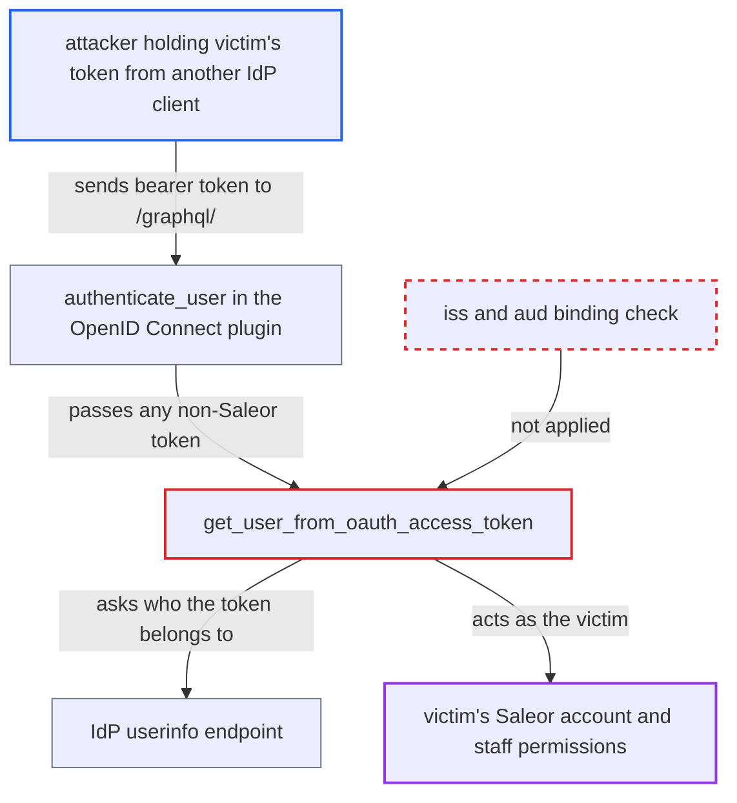

# OIDC bearer access tokens accepted without audience binding (token substitution)

| Field | Value |
|---|---|
| ID | `find_014Aq3iMFfwq1anWw5f7r6hK` |
| Severity | **High** |
| Status | open |
| CWE | CWE-345 — Insufficient verification of data authenticity |
| Created | 2026-10-27T21:17:54.311368Z |
| Claude Security | https://claude.ai/security/findings/find_014Aq3iMFfwq1anWw5f7r6hK |

## Description

An attacker who holds a victim's access token for any other app at the same identity provider can use it to act as that victim on the Saleor API. If the victim is staff, the attacker also gets the victim's staff permissions. The OpenID Connect plugin must have `user_info_url` and `json_web_key_set_url` set. The cause is that `get_user_from_oauth_access_token` never checks that the token was issued to this Saleor deployment.

1. **Attacker** obtains the victim's access token through another OAuth client at the same IdP. The attacker runs or has compromised that client, for example one registered at Google. The victim signs in to it, and the attacker receives the victim's access token.
2. **Attacker** sends the token as `Authorization: Bearer <token>` to `/graphql/`. `PluginBackend` runs `manager.authenticate_user` for any bearer token that `JSONWebTokenBackend` does not recognise as a Saleor token. ([`saleor/core/auth_backend.py:107-122`](https://github.com/cx-benchmark/saleor/blob/c982006cc04c77a97def93218dedac8d715eb041/saleor/core/auth_backend.py#L107-L122))
3. **the plugin method `authenticate_user`** passes the token to `get_user_from_oauth_access_token`. This happens whenever `use_oauth_access_token` is true, which is the case once `user_info_url` and `json_web_key_set_url` are configured. ([`saleor/plugins/openid_connect/plugin.py:537-574`](https://github.com/cx-benchmark/saleor/blob/c982006cc04c77a97def93218dedac8d715eb041/saleor/plugins/openid_connect/plugin.py#L537-L574))
4. **the function `get_user_from_oauth_access_token`** accepts the token without checking who it was issued to. An opaque token is accepted as soon as the IdP userinfo endpoint answers. A JWT only has its signature and time claims checked, because `get_decoded_token` passes no `claims_options`, so `iss` and `aud` are skipped. ([`saleor/plugins/openid_connect/utils.py:284-332`](https://github.com/cx-benchmark/saleor/blob/c982006cc04c77a97def93218dedac8d715eb041/saleor/plugins/openid_connect/utils.py#L284-L332))
5. **the function `validate` on the token claims** checks only the time claims of a JWT access token. The token is then sent to userinfo, which supplies the identity. ([`saleor/plugins/openid_connect/utils.py:195-215`](https://github.com/cx-benchmark/saleor/blob/c982006cc04c77a97def93218dedac8d715eb041/saleor/plugins/openid_connect/utils.py#L195-L215))
6. **the function `get_or_create_user_from_payload`** selects the victim's own Saleor account. It looks the account up by the userinfo `sub` stored for that provider, and `is_active` is the only check. ([`saleor/plugins/openid_connect/utils.py:440-512`](https://github.com/cx-benchmark/saleor/blob/c982006cc04c77a97def93218dedac8d715eb041/saleor/plugins/openid_connect/utils.py#L440-L512))
7. **the plugin code that handles `audience`** compares the configured `audience` with the token's `aud` only to decide on scope permissions. A token with a foreign or missing `aud` still authenticates. A victim whose email is in `staff_user_domains` still gets default-group and group permissions. ([`saleor/plugins/openid_connect/utils.py:236-263`](https://github.com/cx-benchmark/saleor/blob/c982006cc04c77a97def93218dedac8d715eb041/saleor/plugins/openid_connect/utils.py#L236-L263))

## Assessment

The attacker runs, or has compromised, another OAuth client at the IdP that Saleor trusts. Anyone can register a Google client, and a multi-app Auth0, Okta or Keycloak tenant also qualifies. The victim signs in to the attacker's app and so hands over an access token. The plugin needs `user_info_url` and `json_web_key_set_url` configured, and the IdP's userinfo endpoint must accept tokens issued to its other clients. The report assumes authlib 1.7.2, which skips `iss` and `aud` validation when no `claims_options` are given. `/graphql/` is reachable from the internet by anonymous users. The victim must take part by signing in to the attacker's app.

Impact: The attacker acts as the victim on the Saleor API while the token is valid, and for up to the one-hour userinfo cache. They can read and change the victim's personal data, addresses, orders and checkouts. If the victim is staff, the attacker also gets the victim's staff group permissions over store data. This applies when the email domain is in `staff_user_domains`, or when the stored staff status is kept with scope permissions on. The impact stays within the victim's own privileges.

## Recommendation

(1) `get_user_from_oauth_access_token_in_jwt_format` and `get_decoded_token` accept signed JWT access tokens without binding them to this Saleor deployment. There is no `iss` check against the configured issuer and no `aud` check against the configured audience or `client_id`. The `audience` setting only gates scope permissions.

Fix criteria: A JWT access token authenticates only if its `iss` equals the configured provider and its `aud` contains the configured Saleor audience, with `exp` required. A correctly signed token from the same IdP with a different or missing `aud` makes `authenticate_user` return no user.

(2) Opaque bearer tokens are authenticated by the userinfo response alone. That response cannot show which client the token was issued to, so tokens granted to other clients of the IdP are accepted.

Fix criteria: An opaque access token authenticates only after its client or audience binding is verified, for example by RFC 7662 introspection or a provider token-info check of `client_id` or `aud`. Otherwise opaque-token authentication stays off unless the operator explicitly enables it. A valid opaque token issued to another client at the IdP no longer authenticates a Saleor user.

## Evidence

**https://github.com/cx-benchmark/saleor**

- [`saleor/plugins/openid_connect/utils.py:284-332`](https://github.com/cx-benchmark/saleor/blob/c982006cc04c77a97def93218dedac8d715eb041/saleor/plugins/openid_connect/utils.py#L284-L332)
- [`saleor/plugins/openid_connect/utils.py:195-215`](https://github.com/cx-benchmark/saleor/blob/c982006cc04c77a97def93218dedac8d715eb041/saleor/plugins/openid_connect/utils.py#L195-L215)
- [`saleor/plugins/openid_connect/utils.py:236-263`](https://github.com/cx-benchmark/saleor/blob/c982006cc04c77a97def93218dedac8d715eb041/saleor/plugins/openid_connect/utils.py#L236-L263)
- [`saleor/plugins/openid_connect/utils.py:403-406`](https://github.com/cx-benchmark/saleor/blob/c982006cc04c77a97def93218dedac8d715eb041/saleor/plugins/openid_connect/utils.py#L403-L406)
- [`saleor/plugins/openid_connect/plugin.py:537-574`](https://github.com/cx-benchmark/saleor/blob/c982006cc04c77a97def93218dedac8d715eb041/saleor/plugins/openid_connect/plugin.py#L537-L574)
- [`saleor/core/auth_backend.py:107-122`](https://github.com/cx-benchmark/saleor/blob/c982006cc04c77a97def93218dedac8d715eb041/saleor/core/auth_backend.py#L107-L122)
- [`saleor/plugins/openid_connect/utils.py:440-512`](https://github.com/cx-benchmark/saleor/blob/c982006cc04c77a97def93218dedac8d715eb041/saleor/plugins/openid_connect/utils.py#L440-L512)

