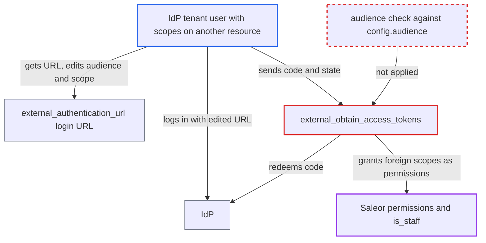

# OIDC code-flow login trusts token-response scopes without audience binding

| Field | Value |
|---|---|
| ID | `find_0123aW4oMVBTkWAHTdqMchGu` |
| Severity | **High** |
| Status | open |
| CWE | CWE-863 — Incorrect authorization |
| Created | 2026-10-27T22:04:39.664346Z |
| Claude Security | https://claude.ai/security/findings/find_0123aW4oMVBTkWAHTdqMchGu |

## Description

A user of the shared identity provider (IdP) tenant who holds `saleor:*` scopes on another resource, such as a staging Saleor, but has no rights on this instance can get those permissions here, up to full admin. This needs `use_oauth_scope_permissions` on or a staff email domain in `staff_user_domains`, and an IdP that lets the client request another audience. The code-flow login in `external_obtain_access_tokens` trusts the token response's `scope` without checking the token's audience.

1. **attacker** requests the login URL from `externalAuthenticationUrl`. `external_authentication_url` puts `audience` only in the browser-side authorization URL and signs only `redirectUri` into `state`. ([`saleor/plugins/openid_connect/plugin.py:399-413`](https://github.com/cx-benchmark/saleor/blob/c982006cc04c77a97def93218dedac8d715eb041/saleor/plugins/openid_connect/plugin.py#L399-L413))
2. **attacker** edits `audience` and `scope` in the URL and logs in at the IdP. The edited front-channel request is not integrity-protected, so the IdP sees the other resource's audience and the `saleor:*` scopes the attacker holds there. ([`saleor/plugins/openid_connect/plugin.py:399-413`](https://github.com/cx-benchmark/saleor/blob/c982006cc04c77a97def93218dedac8d715eb041/saleor/plugins/openid_connect/plugin.py#L399-L413))
3. **attacker** sends the returned code and `state` to `externalObtainAccessTokens`. Saleor redeems the code with its own client secret, so the IdP issues the token response as if Saleor had asked for it.
4. **the method `external_obtain_access_tokens`** reads `scope` from the raw token response. It does this when `use_oauth_scope_permissions` is on or the user's email domain is in `staff_user_domains`, and it never decodes the access token or compares its `aud` with `config.audience`. ([`saleor/plugins/openid_connect/plugin.py:349-364`](https://github.com/cx-benchmark/saleor/blob/c982006cc04c77a97def93218dedac8d715eb041/saleor/plugins/openid_connect/plugin.py#L349-L364))
5. **the function `get_saleor_permissions_qs_from_scope`** maps every `saleor:<codename>` entry to a Saleor permission. There is no filter by resource or issuer, so scopes issued for another resource count the same. ([`saleor/plugins/openid_connect/utils.py:763-779`](https://github.com/cx-benchmark/saleor/blob/c982006cc04c77a97def93218dedac8d715eb041/saleor/plugins/openid_connect/utils.py#L763-L779))
6. **the method `external_obtain_access_tokens`** adds the user to the default staff group, saves `is_staff=True` and puts the permissions into the access token it mints. This happens when the mapped permissions are non-empty or the scope contains `saleor:staff`. ([`saleor/plugins/openid_connect/plugin.py:349-364`](https://github.com/cx-benchmark/saleor/blob/c982006cc04c77a97def93218dedac8d715eb041/saleor/plugins/openid_connect/plugin.py#L349-L364))
7. **the function `get_user_from_access_payload`** accepts that token on every request. It sets the user's effective permissions and `is_staff` from the token's `permissions` claim, so the foreign scopes take effect. ([`saleor/core/jwt.py:152-169`](https://github.com/cx-benchmark/saleor/blob/c982006cc04c77a97def93218dedac8d715eb041/saleor/core/jwt.py#L152-L169))
8. **the method `external_refresh`** grants the foreign scopes again on every refresh. `external_refresh` and `get_and_update_user_permissions` map the refreshed response's `scope` to permissions with the same missing audience check. ([`saleor/plugins/openid_connect/plugin.py:460-488`](https://github.com/cx-benchmark/saleor/blob/c982006cc04c77a97def93218dedac8d715eb041/saleor/plugins/openid_connect/plugin.py#L460-L488))

## Assessment

The attacker is a user of the shared IdP tenant who holds `saleor:*` grants on another resource, for example admin of a staging Saleor, and has no rights on this instance. They use the public `externalAuthenticationUrl` with a registered `redirectUri`, then the public `externalObtainAccessTokens`. The plugin must have `use_oauth_scope_permissions` on, or the user's email domain must be in `staff_user_domains`. The IdP must let this client request another API's audience in a user-delegated code flow and report the granted scopes in the token response's `scope`. This is how Auth0 RBAC behaves. IdPs that fix the audience per authorization-server URL are not affected. The report also assumes authlib 1.7.2 returns the token-response JSON unchanged from `fetch_token`, and it has not verified this because authlib is not installed in the sandbox.

Impact: The attacker gets a Saleor access token with every Saleor permission they hold on the other resource, up to `MANAGE_STAFF` and the rest of the admin set. They also get a saved `is_staff` flag and default staff group membership, and refresh keeps granting the scopes. With an admin grant elsewhere, this is full administrative control of this instance's data and configuration. The gain is limited to the scopes the IdP grants the attacker on the other resource.

## Recommendation

The code-flow login and refresh paths treat the token response's `scope` as a statement about this Saleor instance. They never check that the access token was issued for the configured `audience`, unlike the bearer path at `utils.py:238-251`. The audience is requested only through a front-channel parameter the user can change.

Fix criteria: Scope-derived permissions and staff status in `external_obtain_access_tokens` and `external_refresh` are applied only when the returned access token is verified as issued for the configured `audience`. That means decoding it against the JWKS and checking `aud`, or using introspection. A token whose audience differs or cannot be established yields no scope permissions. Verify this by redeeming a code whose token response carries `saleor:manage_staff` for a different audience. The resulting Saleor token must have no permissions, and the user must not be made staff.

## Evidence

**https://github.com/cx-benchmark/saleor**

- [`saleor/plugins/openid_connect/plugin.py:349-364`](https://github.com/cx-benchmark/saleor/blob/c982006cc04c77a97def93218dedac8d715eb041/saleor/plugins/openid_connect/plugin.py#L349-L364)
- [`saleor/plugins/openid_connect/plugin.py:399-413`](https://github.com/cx-benchmark/saleor/blob/c982006cc04c77a97def93218dedac8d715eb041/saleor/plugins/openid_connect/plugin.py#L399-L413)
- [`saleor/plugins/openid_connect/utils.py:238-251`](https://github.com/cx-benchmark/saleor/blob/c982006cc04c77a97def93218dedac8d715eb041/saleor/plugins/openid_connect/utils.py#L238-L251)
- [`saleor/plugins/openid_connect/plugin.py:460-488`](https://github.com/cx-benchmark/saleor/blob/c982006cc04c77a97def93218dedac8d715eb041/saleor/plugins/openid_connect/plugin.py#L460-L488)
- [`saleor/plugins/openid_connect/utils.py:763-779`](https://github.com/cx-benchmark/saleor/blob/c982006cc04c77a97def93218dedac8d715eb041/saleor/plugins/openid_connect/utils.py#L763-L779)
- [`saleor/core/jwt.py:152-169`](https://github.com/cx-benchmark/saleor/blob/c982006cc04c77a97def93218dedac8d715eb041/saleor/core/jwt.py#L152-L169)

