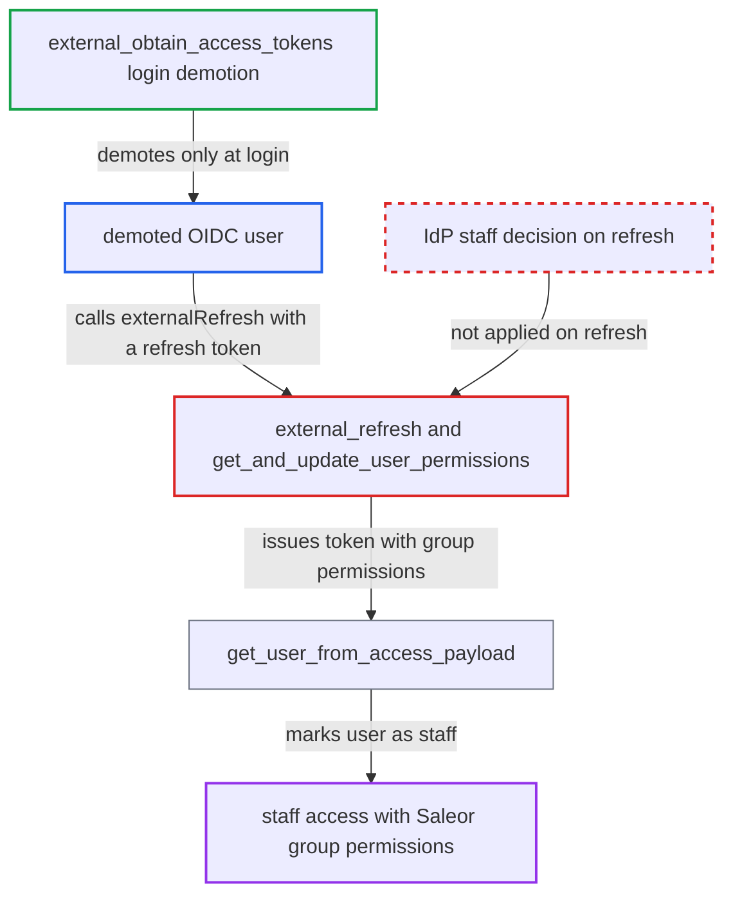

# OIDC externalRefresh ignores IdP staff revocation and restores group permissions

| Field | Value |
|---|---|
| ID | `find_01TeF2cuUyX3JGGkZqLKs4WH` |
| Severity | **High** |
| Status | open |
| CWE | CWE-269 — Improper privilege management |
| Created | 2026-10-27T21:45:21.727736Z |
| Claude Security | https://claude.ai/security/findings/find_01TeF2cuUyX3JGGkZqLKs4WH |

## Description

A user whom the identity provider (IdP) has demoted from staff can get staff access back with all the permissions of their Saleor groups. This needs `use_oauth_scope_permissions` on, an IdP account that still works, and a Saleor group with permissions. The refresh code `external_refresh` and `get_and_update_user_permissions` builds the new token from database groups and never re-applies the IdP's staff decision.

1. **the IdP** removes the user's staff role or Saleor scopes. The user keeps their IdP account and their Saleor group memberships, which the plugin does not remove.
2. **the demoted user** logs in again, or keeps an earlier refresh token. At login, `external_obtain_access_tokens` calls `update_is_staff(user, False)` and issues a token with `permissions: []`, but it leaves the groups in place. ([`saleor/plugins/openid_connect/plugin.py:349-364`](https://github.com/cx-benchmark/saleor/blob/c982006cc04c77a97def93218dedac8d715eb041/saleor/plugins/openid_connect/plugin.py#L349-L364))
3. **the demoted user** calls `externalRefresh` with any refresh token they hold. The refresh token can be the one returned by the demoting login itself. ([`saleor/plugins/openid_connect/plugin.py:415-475`](https://github.com/cx-benchmark/saleor/blob/c982006cc04c77a97def93218dedac8d715eb041/saleor/plugins/openid_connect/plugin.py#L415-L475))
4. **the function `get_and_update_user_permissions`** returns the user's database group permissions for the new token. It starts from `get_user_groups_permissions(user)` and only adds scope permissions. It does not check whether the IdP still marks the user as staff, and it never changes `is_staff`. ([`saleor/plugins/openid_connect/plugin.py:477-488`](https://github.com/cx-benchmark/saleor/blob/c982006cc04c77a97def93218dedac8d715eb041/saleor/plugins/openid_connect/plugin.py#L477-L488))
5. **the function `get_user_from_access_payload`** sets `is_staff = True` when the token is used. It does this whenever the token's `permissions` list is non-empty, whatever the database `is_staff` value says. ([`saleor/core/jwt.py:152-169`](https://github.com/cx-benchmark/saleor/blob/c982006cc04c77a97def93218dedac8d715eb041/saleor/core/jwt.py#L152-L169))
6. **the method `authenticate_user`** adds all group permissions to the request user. Because `user.is_staff` is now true, it calls `assign_staff_to_default_group_and_update_permissions`, which ORs in the group permissions again. ([`saleor/plugins/openid_connect/plugin.py:537-557`](https://github.com/cx-benchmark/saleor/blob/c982006cc04c77a97def93218dedac8d715eb041/saleor/plugins/openid_connect/plugin.py#L537-L557))

## Assessment

The attacker is an OIDC user whose Saleor staff role or scopes the IdP has removed. The deployment has `use_oauth_scope_permissions` on and refresh enabled (the default). The attacker keeps their IdP account and stays in a Saleor group that has permissions. They log in again, or reuse an earlier refresh token, and then call `externalRefresh(pluginId, input:{refreshToken})`. With only `staff_user_domains` configured, login does not demote a user whose domain was removed either. In that mode the refresh path gives nothing beyond login.

Impact: The demoted user keeps full staff access with every permission of the Saleor groups they still belong to. For staff groups this typically means reading and changing customer personal data and orders. With `MANAGE_STAFF` it means administration. Access ends if an admin removes those groups or deactivates the user, or if the IdP stops honouring the refresh token.

## Recommendation

`external_refresh` and `get_and_update_user_permissions` build the refreshed token's permissions from database groups. They do not re-apply the IdP staff decision that `external_obtain_access_tokens` enforces under `use_oauth_scope_permissions`. As a result, `get_user_from_access_payload` restores `is_staff` for a user the IdP has demoted.

Fix criteria: Under `use_oauth_scope_permissions`, `externalRefresh` uses the same staff determination as login (Saleor scopes, `saleor:staff` or a staff domain). When the IdP no longer marks the user as staff, the token carries no staff permissions and `is_staff` stays or becomes false. Test: after the IdP drops the Saleor scopes, both a fresh login and a later `externalRefresh` give `permissions: []`. The token is not authenticated as staff.

## Evidence

**https://github.com/cx-benchmark/saleor**

- [`saleor/plugins/openid_connect/plugin.py:477-488`](https://github.com/cx-benchmark/saleor/blob/c982006cc04c77a97def93218dedac8d715eb041/saleor/plugins/openid_connect/plugin.py#L477-L488)
- [`saleor/plugins/openid_connect/plugin.py:415-475`](https://github.com/cx-benchmark/saleor/blob/c982006cc04c77a97def93218dedac8d715eb041/saleor/plugins/openid_connect/plugin.py#L415-L475)
- [`saleor/plugins/openid_connect/plugin.py:349-364`](https://github.com/cx-benchmark/saleor/blob/c982006cc04c77a97def93218dedac8d715eb041/saleor/plugins/openid_connect/plugin.py#L349-L364)
- [`saleor/core/jwt.py:152-169`](https://github.com/cx-benchmark/saleor/blob/c982006cc04c77a97def93218dedac8d715eb041/saleor/core/jwt.py#L152-L169)
- [`saleor/plugins/openid_connect/plugin.py:537-557`](https://github.com/cx-benchmark/saleor/blob/c982006cc04c77a97def93218dedac8d715eb041/saleor/plugins/openid_connect/plugin.py#L537-L557)
- [`saleor/plugins/openid_connect/tests/test_plugin.py:766-830`](https://github.com/cx-benchmark/saleor/blob/c982006cc04c77a97def93218dedac8d715eb041/saleor/plugins/openid_connect/tests/test_plugin.py#L766-L830)

