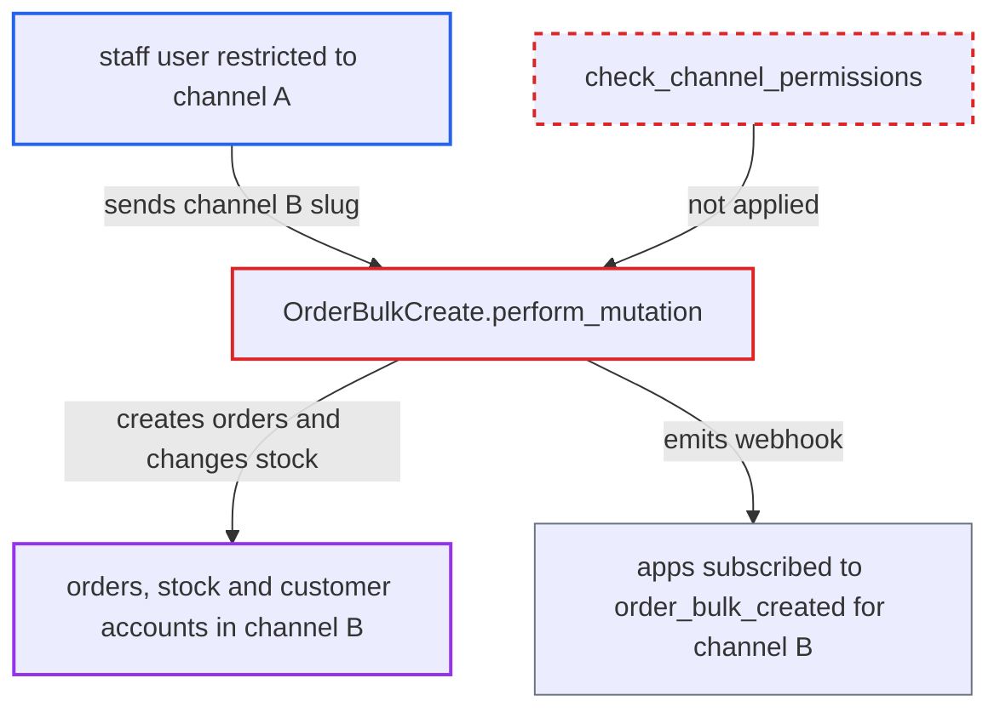

# orderBulkCreate ignores staff channel restrictions, letting restricted staff create orders in any channel

| Field | Value |
|---|---|
| ID | `find_01DtVJZP5oCXdGb8TqH2xWdo` |
| Severity | **High** |
| Status | open |
| CWE | CWE-862 — Missing authorization |
| Created | 2026-10-27T21:19:51.724648Z |
| Claude Security | https://claude.ai/security/findings/find_01DtVJZP5oCXdGb8TqH2xWdo |

## Description

A staff member whose permission group is restricted to one channel can still create orders in any other channel, up to 50 per call. The orders can carry fake payments, stock changes, customers and dates. The attacker needs the `MANAGE_ORDERS_IMPORT` permission. The mutation `OrderBulkCreate` never compares the target channel with the channels the requester may access.

1. **channel-restricted staff user** calls `orderBulkCreate` with another channel's slug. The user's group has `MANAGE_ORDERS_IMPORT` but `restricted_access_to_channels` limits it to channel A, and the user puts channel B's slug in `channel`. ([`saleor/graphql/order/bulk_mutations/order_bulk_create.py:685-692`](https://github.com/cx-benchmark/saleor/blob/c982006cc04c77a97def93218dedac8d715eb041/saleor/graphql/order/bulk_mutations/order_bulk_create.py#L685-L692))
2. **the mutation `OrderBulkCreate.perform_mutation`** accepts the request without any channel-access check. It never calls `cls.check_channel_permissions` and never compares the target channel with the requester's accessible channels. ([`saleor/graphql/order/bulk_mutations/order_bulk_create.py:2468-2519`](https://github.com/cx-benchmark/saleor/blob/c982006cc04c77a97def93218dedac8d715eb041/saleor/graphql/order/bulk_mutations/order_bulk_create.py#L2468-L2519))
3. **the lookup `get_instances_related_to_order`** loads the channel from the supplied slug. The only checks are that the channel exists and that `currency` matches. ([`saleor/graphql/order/bulk_mutations/order_bulk_create.py:1069-1075`](https://github.com/cx-benchmark/saleor/blob/c982006cc04c77a97def93218dedac8d715eb041/saleor/graphql/order/bulk_mutations/order_bulk_create.py#L1069-L1075))
4. **the mutation `OrderBulkCreate`** saves the orders and everything attached to them in channel B. It stores orders with chosen status, dates and customers, plus transactions, fulfillments that change `Stock.quantity`, invoices, notes, and gift card or voucher links, then emits the `order_bulk_created` webhook to apps subscribed for channel B. ([`saleor/graphql/order/bulk_mutations/order_bulk_create.py:2468-2519`](https://github.com/cx-benchmark/saleor/blob/c982006cc04c77a97def93218dedac8d715eb041/saleor/graphql/order/bulk_mutations/order_bulk_create.py#L2468-L2519))

## Assessment

The attacker is an authenticated staff user in a permission group that has `MANAGE_ORDERS_IMPORT` and has `restricted_access_to_channels` set, limited to channel A. They call `orderBulkCreate` with a `channel` slug for channel B (or any channel) and a matching `currency`. No victim action is needed. It works on the default configuration.

Impact: The attacker can persist fabricated orders in channels they are excluded from. The orders can have any status, historical dates, any customer (which shows them in that customer's account), and transactions that make them read as paid. Fulfillments can change stock in any warehouse, going negative with `stockUpdatePolicy: FORCE`. The attacker can also add invoices with their own external `url`, notes attributed to any user or app, and gift card or voucher links. Error messages reveal whether users, gift card codes and voucher codes exist, which is a minor leak. Negative stock can block legitimate sales, but this effect is limited. The permission is already privileged, so this is an escalation across channels, not from an unprivileged user.

## Recommendation

`OrderBulkCreate.perform_mutation` creates orders in a channel chosen by the caller without applying the per-group channel restriction (`check_channel_permissions`) that all other order mutations enforce.

Fix criteria: A staff requester can import only orders whose `channel` is in `get_user_accessible_channels`. Apps stay unrestricted, as in `check_channel_permissions`. Inputs for any other channel are rejected with a permission error, either for that order or for the whole batch, before any object is saved or any stock changes. A test with a channel-restricted staff client calling `orderBulkCreate` for a non-accessible channel slug confirms that no `Order`, `TransactionItem`, `Fulfillment` or `Stock` change occurs.

## Evidence

**https://github.com/cx-benchmark/saleor**

- [`saleor/graphql/order/bulk_mutations/order_bulk_create.py:2468-2519`](https://github.com/cx-benchmark/saleor/blob/c982006cc04c77a97def93218dedac8d715eb041/saleor/graphql/order/bulk_mutations/order_bulk_create.py#L2468-L2519)
- [`saleor/graphql/order/bulk_mutations/order_bulk_create.py:1069-1075`](https://github.com/cx-benchmark/saleor/blob/c982006cc04c77a97def93218dedac8d715eb041/saleor/graphql/order/bulk_mutations/order_bulk_create.py#L1069-L1075)
- [`saleor/graphql/order/bulk_mutations/order_bulk_create.py:685-692`](https://github.com/cx-benchmark/saleor/blob/c982006cc04c77a97def93218dedac8d715eb041/saleor/graphql/order/bulk_mutations/order_bulk_create.py#L685-L692)
- [`saleor/graphql/core/mutations.py:585-599`](https://github.com/cx-benchmark/saleor/blob/c982006cc04c77a97def93218dedac8d715eb041/saleor/graphql/core/mutations.py#L585-L599)

