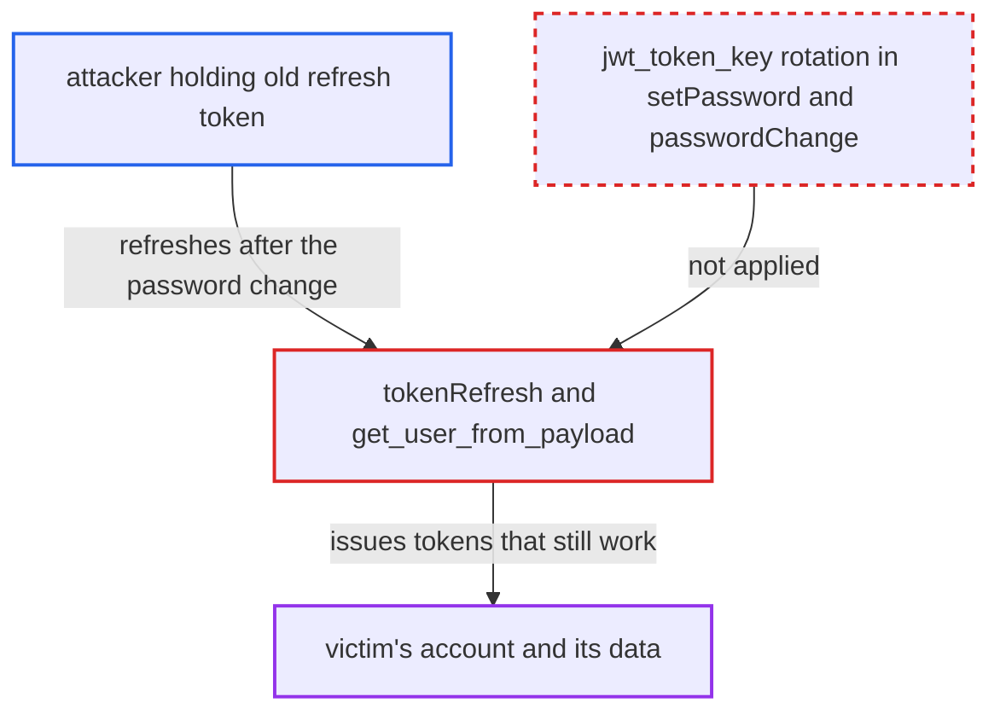

# Password reset and password change do not revoke existing JWT sessions

| Field | Value |
|---|---|
| ID | `find_01SjRu4vNTMWgzSkLX6DYWwi` |
| Severity | **High** |
| Status | open |
| CWE | CWE-613 — Insufficient Session Expiration |
| Created | 2026-10-27T21:22:03.241718Z |
| Claude Security | https://claude.ai/security/findings/find_01SjRu4vNTMWgzSkLX6DYWwi |

## Description

An attacker who already holds a victim's login tokens keeps full access to that account after the victim resets or changes the password. This lasts until the refresh token expires, 30 days by default. The attacker needs a valid refresh token, for example from a phished password or a stolen token. The cause is that `SetPassword._set_password_for_user` and `PasswordChange.perform_mutation` never change `jwt_token_key`, the value that ties tokens to the account.

1. **attacker** obtains a valid refresh token for the victim. The report names two ways: logging in with a phished or leaked password through `tokenCreate`, or stealing the token from a device.
2. **victim** resets the password through `requestPasswordReset` and `setPassword`, or changes it through `passwordChange`. The victim does this to recover from the compromise, but `_set_password_for_user` saves only `password`, `updated_at` and optionally `is_confirmed`. ([`saleor/graphql/account/mutations/authentication/set_password.py:112-124`](https://github.com/cx-benchmark/saleor/blob/c982006cc04c77a97def93218dedac8d715eb041/saleor/graphql/account/mutations/authentication/set_password.py#L112-L124))
3. **the handler `PasswordChange.perform_mutation`** saves the new password without rotating `jwt_token_key`. It saves only `password` and `updated_at`, so other sessions are not invalidated. ([`saleor/graphql/account/mutations/authentication/password_change.py:73-75`](https://github.com/cx-benchmark/saleor/blob/c982006cc04c77a97def93218dedac8d715eb041/saleor/graphql/account/mutations/authentication/password_change.py#L73-L75))
4. **the opt-in mutation `tokensDeactivateAll`** is the only code that rotates `jwt_token_key`. Neither password flow calls it, so tokens issued before the change keep matching the stored key. ([`saleor/graphql/account/mutations/authentication/deactivate_all_user_tokens.py:22-26`](https://github.com/cx-benchmark/saleor/blob/c982006cc04c77a97def93218dedac8d715eb041/saleor/graphql/account/mutations/authentication/deactivate_all_user_tokens.py#L22-L26))
5. **attacker** calls `tokenRefresh` with the old refresh token as an argument. Passing the token as an argument skips the CSRF check, and `tokenRefresh` mints a fresh access token from any unexpired refresh token whose key still matches. ([`saleor/graphql/account/mutations/authentication/refresh_token.py:130-145`](https://github.com/cx-benchmark/saleor/blob/c982006cc04c77a97def93218dedac8d715eb041/saleor/graphql/account/mutations/authentication/refresh_token.py#L130-L145))
6. **the function `get_user_from_payload`** accepts the old token. It checks only that the `email` claim resolves to an active user and that the `token` claim equals `user.jwt_token_key`. It does not check the password or when it was changed. ([`saleor/core/jwt.py:125-136`](https://github.com/cx-benchmark/saleor/blob/c982006cc04c77a97def93218dedac8d715eb041/saleor/core/jwt.py#L125-L136))
7. **attacker** uses the new access tokens to act as the victim. `load_user_from_request` applies the same `email` and `jwt_token_key` check to access tokens, so they authenticate. The attacker can refresh until the original refresh token expires, 30 days by default. ([`saleor/core/auth_backend.py:140-153`](https://github.com/cx-benchmark/saleor/blob/c982006cc04c77a97def93218dedac8d715eb041/saleor/core/auth_backend.py#L140-L153))

## Assessment

The attacker must first hold a valid refresh token for the victim. They can get one by logging in with a phished or leaked password through `tokenCreate`, or by stealing the token from a device. The victim then resets the password through `requestPasswordReset` and `setPassword`, or changes it through `passwordChange`. Because `jwt_token_key` stays the same, the attacker keeps calling `tokenRefresh(refreshToken: ...)` for 5-minute access tokens. This works until the refresh token's original expiry, set by `JWT_TTL_REFRESH` (30 days by default). `tokenRefresh` does not issue a new refresh token. An email change does invalidate old tokens, because the `email` claim no longer resolves to the user. The gap is specific to the password flows.

Impact: The attacker keeps full API access as the compromised account after the owner's recovery action. For a customer, that means reading and changing addresses, orders and metadata. For a staff account, it means every operation the account's permissions allow. The reach is limited to that one account and to the remaining lifetime of the tokens already held.

## Recommendation

A successful password reset (`setPassword`) or password change (`passwordChange`) leaves `jwt_token_key` unchanged. Access and refresh tokens issued under the old credential therefore stay valid.

Fix criteria: After a successful `setPassword` or `passwordChange`, every token issued before the change is rejected by `tokenRefresh` and by request authentication. The current session may be given fresh tokens. To verify, log in and capture the refresh and access tokens. Then reset the password with the e-mailed token, and separately change it via `passwordChange`. Confirm that `tokenRefresh` with the captured refresh token returns `JWT_INVALID_TOKEN`. Confirm that the captured access token no longer authenticates.

## Evidence

**https://github.com/cx-benchmark/saleor**

- [`saleor/graphql/account/mutations/authentication/set_password.py:112-124`](https://github.com/cx-benchmark/saleor/blob/c982006cc04c77a97def93218dedac8d715eb041/saleor/graphql/account/mutations/authentication/set_password.py#L112-L124)
- [`saleor/graphql/account/mutations/authentication/password_change.py:73-75`](https://github.com/cx-benchmark/saleor/blob/c982006cc04c77a97def93218dedac8d715eb041/saleor/graphql/account/mutations/authentication/password_change.py#L73-L75)
- [`saleor/core/jwt.py:125-136`](https://github.com/cx-benchmark/saleor/blob/c982006cc04c77a97def93218dedac8d715eb041/saleor/core/jwt.py#L125-L136)
- [`saleor/core/auth_backend.py:140-153`](https://github.com/cx-benchmark/saleor/blob/c982006cc04c77a97def93218dedac8d715eb041/saleor/core/auth_backend.py#L140-L153)
- [`saleor/graphql/account/mutations/authentication/refresh_token.py:130-145`](https://github.com/cx-benchmark/saleor/blob/c982006cc04c77a97def93218dedac8d715eb041/saleor/graphql/account/mutations/authentication/refresh_token.py#L130-L145)
- [`saleor/graphql/account/mutations/authentication/deactivate_all_user_tokens.py:22-26`](https://github.com/cx-benchmark/saleor/blob/c982006cc04c77a97def93218dedac8d715eb041/saleor/graphql/account/mutations/authentication/deactivate_all_user_tokens.py#L22-L26)
- [`saleor/settings.py:998-1000`](https://github.com/cx-benchmark/saleor/blob/c982006cc04c77a97def93218dedac8d715eb041/saleor/settings.py#L998-L1000)

