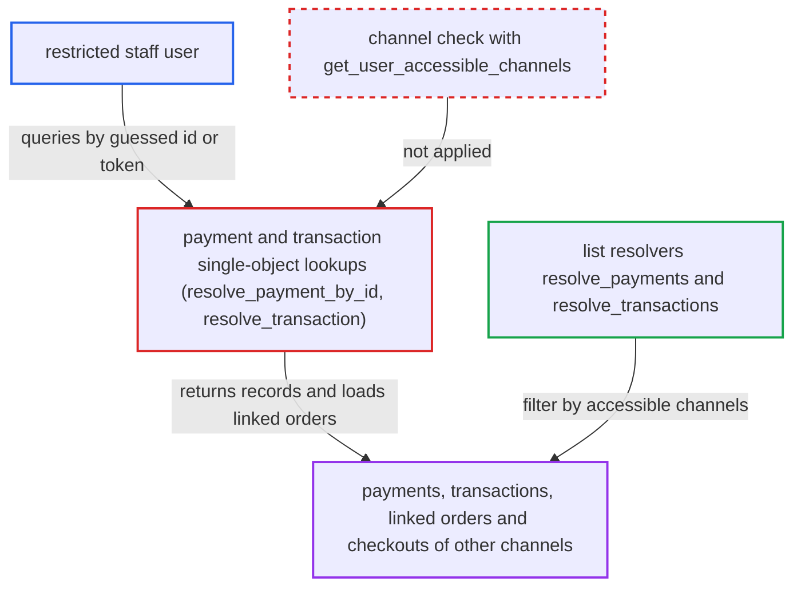

# payment(id) and transaction(id) queries bypass staff channel restrictions

| Field | Value |
|---|---|
| ID | `find_01RM5saLgaMRgUdLd8EyKnVg` |
| Severity | **High** |
| Status | open |
| CWE | CWE-639 — Insecure direct object reference |
| Created | 2026-10-27T21:42:41.231683Z |
| Claude Security | https://claude.ai/security/findings/find_01RM5saLgaMRgUdLd8EyKnVg |

## Description

A staff member whose permission group is limited to certain channels can read payments, transactions and the linked orders and checkouts of channels they are excluded from. They need `MANAGE_ORDERS` for `payment`, or `HANDLE_PAYMENTS` or `MANAGE_ORDERS` for `transaction`. The single-object lookups `resolve_payment_by_id` and `resolve_transaction` fetch by id or token and never apply the channel restriction.

1. **restricted staff user** sends a `payment(id:)` or `transaction(id:)` query with a guessed id. `Payment` ids are sequential, so `Payment:<n>` can be counted up. Transactions made by `transactionCreate` or `orderBulkCreate` are reachable as `TransactionItem:<n>`. ([`saleor/graphql/payment/mutations/transaction/transaction_create.py:289-292`](https://github.com/cx-benchmark/saleor/blob/c982006cc04c77a97def93218dedac8d715eb041/saleor/graphql/payment/mutations/transaction/transaction_create.py#L289-L292))
2. **the `PermissionsField` on `payment` and `transaction`** checks only the global permission. It requires `MANAGE_ORDERS`, or `HANDLE_PAYMENTS`/`MANAGE_ORDERS` for `transaction`, and does not look at channels, so the restricted user passes. ([`saleor/graphql/payment/schema.py:130-155`](https://github.com/cx-benchmark/saleor/blob/c982006cc04c77a97def93218dedac8d715eb041/saleor/graphql/payment/schema.py#L130-L155))
3. **the resolvers `resolve_payment_by_id` and `resolve_transaction`** return the record matched by primary key, integer id or UUID token. No channel condition is applied and `get_user_accessible_channels` is never consulted. ([`saleor/graphql/payment/resolvers.py:13-18`](https://github.com/cx-benchmark/saleor/blob/c982006cc04c77a97def93218dedac8d715eb041/saleor/graphql/payment/resolvers.py#L13-L18))
4. **`TransactionItem.resolve_order` and `resolve_checkout`** load the linked order or checkout of the excluded channel. The `Payment` type does the same in its own `resolve_order` and `resolve_checkout`, with no channel check. ([`saleor/graphql/payment/types.py:831-861`](https://github.com/cx-benchmark/saleor/blob/c982006cc04c77a97def93218dedac8d715eb041/saleor/graphql/payment/types.py#L831-L861))
5. **the `Order` field resolvers** return customer data to the restricted user. Address and email fields check only `MANAGE_ORDERS`, or return data in clear for UUID orders, so no channel restriction is re-applied. ([`saleor/graphql/order/types.py:2163-2215`](https://github.com/cx-benchmark/saleor/blob/c982006cc04c77a97def93218dedac8d715eb041/saleor/graphql/order/types.py#L2163-L2215))

## Assessment

The attacker is a staff user in a permission group marked `restricted_access_to_channels`, limited to channel A. They hold `MANAGE_ORDERS` for `payment`, or `HANDLE_PAYMENTS` or `MANAGE_ORDERS` for `transaction`. They send GraphQL queries over the network with ids such as `Payment:<n>` or `TransactionItem:<n>`, counting `n` upward. Transactions created by `transactionInitialize` also need their UUID token. `GRAPHQL_MIDDLEWARE` is empty, so no other layer blocks the request.

Impact: The attacker can read every legacy payment and every manual or app-created transaction in the store, plus their linked orders and checkouts. This exposes customer names, addresses, emails, order lines, totals, PSP references, gateway tokens, card brand, digits and expiry, and customer IPs. The access is read-only, and nothing can be modified through this path.

## Recommendation

`resolve_payment_by_id` and `resolve_transaction` return objects by id or token without restricting staff requesters to their accessible channels. This breaks the channel-scoped rules that `resolve_payments`, `resolve_transactions` and the payment mutations enforce.

Fix criteria: For a staff requester, `payment(id:)` returns no data when the payment's order or checkout channel is outside `get_user_accessible_channels`. The same holds for `transaction(id:|token:)`, judged by the transaction's order or checkout channel, as in the list resolvers. Apps keep their documented access. To verify, query an excluded-channel payment and an int-id transaction as a restricted staff user and confirm null or a permission error. Then confirm the same ids still resolve for an unrestricted user.

## Evidence

**https://github.com/cx-benchmark/saleor**

- [`saleor/graphql/payment/resolvers.py:13-18`](https://github.com/cx-benchmark/saleor/blob/c982006cc04c77a97def93218dedac8d715eb041/saleor/graphql/payment/resolvers.py#L13-L18)
- [`saleor/graphql/payment/resolvers.py:35-44`](https://github.com/cx-benchmark/saleor/blob/c982006cc04c77a97def93218dedac8d715eb041/saleor/graphql/payment/resolvers.py#L35-L44)
- [`saleor/graphql/payment/schema.py:130-155`](https://github.com/cx-benchmark/saleor/blob/c982006cc04c77a97def93218dedac8d715eb041/saleor/graphql/payment/schema.py#L130-L155)
- [`saleor/graphql/payment/resolvers.py:21-73`](https://github.com/cx-benchmark/saleor/blob/c982006cc04c77a97def93218dedac8d715eb041/saleor/graphql/payment/resolvers.py#L21-L73)
- [`saleor/graphql/payment/types.py:295-325`](https://github.com/cx-benchmark/saleor/blob/c982006cc04c77a97def93218dedac8d715eb041/saleor/graphql/payment/types.py#L295-L325)
- [`saleor/graphql/payment/types.py:831-861`](https://github.com/cx-benchmark/saleor/blob/c982006cc04c77a97def93218dedac8d715eb041/saleor/graphql/payment/types.py#L831-L861)
- [`saleor/graphql/payment/mutations/transaction/transaction_create.py:289-292`](https://github.com/cx-benchmark/saleor/blob/c982006cc04c77a97def93218dedac8d715eb041/saleor/graphql/payment/mutations/transaction/transaction_create.py#L289-L292)
- [`saleor/graphql/order/types.py:2163-2215`](https://github.com/cx-benchmark/saleor/blob/c982006cc04c77a97def93218dedac8d715eb041/saleor/graphql/order/types.py#L2163-L2215)
- [`saleor/graphql/core/mutations.py:585-598`](https://github.com/cx-benchmark/saleor/blob/c982006cc04c77a97def93218dedac8d715eb041/saleor/graphql/core/mutations.py#L585-L598)

