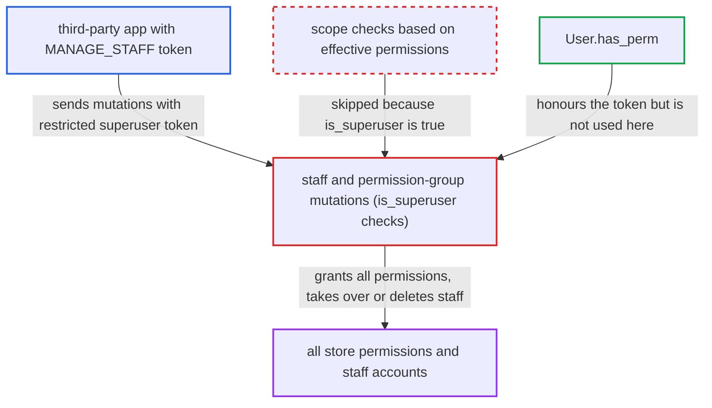

# Permission-restricted third-party tokens of superusers bypass staff and group scope checks

| Field | Value |
|---|---|
| ID | `find_01KY7a27oEZ7NwqdjRgw3pmC` |
| Severity | **High** |
| Status | open |
| CWE | CWE-863 — Improper Authorization |
| Created | 2026-10-27T21:43:19.476116Z |
| Claude Security | https://claude.ai/security/findings/find_01KY7a27oEZ7NwqdjRgw3pmC |

## Description

An installed third-party app that holds `MANAGE_STAFF` can use a superuser's restricted token to give itself every permission and take over staff or superuser accounts. The attack needs a superuser to open the app in the Dashboard. The staff and permission-group mutations check `requestor.is_superuser` directly, so the token's permission limit is ignored.

1. **superuser** opens the installed app in the Dashboard. The Dashboard fetches `app.accessToken` and gives the app a third-party JWT whose `permissions` claim is the app's permissions intersected with the user's, here `[MANAGE_STAFF]`. ([`saleor/core/jwt.py:172-199`](https://github.com/cx-benchmark/saleor/blob/c982006cc04c77a97def93218dedac8d715eb041/saleor/core/jwt.py#L172-L199))
2. **`load_user_from_request`** replaces `user.effective_permissions` with the token's list but leaves `is_superuser` unchanged. `User.has_perm` respects the narrowed list, but the user object loaded from the database still has `is_superuser` set to `True`. ([`saleor/core/auth_backend.py:168-183`](https://github.com/cx-benchmark/saleor/blob/c982006cc04c77a97def93218dedac8d715eb041/saleor/core/auth_backend.py#L168-L183))
3. **the app** sends a staff or permission-group mutation to `/graphql/` with the token. The `Meta.permissions` gate passes because the token holds `MANAGE_STAFF`. The `Apps are not allowed to perform this mutation` guards do not fire, because a JWT never resolves to an App in the context and the request is treated as the superuser. ([`saleor/graphql/app/dataloaders/utils.py:13-17`](https://github.com/cx-benchmark/saleor/blob/c982006cc04c77a97def93218dedac8d715eb041/saleor/graphql/app/dataloaders/utils.py#L13-L17))
4. **`PermissionGroupCreate.clean_permissions`** skips the check for permissions the requestor lacks. The check is skipped whenever `requestor.is_superuser` is true, so a new group can hold every permission. ([`saleor/graphql/account/mutations/permission_group/permission_group_create.py:124-137`](https://github.com/cx-benchmark/saleor/blob/c982006cc04c77a97def93218dedac8d715eb041/saleor/graphql/account/mutations/permission_group/permission_group_create.py#L124-L137))
5. **`StaffCreate.ensure_requestor_can_manage_groups`** returns early for the superuser flag. A staff user the app controls can be created in, or added to, any group, including a full-permission group. ([`saleor/graphql/account/mutations/staff/staff_create.py:135-157`](https://github.com/cx-benchmark/saleor/blob/c982006cc04c77a97def93218dedac8d715eb041/saleor/graphql/account/mutations/staff/staff_create.py#L135-L157))
6. **`StaffUpdate.clean_input`** skips the out-of-scope user check. The app can edit any staff user, including another superuser, for example by changing their email. ([`saleor/graphql/account/mutations/staff/staff_update.py:71-78`](https://github.com/cx-benchmark/saleor/blob/c982006cc04c77a97def93218dedac8d715eb041/saleor/graphql/account/mutations/staff/staff_update.py#L71-L78))
7. **the group update and staff delete checks** return early on `requestor.is_superuser`. Any group can be edited with any permissions or channels, and `staffDelete` reaches any staff user. ([`saleor/graphql/account/mutations/permission_group/permission_group_update.py:120-137`](https://github.com/cx-benchmark/saleor/blob/c982006cc04c77a97def93218dedac8d715eb041/saleor/graphql/account/mutations/permission_group/permission_group_update.py#L120-L137))

## Assessment

The attacker is a third-party app installed with `MANAGE_STAFF` in its permission set, or whoever controls its backend or iframe. A superuser must open the app in the Dashboard so the app receives the token. The app then sends `permissionGroupCreate` with all permissions and users it controls, or `staffCreate` with `addGroups` set to an admin group, or `staffUpdate` on another superuser to change their email. The report notes that the similar `is_superuser` shortcuts in the app mutations (`graphql/app/utils.py:16`, `app_update.py:52`, `app_token_create.py:65`, `app_delete.py:46`) are not reachable this way. Restricted third-party tokens can never carry `MANAGE_APPS`.

Impact: The app escalates from `MANAGE_STAFF` to every permission. It does this by creating or assigning full-permission groups and by taking over staff or superuser accounts through an email rewrite and a password reset. That gives full read and write access to store data (orders, customers, settings, apps) and the ability to lock out legitimate staff.

## Recommendation

(1) The scope checks in the staff and permission-group mutations decide on the database flag `requestor.is_superuser` instead of the requestor's effective permissions. A token-restricted superuser is therefore treated as unrestricted.

Fix criteria: Every scope decision on permissions, groups, users and channels for a request made with a permission-restricted third-party token is bounded by the token's permission set. A superuser acting through a `[MANAGE_STAFF]` token gets the same OUT_OF_SCOPE errors as a plain staff user holding only `MANAGE_STAFF`. This applies when adding permissions or groups it does not hold, or editing or deleting users with wider permissions. A test mints `create_access_token_for_app` for a superuser with an app limited to `MANAGE_STAFF`. It asserts that `permissionGroupCreate` with extra permissions, `staffCreate(addGroups)` to a wider group, and `staffUpdate` on another superuser are all refused.

(2) `load_user_from_request` leaves `is_superuser=True` on a user object whose permissions a token has narrowed. Any direct `is_superuser` test anywhere in the API therefore ignores the narrowing.

Fix criteria: When a token narrows a user's effective permissions, the authenticated user no longer presents itself as an unrestricted superuser to permission logic. For example, the superuser bypass is derived from the effective permission set, not the database flag. Consumers of `requestor_is_superuser` and `user.is_superuser` behave identically to a non-superuser with the same effective permissions under such a token, and a test confirms this.

## Evidence

**https://github.com/cx-benchmark/saleor**

- [`saleor/graphql/account/mutations/permission_group/permission_group_create.py:124-137`](https://github.com/cx-benchmark/saleor/blob/c982006cc04c77a97def93218dedac8d715eb041/saleor/graphql/account/mutations/permission_group/permission_group_create.py#L124-L137)
- [`saleor/graphql/account/mutations/staff/staff_create.py:135-157`](https://github.com/cx-benchmark/saleor/blob/c982006cc04c77a97def93218dedac8d715eb041/saleor/graphql/account/mutations/staff/staff_create.py#L135-L157)
- [`saleor/graphql/account/mutations/staff/staff_update.py:71-78`](https://github.com/cx-benchmark/saleor/blob/c982006cc04c77a97def93218dedac8d715eb041/saleor/graphql/account/mutations/staff/staff_update.py#L71-L78)
- [`saleor/graphql/account/mutations/permission_group/permission_group_update.py:120-137`](https://github.com/cx-benchmark/saleor/blob/c982006cc04c77a97def93218dedac8d715eb041/saleor/graphql/account/mutations/permission_group/permission_group_update.py#L120-L137)
- [`saleor/graphql/account/mutations/base.py:549-562`](https://github.com/cx-benchmark/saleor/blob/c982006cc04c77a97def93218dedac8d715eb041/saleor/graphql/account/mutations/base.py#L549-L562)
- [`saleor/core/jwt.py:172-199`](https://github.com/cx-benchmark/saleor/blob/c982006cc04c77a97def93218dedac8d715eb041/saleor/core/jwt.py#L172-L199)
- [`saleor/core/auth_backend.py:168-183`](https://github.com/cx-benchmark/saleor/blob/c982006cc04c77a97def93218dedac8d715eb041/saleor/core/auth_backend.py#L168-L183)
- [`saleor/graphql/app/dataloaders/utils.py:13-17`](https://github.com/cx-benchmark/saleor/blob/c982006cc04c77a97def93218dedac8d715eb041/saleor/graphql/app/dataloaders/utils.py#L13-L17)

