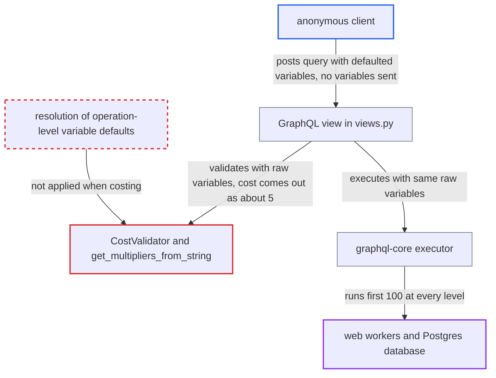

# Query cost validator ignores operation-level variable defaults, bypassing complexity limit

| Field | Value |
|---|---|
| ID | `find_01YNwgxHyNBxmkezK2STbUAd` |
| Severity | **High** |
| Status | open |
| CWE | CWE-770 — Allocation of Resources Without Limits |
| Created | 2026-10-27T21:21:44.782024Z |
| Claude Security | https://claude.ai/security/findings/find_01YNwgxHyNBxmkezK2STbUAd |

## Description

An anonymous client can send a GraphQL query that is far larger than the complexity budget allows, and the server runs it. Each request can tie up web workers and the database, and repeated requests can exhaust them for every channel. The attack needs no login. The cause is `CostValidator`, which ignores operation-level variable defaults such as `query($n: Int = 100)` when it counts cost, while execution applies them.

1. **Anonymous client** posts a nested query that uses variables with operation-level defaults and sends no `variables`. The query is `products(first:$a)` → `category` → `products(first:$b)` → `category` → `products(first:$c)`, with `$a`, `$b` and `$c` each declared as `Int=100`.
2. **the view in `views.py`** passes the raw `variables` dict from the request body to both `validate_query` and `document.execute`. The same dict is used for validation and execution, and it has no entry for the defaulted variables. ([`saleor/graphql/views.py:478-539`](https://github.com/cx-benchmark/saleor/blob/c982006cc04c77a97def93218dedac8d715eb041/saleor/graphql/views.py#L478-L539))
3. **`CostValidator`** reads field arguments with `get_argument_values` using the raw variables. In graphql-core 2.3.2 a missing variable falls back only to the schema default of the argument. Connection `first`/`last` have no schema default, so they are absent from `field_args`. ([`saleor/graphql/core/validators/query_cost.py:83-92`](https://github.com/cx-benchmark/saleor/blob/c982006cc04c77a97def93218dedac8d715eb041/saleor/graphql/core/validators/query_cost.py#L83-L92))
4. **`get_multipliers_from_string`** drops the multiplier when the argument is missing. `int(None)` raises `TypeError`, which is swallowed by `pass`, so the field is costed at the base complexity of 1. ([`saleor/graphql/core/validators/query_cost.py:221-236`](https://github.com/cx-benchmark/saleor/blob/c982006cc04c77a97def93218dedac8d715eb041/saleor/graphql/core/validators/query_cost.py#L221-L236))
5. **`compute_cost`** carries the missing multiplier down through `operation_multipliers`. Every nesting level that uses a defaulted variable loses its ×100 factor. The example query is costed at about 5, against about 1,020,200 for the same query with literal arguments, so it passes the 50000 budget. ([`saleor/graphql/core/validators/query_cost.py:197-205`](https://github.com/cx-benchmark/saleor/blob/c982006cc04c77a97def93218dedac8d715eb041/saleor/graphql/core/validators/query_cost.py#L197-L205))
6. **graphql-core executor** runs the query with the operation defaults applied. `get_variable_values` applies the defaults, so every connection runs with `first: 100`. That is 10,000 `Category.products` resolutions and about 1M nodes. ([`saleor/graphql/views.py:478-539`](https://github.com/cx-benchmark/saleor/blob/c982006cc04c77a97def93218dedac8d715eb041/saleor/graphql/views.py#L478-L539))
7. **`Category.resolve_products`** builds and slices a new queryset for each parent category. Each nested level therefore issues database queries for every parent node. ([`saleor/graphql/product/types/categories.py:179-230`](https://github.com/cx-benchmark/saleor/blob/c982006cc04c77a97def93218dedac8d715eb041/saleor/graphql/product/types/categories.py#L179-L230))

## Assessment

The attacker is an unauthenticated client who can reach `/graphql/`. Storefront traffic is allowed by default, per `site/models.py:77`, so anonymous storefront users are the most exposed. The attacker declares the pagination arguments as variables with operation-level defaults and leaves `variables` out of the request body. Adding more nesting levels or aliases multiplies the work further. `limit` arguments such as `assignedAttributes(limit:)` and `referenceTypes(limit:)` are affected in a milder way. They have the schema default `DEFAULT_NESTED_LIST_LIMIT` (100), so the validator counts ×100. Execution uses whatever larger operation default the attacker wrote, and these `PositiveInt` arguments have no upper bound.

Impact: The attacker can make the API run queries whose size is set by the nesting depth they choose, far above the `GRAPHQL_QUERY_MAX_COMPLEXITY` budget of 50000. Each request ties up a web worker's CPU and memory and issues thousands of Postgres queries. Repeated requests can exhaust the workers and the shared database for every channel the deployment serves. No data is disclosed or modified.

## Recommendation

(1) The cost validator derives argument values from the raw request variables only. An argument bound to a variable with an operation-level default is treated as absent, and its multiplier is silently dropped, while execution applies the default.

Fix criteria: Cost computation sees exactly the argument values that execution will use. It either resolves variables with the operation's variable definitions, including defaults and coercion, before computing multipliers, or it rejects queries whose multiplier arguments cannot be resolved at validation time. `query($n:Int=100){products(first:$n,...){edges{node{id}}}}` sent without variables is costed at 100, the same as the literal form. Nested variants with operation defaults are rejected when they exceed `GRAPHQL_QUERY_MAX_COMPLEXITY`.

(2) `get_multipliers_from_string` turns any unparseable or missing multiplier into 'no multiplier' (cost 1) instead of a conservative value. Every gap in argument resolution therefore becomes an under-count rather than an over-count.

Fix criteria: A missing or unparseable multiplier for a paginated field fails closed. It either assumes the maximum page size (`GRAPHQL_PAGINATION_LIMIT`, or the field's declared default such as `DEFAULT_NESTED_LIST_LIMIT`) or raises a validation error, and is never costed as 1. A connection field queried with an unresolvable `first` is costed at the page limit.

## Evidence

**https://github.com/cx-benchmark/saleor**

- [`saleor/graphql/core/validators/query_cost.py:83-92`](https://github.com/cx-benchmark/saleor/blob/c982006cc04c77a97def93218dedac8d715eb041/saleor/graphql/core/validators/query_cost.py#L83-L92)
- [`saleor/graphql/core/validators/query_cost.py:221-236`](https://github.com/cx-benchmark/saleor/blob/c982006cc04c77a97def93218dedac8d715eb041/saleor/graphql/core/validators/query_cost.py#L221-L236)
- [`saleor/graphql/core/validators/query_cost.py:197-205`](https://github.com/cx-benchmark/saleor/blob/c982006cc04c77a97def93218dedac8d715eb041/saleor/graphql/core/validators/query_cost.py#L197-L205)
- [`saleor/graphql/views.py:478-539`](https://github.com/cx-benchmark/saleor/blob/c982006cc04c77a97def93218dedac8d715eb041/saleor/graphql/views.py#L478-L539)
- [`saleor/graphql/core/fields.py:69-110`](https://github.com/cx-benchmark/saleor/blob/c982006cc04c77a97def93218dedac8d715eb041/saleor/graphql/core/fields.py#L69-L110)
- [`saleor/graphql/query_cost_map.py:236-241`](https://github.com/cx-benchmark/saleor/blob/c982006cc04c77a97def93218dedac8d715eb041/saleor/graphql/query_cost_map.py#L236-L241)
- [`saleor/graphql/product/types/categories.py:179-230`](https://github.com/cx-benchmark/saleor/blob/c982006cc04c77a97def93218dedac8d715eb041/saleor/graphql/product/types/categories.py#L179-L230)
- [`saleor/settings.py:907-910`](https://github.com/cx-benchmark/saleor/blob/c982006cc04c77a97def93218dedac8d715eb041/saleor/settings.py#L907-L910)

