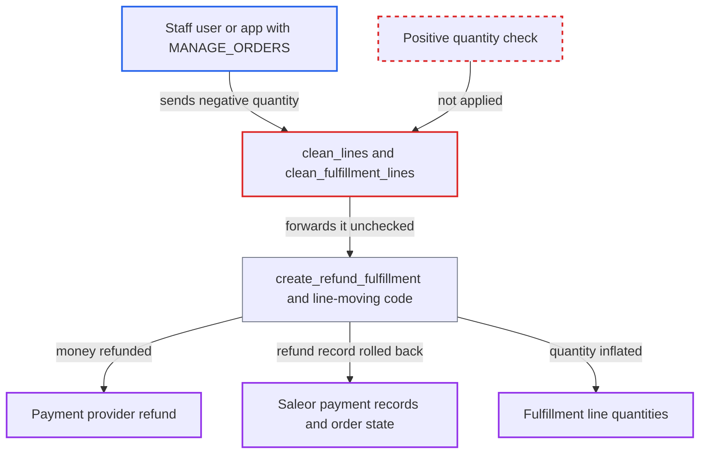

# Refund/return product mutations accept negative line quantities

| Field | Value |
|---|---|
| ID | `find_01DT9CUqhE4tHPy1AtWnnFcx` |
| Severity | **High** |
| Status | open |
| CWE | CWE-1284 — Improper Input Validation |
| Created | 2026-10-27T21:29:48.307511Z |
| Claude Security | https://claude.ai/security/findings/find_01DT9CUqhE4tHPy1AtWnnFcx |

## Description

A staff user or app with `MANAGE_ORDERS` for the order's channel, working with the order's customer, can make the provider refund money while Saleor records no refund. They can also inflate fulfillment line quantities. The refund and return mutations accept negative line quantities, because `clean_lines` and `clean_fulfillment_lines` only check upper bounds.

1. **Staff user or app with `MANAGE_ORDERS`** sends a refund or return mutation with a negative line quantity. For example `fulfillmentReturnProducts` with `quantity: -5`, or `fulfillmentRefundProducts` with a negative order line mixed with positive fulfillment lines, with or without `amountToRefund`.
2. **the validators `clean_lines` and `clean_fulfillment_lines`** accept the negative quantity. They only test upper bounds such as `line.quantity < quantity`, which is false for a negative number, so the value is passed on as `OrderLineInfo` or `FulfillmentLineData`. ([`saleor/graphql/order/mutations/fulfillment_refund_and_return_product_base.py:209-232`](https://github.com/cx-benchmark/saleor/blob/c982006cc04c77a97def93218dedac8d715eb041/saleor/graphql/order/mutations/fulfillment_refund_and_return_product_base.py#L209-L232))
3. **the helper `_move_fulfillment_lines_to_target_fulfillment`** grows the source fulfillment line instead of shrinking it. `fulfilled_to_move` becomes the negative value, so `fulfillment_line.quantity -= fulfilled_to_move` raises the quantity above what was fulfilled, it is saved with `bulk_update`, and the target line is skipped. ([`saleor/order/actions.py:1451-1510`](https://github.com/cx-benchmark/saleor/blob/c982006cc04c77a97def93218dedac8d715eb041/saleor/order/actions.py#L1451-L1510))
4. **the function `_calculate_refund_amount`** lowers the computed refund by the negative line. It multiplies each quantity by the unit price and sums, so a negative line offsets positive ones. ([`saleor/order/actions.py:2014-2046`](https://github.com/cx-benchmark/saleor/blob/c982006cc04c77a97def93218dedac8d715eb041/saleor/order/actions.py#L2014-L2046))
5. **the function `create_refund_fulfillment`** asks the payment provider to refund before the database writes. `_process_refund` calls `gateway.refund` before `_move_order_lines_to_target_fulfillment` runs, so the provider has already returned the money when a later write fails. ([`saleor/order/actions.py:1525-1575`](https://github.com/cx-benchmark/saleor/blob/c982006cc04c77a97def93218dedac8d715eb041/saleor/order/actions.py#L1525-L1575))
6. **the database** rejects the negative `FulfillmentLine` insert. `FulfillmentLine.quantity` is a `PositiveIntegerField`, so `bulk_create` raises `IntegrityError` after the provider refund succeeded. ([`saleor/order/models.py:865`](https://github.com/cx-benchmark/saleor/blob/c982006cc04c77a97def93218dedac8d715eb041/saleor/order/models.py#L865))
7. **`transaction_with_commit_on_errors`** rolls back Saleor's refund records. The `Transaction` row, the `captured_amount` decrement and the refund events are lost, so the order still looks fully paid and refundable. ([`saleor/order/actions.py:1525-1575`](https://github.com/cx-benchmark/saleor/blob/c982006cc04c77a97def93218dedac8d715eb041/saleor/order/actions.py#L1525-L1575))

## Assessment

The attacker is a staff user or app with `MANAGE_ORDERS` for the order's channel, colluding with the order's customer. No other condition is needed. For a return, they send `fulfillmentReturnProducts` with a negative `fulfillmentLines` quantity to inflate a fulfillment line. For a refund, they send `fulfillmentRefundProducts` with a negative `orderLines` quantity plus positive `fulfillmentLines` quantities, or with `amountToRefund`. The provider refund then runs and the later `FulfillmentLine` insert fails.

Impact: Money is refunded at the provider while Saleor's payment records, events and fulfillment status stay unchanged. The order can stay fully paid for fulfillment or be refunded again, up to the provider's limit. Fulfillment line quantities can also be pushed above the ordered quantity. Loss is bounded by the payment's captured amount at the provider, and the attacker needs a privileged staff account.

## Recommendation

(1) The `quantity` inputs of the refund and return mutations are not checked to be positive, so negative values reach the code that moves fulfillment lines and calculates refunds, which assumes non-negative numbers.

Fix criteria: `fulfillmentRefundProducts` and `fulfillmentReturnProducts` reject any `orderLines[].quantity` or `fulfillmentLines[].quantity` that is not a positive integer, with a validation error, before any payment or fulfillment side effect. Tests sending `quantity: 0` and `quantity: -1` for both line kinds assert an error, unchanged fulfillment line quantities, no provider refund call and no `IntegrityError`.

(2) `create_refund_fulfillment` makes the irreversible provider refund before database writes that can still fail, so a later failure leaves Saleor's payment state out of step with the provider.

Fix criteria: All validation and database preparation that can fail, including creating the refund fulfillment and its lines, is completed or fully validated before the external refund call. Alternatively, a failure after the external call still persists the refund `Transaction` and `captured_amount` change. A test that injects a failure after `gateway.refund` asserts the refund remains recorded on the payment.

## Evidence

**https://github.com/cx-benchmark/saleor**

- [`saleor/graphql/order/mutations/fulfillment_refund_and_return_product_base.py:209-232`](https://github.com/cx-benchmark/saleor/blob/c982006cc04c77a97def93218dedac8d715eb041/saleor/graphql/order/mutations/fulfillment_refund_and_return_product_base.py#L209-L232)
- [`saleor/graphql/order/mutations/fulfillment_refund_and_return_product_base.py:138-158`](https://github.com/cx-benchmark/saleor/blob/c982006cc04c77a97def93218dedac8d715eb041/saleor/graphql/order/mutations/fulfillment_refund_and_return_product_base.py#L138-L158)
- [`saleor/order/actions.py:1451-1510`](https://github.com/cx-benchmark/saleor/blob/c982006cc04c77a97def93218dedac8d715eb041/saleor/order/actions.py#L1451-L1510)
- [`saleor/order/actions.py:1525-1575`](https://github.com/cx-benchmark/saleor/blob/c982006cc04c77a97def93218dedac8d715eb041/saleor/order/actions.py#L1525-L1575)
- [`saleor/order/actions.py:2014-2046`](https://github.com/cx-benchmark/saleor/blob/c982006cc04c77a97def93218dedac8d715eb041/saleor/order/actions.py#L2014-L2046)
- [`saleor/order/models.py:865`](https://github.com/cx-benchmark/saleor/blob/c982006cc04c77a97def93218dedac8d715eb041/saleor/order/models.py#L865)

