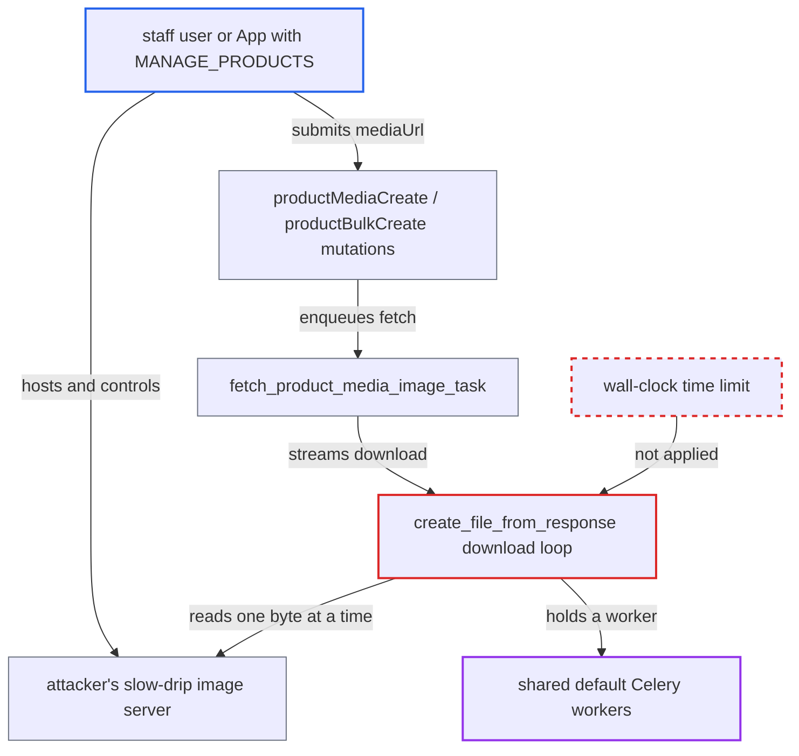

# Remote product image fetch has no wall-clock limit; slow-drip URL pins shared Celery workers

| Field | Value |
|---|---|
| ID | `find_01XXQoQ7MZTC8B6U3sp32bR6` |
| Severity | **High** |
| Status | open |
| CWE | CWE-400 — Uncontrolled resource consumption |
| Created | 2026-10-27T21:21:28.794627Z |
| Claude Security | https://claude.ai/security/findings/find_01XXQoQ7MZTC8B6U3sp32bR6 |

## Description

A staff user or third-party App with `MANAGE_PRODUCTS` can stall the shared background job queue. They point product media at a server that sends one byte every few seconds. Each such download holds a Celery worker, so webhooks, emails and order tasks stop. The cause is that `fetch_product_media_image_task` and `create_file_from_response` have no total time limit.

1. **attacker** hosts a slow-drip image URL. The server answers `200` with `Content-Type: image/png` and no `Content-Length`, then sends one byte every few seconds.
2. **attacker** calls `productMediaCreate` or `productBulkCreate` with that URL as `mediaUrl`. The header-only probe `probe_media_url` passes, and the mutation enqueues `fetch_product_media_image_task.delay(media.pk)`. `productBulkCreate` enqueues one task per media item. ([`saleor/graphql/product/mutations/product/product_media_create.py:107-150`](https://github.com/cx-benchmark/saleor/blob/c982006cc04c77a97def93218dedac8d715eb041/saleor/graphql/product/mutations/product/product_media_create.py#L107-L150))
3. **the task `fetch_product_media_image_task`** opens the stored `external_url` as a stream and passes the response on to `create_image`. It uses `COMMON_REQUESTS_TIMEOUT` and has no `time_limit` or `soft_time_limit`. It runs on the shared default queue because `FETCH_IMAGES_QUEUE_NAME` defaults to `None`. ([`saleor/product/tasks.py:362-426`](https://github.com/cx-benchmark/saleor/blob/c982006cc04c77a97def93218dedac8d715eb041/saleor/product/tasks.py#L362-L426))
4. **the helper `create_file_from_response`** keeps reading 64 KiB chunks while the remote server drips bytes. The only stop conditions are end of body or going past `MAX_IMAGE_FILE_SIZE` (10 MiB). The read timeout of 18 seconds restarts whenever any byte arrives, so it never fires. ([`saleor/core/utils/__init__.py:158-184`](https://github.com/cx-benchmark/saleor/blob/c982006cc04c77a97def93218dedac8d715eb041/saleor/core/utils/__init__.py#L158-L184))
5. **attacker** repeats this once per worker process. With as many dripping URLs as there are worker processes, every worker on the default queue stays busy for as long as the attacker keeps the connections open. ([`saleor/settings.py:1079-1158`](https://github.com/cx-benchmark/saleor/blob/c982006cc04c77a97def93218dedac8d715eb041/saleor/settings.py#L1079-L1158))

## Assessment

The attacker is a staff user or a third-party App with `MANAGE_PRODUCTS`. They need no victim action and no special state, and the default configuration is enough. They can use `productMediaCreate` once per worker process, or `productBulkCreate` with many media entries. The task runs on the shared default queue unless `FETCH_IMAGES_QUEUE_NAME` is changed from its default of `None`. The report assumes that `requests-hardened` 1.3.0 adds no total-duration limit beyond `default_timeout`. It also assumes that requests 2.34.2 and urllib3 2.8.0 apply the read timeout to each socket read.

Impact: The attacker can keep the default Celery queue from processing anything for as long as they keep the connections open, and can renew this at will. Async webhooks to integrated apps, notification emails, and order and catalog background tasks all wait. No data is read or changed, and the synchronous GraphQL API keeps serving. Time is bounded only by the 10 MiB size cap at under 18 seconds per byte.

## Recommendation

The download in `fetch_product_media_image_task`, `create_image` and `create_file_from_response` treats the per-read timeout of `requests` as if it limited the whole transfer. The task also has no Celery time limit. A slow-drip server can hold a shared worker indefinitely.

Fix criteria: Every remote product-media download finishes or aborts within a fixed wall-clock budget. Going over the budget is a permanent failure that is not retried. It triggers the existing failure handler, which deletes the `ProductMedia` row. A task-level hard or soft time limit is an acceptable backstop. A test against a server that sends one byte per second with no `Content-Length` shows the task failing within the budget, releasing the worker and not being retried.

## Evidence

**https://github.com/cx-benchmark/saleor**

- [`saleor/product/tasks.py:362-426`](https://github.com/cx-benchmark/saleor/blob/c982006cc04c77a97def93218dedac8d715eb041/saleor/product/tasks.py#L362-L426)
- [`saleor/core/utils/__init__.py:158-184`](https://github.com/cx-benchmark/saleor/blob/c982006cc04c77a97def93218dedac8d715eb041/saleor/core/utils/__init__.py#L158-L184)
- [`saleor/product/utils/tasks_utils.py:29-33`](https://github.com/cx-benchmark/saleor/blob/c982006cc04c77a97def93218dedac8d715eb041/saleor/product/utils/tasks_utils.py#L29-L33)
- [`saleor/settings.py:1079-1158`](https://github.com/cx-benchmark/saleor/blob/c982006cc04c77a97def93218dedac8d715eb041/saleor/settings.py#L1079-L1158)
- [`saleor/graphql/product/mutations/product/product_media_create.py:107-150`](https://github.com/cx-benchmark/saleor/blob/c982006cc04c77a97def93218dedac8d715eb041/saleor/graphql/product/mutations/product/product_media_create.py#L107-L150)
- [`saleor/app/installation_utils.py:78-113`](https://github.com/cx-benchmark/saleor/blob/c982006cc04c77a97def93218dedac8d715eb041/saleor/app/installation_utils.py#L78-L113)

