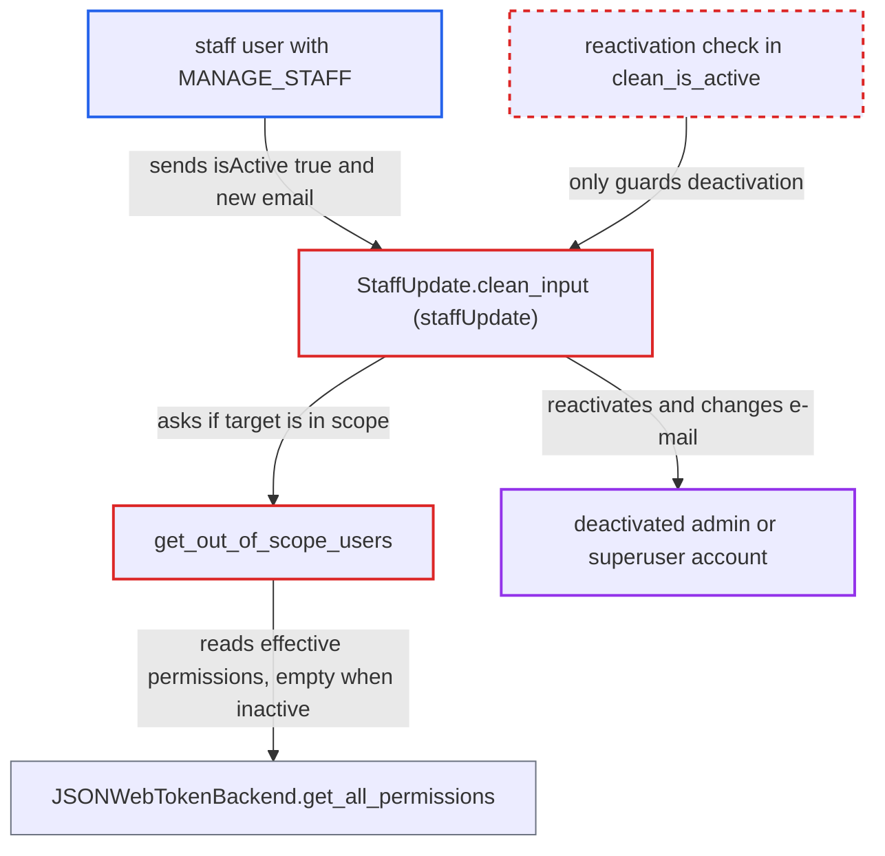

# Staff scope check passes for inactive users, letting MANAGE_STAFF holders take over deactivated admins

| Field | Value |
|---|---|
| ID | `find_019xxfUZUShHh4hLZeF5Vs58` |
| Severity | **High** |
| Status | open |
| CWE | CWE-863 — Improper Authorization |
| Created | 2026-10-27T21:13:36.322613Z |
| Claude Security | https://claude.ai/security/findings/find_019xxfUZUShHh4hLZeF5Vs58 |

## Description

A staff user who holds only `MANAGE_STAFF` can take over a deactivated staff account that has wider permissions, including a deactivated superuser. The attacker needs such an inactive account to exist. The scope check `get_out_of_scope_users` reads the target's effective permissions, which are empty for inactive users, so every inactive account passes. `clean_is_active` does not check reactivation.

1. **attacker with `MANAGE_STAFF`** finds a deactivated staff account with wider permissions. The report says such an account, for example an off-boarded admin or a disabled superuser, must already exist, and the attacker can find it with `staffUsers`.
2. **attacker** sends `staffUpdate` with `isActive: true` and a new `email` for that account. `UserInput`, the base of `StaffUpdateInput`, accepts both `email` and `is_active`. ([`saleor/graphql/account/mutations/base.py:177-184`](https://github.com/cx-benchmark/saleor/blob/c982006cc04c77a97def93218dedac8d715eb041/saleor/graphql/account/mutations/base.py#L177-L184))
3. **`get_out_of_scope_users`** measures the inactive target's scope with `get_all_permissions()`. `JSONWebTokenBackend.get_all_permissions` returns an empty set when `is_active` is false, even for a superuser, and `has_perms` on an empty set is vacuously True, so the target counts as in scope. ([`saleor/graphql/account/utils.py:67-74`](https://github.com/cx-benchmark/saleor/blob/c982006cc04c77a97def93218dedac8d715eb041/saleor/graphql/account/utils.py#L67-L74))
4. **`StaffUpdate.clean_input`** accepts the update because the scope check passed. This is the only check that stops a non-superuser `MANAGE_STAFF` holder from editing staff with wider permissions. ([`saleor/graphql/account/mutations/staff/staff_update.py:71-78`](https://github.com/cx-benchmark/saleor/blob/c982006cc04c77a97def93218dedac8d715eb041/saleor/graphql/account/mutations/staff/staff_update.py#L71-L78))
5. **`StaffUpdate.clean_is_active`** lets the reactivation through. Its superuser, own-account and manageability guards run only when deactivating, so `isActive: true` is never checked. ([`saleor/graphql/account/mutations/staff/staff_update.py:101-116`](https://github.com/cx-benchmark/saleor/blob/c982006cc04c77a97def93218dedac8d715eb041/saleor/graphql/account/mutations/staff/staff_update.py#L101-L116))
6. **`perform_mutation`** saves the account as active with the attacker's e-mail. `is_superuser` and the target's groups are left unchanged, so the account keeps all its permissions. ([`saleor/graphql/account/mutations/staff/staff_create.py:229-254`](https://github.com/cx-benchmark/saleor/blob/c982006cc04c77a97def93218dedac8d715eb041/saleor/graphql/account/mutations/staff/staff_create.py#L229-L254))
7. **attacker** calls `requestPasswordReset` with the new e-mail, reads the token from their mailbox and calls `setPassword`. The reset token is sent to `user.email`, which is now the attacker's address, and `setPassword` returns that account's tokens. ([`saleor/graphql/account/mutations/authentication/request_password_reset.py:65-110`](https://github.com/cx-benchmark/saleor/blob/c982006cc04c77a97def93218dedac8d715eb041/saleor/graphql/account/mutations/authentication/request_password_reset.py#L65-L110))

## Assessment

The attacker is a staff user whose permissions include `MANAGE_STAFF` but not the target's permissions. A deactivated account with wider permissions must already exist, such as an off-boarded admin or a disabled superuser. The attacker cannot create that state but can find it with `staffUsers`. Another route reaches the same flawed helper: `StaffDeleteMixin` (`staffDelete` and `staffBulkDelete`) and `PermissionGroupUpdate.ensure_can_manage_users` (`removeUsers`). With these, inactive staff with wider permissions can be deleted or removed from groups.

Impact: The attacker gets a session with every permission of the revived account. For a superuser that is full control of the store: customer personal data, orders, payments, apps and tokens, staff and permission groups. The limit is that only accounts that are already inactive can be taken over. Inactive non-superuser staff with wider permissions can also be deleted, while superusers stay protected from deletion by `UserDeleteMixin`.

## Recommendation

(1) `get_out_of_scope_users` takes the target's scope from `get_all_permissions()`, which is empty for inactive users. Inactive superusers and admins are therefore always treated as within the requestor's scope.

Fix criteria: The scope comparison uses the target's assigned permissions, direct and group, whether or not `is_active` is set. Any `is_superuser` target counts as out of scope for non-superusers. A requestor with only `MANAGE_STAFF` gets `OUT_OF_SCOPE_USER` from `staffUpdate`, `staffDelete`, `staffBulkDelete` and `permissionGroupUpdate(removeUsers)` against an inactive user with wider permissions. The same requestor also gets it against an inactive superuser.

(2) `StaffUpdate.clean_is_active` applies its guards only to deactivation. Reactivating a privileged account, together with changing its e-mail, is not checked.

Fix criteria: Reactivating a user, or changing the e-mail of a user, whose assigned permissions exceed the requestor's is refused. `staffUpdate(isActive:true, email:...)` on an inactive superuser by a non-superuser fails. The account stays inactive with its original e-mail.

## Evidence

**https://github.com/cx-benchmark/saleor**

- [`saleor/graphql/account/utils.py:67-74`](https://github.com/cx-benchmark/saleor/blob/c982006cc04c77a97def93218dedac8d715eb041/saleor/graphql/account/utils.py#L67-L74)
- [`saleor/core/auth_backend.py:95-104`](https://github.com/cx-benchmark/saleor/blob/c982006cc04c77a97def93218dedac8d715eb041/saleor/core/auth_backend.py#L95-L104)
- [`saleor/permission/models.py:140-163`](https://github.com/cx-benchmark/saleor/blob/c982006cc04c77a97def93218dedac8d715eb041/saleor/permission/models.py#L140-L163)
- [`saleor/graphql/account/mutations/staff/staff_update.py:71-78`](https://github.com/cx-benchmark/saleor/blob/c982006cc04c77a97def93218dedac8d715eb041/saleor/graphql/account/mutations/staff/staff_update.py#L71-L78)
- [`saleor/graphql/account/mutations/staff/staff_update.py:101-116`](https://github.com/cx-benchmark/saleor/blob/c982006cc04c77a97def93218dedac8d715eb041/saleor/graphql/account/mutations/staff/staff_update.py#L101-L116)
- [`saleor/graphql/account/mutations/base.py:177-184`](https://github.com/cx-benchmark/saleor/blob/c982006cc04c77a97def93218dedac8d715eb041/saleor/graphql/account/mutations/base.py#L177-L184)
- [`saleor/graphql/account/mutations/staff/staff_create.py:229-254`](https://github.com/cx-benchmark/saleor/blob/c982006cc04c77a97def93218dedac8d715eb041/saleor/graphql/account/mutations/staff/staff_create.py#L229-L254)
- [`saleor/graphql/account/mutations/authentication/request_password_reset.py:65-110`](https://github.com/cx-benchmark/saleor/blob/c982006cc04c77a97def93218dedac8d715eb041/saleor/graphql/account/mutations/authentication/request_password_reset.py#L65-L110)
- [`saleor/graphql/account/mutations/base.py:549-562`](https://github.com/cx-benchmark/saleor/blob/c982006cc04c77a97def93218dedac8d715eb041/saleor/graphql/account/mutations/base.py#L549-L562)

