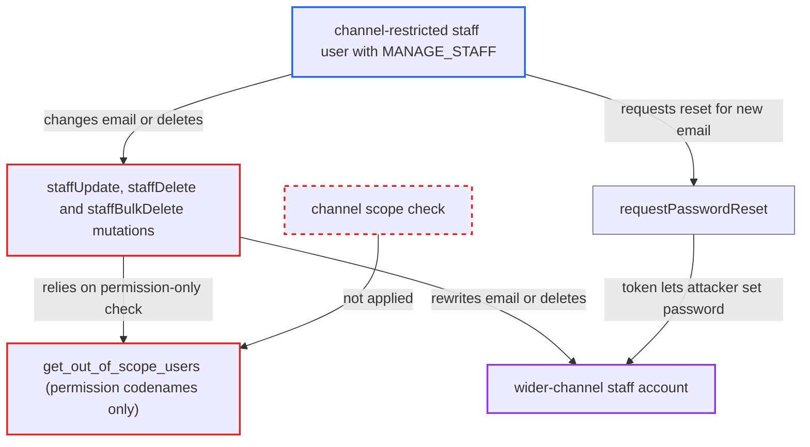

# Staff user scope check ignores channels, letting channel-restricted MANAGE_STAFF take over wider-channel staff

| Field | Value |
|---|---|
| ID | `find_014MMeF1oaFkeBEsw8HJLH3F` |
| Severity | **High** |
| Status | open |
| CWE | CWE-863 — Incorrect Authorization |
| Created | 2026-10-27T21:44:55.517404Z |
| Claude Security | https://claude.ai/security/findings/find_014MMeF1oaFkeBEsw8HJLH3F |

## Description

A staff user who holds `MANAGE_STAFF` but is restricted to one channel can take over or delete staff accounts that reach other channels. The target's permissions must be a subset of the attacker's own. The cause is `get_out_of_scope_users`, which compares only permission codenames and never channels. `staffUpdate`, `staffDelete` and `staffBulkDelete` rely on it alone.

1. **attacker (channel-restricted staff user)** lists staff with `staffUsers` and picks a victim whose permissions are a subset of their own. The victim belongs to an unrestricted group or to groups covering other channels, so the victim can reach channels the attacker cannot.
2. **attacker** sends `staffUpdate` with the victim's id and `email` set to an address they control. `StaffUpdate.clean_input` checks the target only with `get_out_of_scope_users`. ([`saleor/graphql/account/mutations/staff/staff_update.py:71-78`](https://github.com/cx-benchmark/saleor/blob/c982006cc04c77a97def93218dedac8d715eb041/saleor/graphql/account/mutations/staff/staff_update.py#L71-L78))
3. **the helper `get_out_of_scope_users`** lets the request through. It only checks that the requestor holds every permission codename of the target, and `User.has_perms` ignores channels. The target's channels are never compared with the requestor's. ([`saleor/graphql/account/utils.py:67-74`](https://github.com/cx-benchmark/saleor/blob/c982006cc04c77a97def93218dedac8d715eb041/saleor/graphql/account/utils.py#L67-L74))
4. **the mutation `perform_mutation`** saves the new `email` on the victim's account. `StaffUpdate` inherits this from the staff create code, and the report says no confirmation is sent to the old address. ([`saleor/graphql/account/mutations/staff/staff_create.py:229-254`](https://github.com/cx-benchmark/saleor/blob/c982006cc04c77a97def93218dedac8d715eb041/saleor/graphql/account/mutations/staff/staff_create.py#L229-L254))
5. **attacker** calls the public `requestPasswordReset` with the new email. The reset token is sent to the address the attacker now controls. ([`saleor/graphql/account/mutations/authentication/request_password_reset.py:65-110`](https://github.com/cx-benchmark/saleor/blob/c982006cc04c77a97def93218dedac8d715eb041/saleor/graphql/account/mutations/authentication/request_password_reset.py#L65-L110))
6. **attacker** calls `setPassword` with the token and logs in as the victim. An unrestricted victim reaches every channel, so the attacker gets the same permissions in all of them. ([`saleor/graphql/account/dataloaders.py:181-251`](https://github.com/cx-benchmark/saleor/blob/c982006cc04c77a97def93218dedac8d715eb041/saleor/graphql/account/dataloaders.py#L181-L251))

## Assessment

The attacker is a staff user with `MANAGE_STAFF` plus another permission such as `MANAGE_ORDERS`, in a group restricted to one channel (`restricted_access_to_channels=True`). A staff user must exist whose permissions are a subset of the attacker's and who is in an unrestricted group or in groups covering other channels. The takeover works through `staffUpdate` and the public `requestPasswordReset`; password login defaults to ENABLED. The attacker can instead call `staffDelete` or `staffBulkDelete` on the same kind of victim, because they use the same permission-only check. The report also lists `permissionGroupUpdate(removeUsers)` as affected by the same weak scope model.

Impact: The attacker acts as the victim in every channel the victim can reach, including channels they were deliberately excluded from. They can read those channels' orders, payments and customer personal data, and change, refund or cancel those orders. The victim is locked out, and wider-channel staff can be deleted. Impact is bounded by the attacker's own permission set, because the victim's permissions must be a subset of it.

## Recommendation

`get_out_of_scope_users` models a requestor's scope over another user as permission codenames only. `staffUpdate`, `staffDelete`, `staffBulkDelete` and `permissionGroupUpdate(removeUsers)` therefore ignore the channel scope that the permission-group mutations enforce.

Fix criteria: For a non-superuser requestor, a target staff user counts as out of scope when any channel the target can access is not accessible to the requestor. This includes a target with unrestricted channel access when the requestor has none. Test: a `MANAGE_STAFF` user restricted to channel A gets `OUT_OF_SCOPE_USER` from `staffUpdate` (email change) and from `staffDelete` against a staff user in an unrestricted group with a subset of permissions. The target's email is unchanged afterwards.

## Evidence

**https://github.com/cx-benchmark/saleor**

- [`saleor/graphql/account/utils.py:67-74`](https://github.com/cx-benchmark/saleor/blob/c982006cc04c77a97def93218dedac8d715eb041/saleor/graphql/account/utils.py#L67-L74)
- [`saleor/graphql/account/mutations/staff/staff_update.py:71-78`](https://github.com/cx-benchmark/saleor/blob/c982006cc04c77a97def93218dedac8d715eb041/saleor/graphql/account/mutations/staff/staff_update.py#L71-L78)
- [`saleor/graphql/account/mutations/base.py:549-562`](https://github.com/cx-benchmark/saleor/blob/c982006cc04c77a97def93218dedac8d715eb041/saleor/graphql/account/mutations/base.py#L549-L562)
- [`saleor/account/models.py:350-367`](https://github.com/cx-benchmark/saleor/blob/c982006cc04c77a97def93218dedac8d715eb041/saleor/account/models.py#L350-L367)
- [`saleor/graphql/account/mutations/staff/staff_create.py:229-254`](https://github.com/cx-benchmark/saleor/blob/c982006cc04c77a97def93218dedac8d715eb041/saleor/graphql/account/mutations/staff/staff_create.py#L229-L254)
- [`saleor/graphql/account/mutations/authentication/request_password_reset.py:65-110`](https://github.com/cx-benchmark/saleor/blob/c982006cc04c77a97def93218dedac8d715eb041/saleor/graphql/account/mutations/authentication/request_password_reset.py#L65-L110)
- [`saleor/graphql/account/dataloaders.py:181-251`](https://github.com/cx-benchmark/saleor/blob/c982006cc04c77a97def93218dedac8d715eb041/saleor/graphql/account/dataloaders.py#L181-L251)
- [`saleor/graphql/account/mutations/permission_group/permission_group_update.py:120-137`](https://github.com/cx-benchmark/saleor/blob/c982006cc04c77a97def93218dedac8d715eb041/saleor/graphql/account/mutations/permission_group/permission_group_update.py#L120-L137)
- [`saleor/graphql/account/utils.py:90-98`](https://github.com/cx-benchmark/saleor/blob/c982006cc04c77a97def93218dedac8d715eb041/saleor/graphql/account/utils.py#L90-L98)

