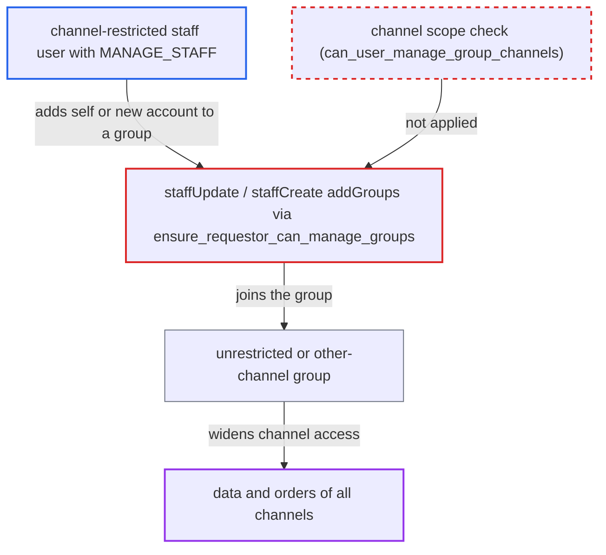

# staffUpdate/staffCreate addGroups skips channel-scope check, letting channel-restricted staff gain all channels

| Field | Value |
|---|---|
| ID | `find_01CXMJssebVpspsVkVcJKwUq` |
| Severity | **High** |
| Status | open |
| CWE | CWE-863 — Incorrect Authorization |
| Created | 2026-10-27T21:12:04.810202Z |
| Claude Security | https://claude.ai/security/findings/find_01CXMJssebVpspsVkVcJKwUq |

## Description

A staff user who holds MANAGE_STAFF but is restricted to some channels can give themselves access to every channel. They can also create a new staff account they control and give it the same access. The cause is `StaffCreate.ensure_requestor_can_manage_groups`, which `StaffUpdate` inherits. It checks only a group's permissions and ignores its channels.

1. **Channel-restricted staff attacker** lists all groups with `permissionGroups`. The query shows every group with its permissions and channels to MANAGE_STAFF holders, so finding a group whose permissions are a subset of the attacker's is easy.
2. **Attacker** calls `staffUpdate` on their own account with `addGroups`. The call is `staffUpdate(id: <self>, input: {addGroups: [<group>]})` on `/graphql/`. The chosen group is unrestricted or covers other channels. As an alternative, `staffCreate` with an attacker-chosen e-mail can put a new account into that group. ([`saleor/graphql/account/mutations/staff/staff_update.py:71-87`](https://github.com/cx-benchmark/saleor/blob/c982006cc04c77a97def93218dedac8d715eb041/saleor/graphql/account/mutations/staff/staff_update.py#L71-L87))
3. **the method `ensure_requestor_can_manage_groups`** approves the group using only a permission comparison. It relies on `get_groups_which_user_can_manage`, which accepts any group whose permissions are a subset of the requestor's. It never reads `channels` or `restricted_access_to_channels`. ([`saleor/graphql/account/mutations/staff/staff_create.py:129-158`](https://github.com/cx-benchmark/saleor/blob/c982006cc04c77a97def93218dedac8d715eb041/saleor/graphql/account/mutations/staff/staff_create.py#L129-L158))
4. **the method `_save_m2m`** adds the group to the target user. The membership changes without the full check `can_user_manage_group_channels`, which the staff mutations never call. ([`saleor/graphql/account/mutations/staff/staff_update.py:171-179`](https://github.com/cx-benchmark/saleor/blob/c982006cc04c77a97def93218dedac8d715eb041/saleor/graphql/account/mutations/staff/staff_update.py#L171-L179))
5. **Channel access loader** computes the user's channels as the union over all their groups. A group with `restricted_access_to_channels=False` grants every channel, so the attacker's existing permissions now apply everywhere. ([`saleor/graphql/account/dataloaders.py:181-251`](https://github.com/cx-benchmark/saleor/blob/c982006cc04c77a97def93218dedac8d715eb041/saleor/graphql/account/dataloaders.py#L181-L251))

## Assessment

The attacker is an authenticated staff user who holds MANAGE_STAFF and is restricted to some channels. A group must exist whose permissions are a subset of the attacker's and which is unrestricted or covers other channels. Examples are another channel's group or the OpenID default group. The attacker can target their own account with `staffUpdate`, or use `staffCreate` with an e-mail they control. The request goes to `/graphql/`.

Impact: The attacker's existing permissions, such as MANAGE_ORDERS, start to work in channels they were deliberately excluded from. They can read orders, payments and customer personal data there. They can also change, refund, capture or cancel those orders. Their own permission set still limits this, since the group's permissions must be a subset of theirs.

## Recommendation

`StaffCreate.ensure_requestor_can_manage_groups` decides whether a group can be managed with `get_groups_which_user_can_manage`. That function ignores the group's channel scope. `staffCreate` and `staffUpdate` use it for `addGroups` and `removeGroups`.

Fix criteria: A non-superuser requestor cannot add or remove any user, themselves included, to or from a group whose accessible channels are not a subset of the requestor's. This holds through `staffCreate` and `staffUpdate`, as it does through the permission-group mutations. Check: a MANAGE_STAFF user restricted to channel A gets an out-of-scope error when adding themselves or a new staff user to an unrestricted group or to a channel-B group. Their `accessibleChannels` stays unchanged.

## Evidence

**https://github.com/cx-benchmark/saleor**

- [`saleor/graphql/account/mutations/staff/staff_create.py:129-158`](https://github.com/cx-benchmark/saleor/blob/c982006cc04c77a97def93218dedac8d715eb041/saleor/graphql/account/mutations/staff/staff_create.py#L129-L158)
- [`saleor/graphql/account/utils.py:116-140`](https://github.com/cx-benchmark/saleor/blob/c982006cc04c77a97def93218dedac8d715eb041/saleor/graphql/account/utils.py#L116-L140)
- [`saleor/graphql/account/mutations/staff/staff_update.py:71-87`](https://github.com/cx-benchmark/saleor/blob/c982006cc04c77a97def93218dedac8d715eb041/saleor/graphql/account/mutations/staff/staff_update.py#L71-L87)
- [`saleor/graphql/account/mutations/staff/staff_update.py:171-179`](https://github.com/cx-benchmark/saleor/blob/c982006cc04c77a97def93218dedac8d715eb041/saleor/graphql/account/mutations/staff/staff_update.py#L171-L179)
- [`saleor/graphql/account/utils.py:77-98`](https://github.com/cx-benchmark/saleor/blob/c982006cc04c77a97def93218dedac8d715eb041/saleor/graphql/account/utils.py#L77-L98)
- [`saleor/graphql/account/mutations/permission_group/permission_group_update.py:120-137`](https://github.com/cx-benchmark/saleor/blob/c982006cc04c77a97def93218dedac8d715eb041/saleor/graphql/account/mutations/permission_group/permission_group_update.py#L120-L137)
- [`saleor/graphql/account/mutations/permission_group/permission_group_create.py:201-235`](https://github.com/cx-benchmark/saleor/blob/c982006cc04c77a97def93218dedac8d715eb041/saleor/graphql/account/mutations/permission_group/permission_group_create.py#L201-L235)
- [`saleor/graphql/account/dataloaders.py:181-251`](https://github.com/cx-benchmark/saleor/blob/c982006cc04c77a97def93218dedac8d715eb041/saleor/graphql/account/dataloaders.py#L181-L251)
- [`saleor/graphql/core/mutations.py:585-598`](https://github.com/cx-benchmark/saleor/blob/c982006cc04c77a97def93218dedac8d715eb041/saleor/graphql/core/mutations.py#L585-L598)

