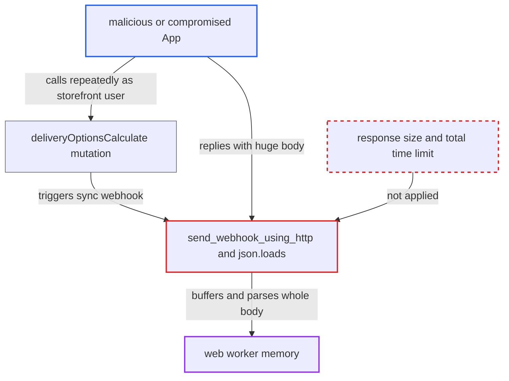

# Sync webhook responses are fully buffered and JSON-parsed with no size or time limit

| Field | Value |
|---|---|
| ID | `find_01EbEXWayB7qCMUYQhdC7xub` |
| Severity | **High** |
| Status | open |
| CWE | CWE-400 — Uncontrolled resource consumption |
| Created | 2026-10-27T21:28:14.584435Z |
| Claude Security | https://claude.ai/security/findings/find_01EbEXWayB7qCMUYQhdC7xub |

## Description

A malicious or compromised installed App can crash the web workers that serve shop requests, and the OOM kill also drops every other request on that worker. The App needs a permission for a sync webhook event, such as `MANAGE_SHIPPING`. The cause is `send_webhook_using_http`, which reads the whole webhook response into memory with no size or total-time limit, after which `_send_webhook_request_sync` parses it all with `json.loads`.

1. **the attacker's App** answers a sync webhook with a very large or gzip-compressed JSON body. The App holds a permission for a sync event, such as `MANAGE_SHIPPING` for `SHIPPING_LIST_METHODS_FOR_CHECKOUT`, so its server is called during checkout requests.
2. **the attacker as storefront user** creates a checkout and calls `deliveryOptionsCalculate` repeatedly. The mutation has no permission check and skips the `delivery_methods_stale_at` TTL, so every call triggers the sync webhook. ([`saleor/graphql/shipping/mutations/delivery_options_calculate.py:47-68`](https://github.com/cx-benchmark/saleor/blob/c982006cc04c77a97def93218dedac8d715eb041/saleor/graphql/shipping/mutations/delivery_options_calculate.py#L47-L68))
3. **the function `list_shipping_methods_for_checkout`** calls the App's webhook on each request. It uses the uncached `trigger_webhook_sync_promise` for every webhook of every app subscribed to `SHIPPING_LIST_METHODS_FOR_CHECKOUT`. ([`saleor/checkout/webhooks/list_shipping_methods.py:23-61`](https://github.com/cx-benchmark/saleor/blob/c982006cc04c77a97def93218dedac8d715eb041/saleor/checkout/webhooks/list_shipping_methods.py#L23-L61))
4. **the function `send_webhook_using_http`** loads the whole response body into memory and returns it as `response.text`. It calls `HTTPClient.send_request` without `stream=True`, so `requests` reads the full body after decoding any `Content-Encoding`. `WEBHOOK_SYNC_TIMEOUT` only limits idle time between socket reads. ([`saleor/webhook/transport/utils.py:246-287`](https://github.com/cx-benchmark/saleor/blob/c982006cc04c77a97def93218dedac8d715eb041/saleor/webhook/transport/utils.py#L246-L287))
5. **the function `_send_webhook_request_sync`** runs `json.loads` on the full body inside the GraphQL request. The body now exists as bytes, as a `str` and as a parsed object, and small repeated values make the parsed object much larger. The 1 KiB `EVENT_DELIVERY_ATTEMPT_RESPONSE_SIZE_LIMIT` is applied only later in `attempt_update`. ([`saleor/webhook/transport/synchronous/transport.py:141-150`](https://github.com/cx-benchmark/saleor/blob/c982006cc04c77a97def93218dedac8d715eb041/saleor/webhook/transport/synchronous/transport.py#L141-L150))
6. **the web worker** runs out of memory and is OOM-killed. Every other request the worker is serving is dropped with it, and the attacker can repeat the trigger across pods.

## Assessment

The attacker is an installed App, malicious or compromised, that holds a permission for a sync event: `MANAGE_SHIPPING` for `SHIPPING_LIST_METHODS_FOR_CHECKOUT`, or the report's other examples `CHECKOUT_FILTER_SHIPPING_METHODS`, `CHECKOUT_CALCULATE_TAXES` (`HANDLE_TAXES`) and payment session events (`HANDLE_PAYMENTS`). Its server returns a huge or compressed JSON reply. The attacker then acts as an anonymous storefront user, creates a checkout and calls `deliveryOptionsCalculate` repeatedly. Ordinary customer checkouts trigger the webhook too. Async deliveries and `handle_transaction_request_task` take the same path in Celery workers. The circuit breaker is off by default, and a huge but valid reply would not count as a failure anyway.

Impact: The attacker can exhaust memory or stall the web workers, and the Celery workers on async paths, until they are OOM-killed along with all requests they serve. The outage lasts as long as the webhook exists. The report names no confidentiality or integrity impact.

## Recommendation

`send_webhook_using_http` buffers the whole upstream response body, and `_send_webhook_request_sync` parses it, with no byte limit and no total-time limit. A semi-trusted App can therefore control worker memory and CPU.

Fix criteria: Webhook responses are read with a hard maximum size of a few MiB, streamed and aborted when `Content-Length` or the running byte count exceeds it, and within a total wall-clock budget. A response over the limit counts as a FAILED delivery (`None` to callers), and the body is never materialised or parsed. To verify, point a sync shipping webhook at a server returning a 1 GiB JSON body. The checkout request should complete with the app's methods skipped, and worker memory should stay flat.

## Evidence

**https://github.com/cx-benchmark/saleor**

- [`saleor/webhook/transport/utils.py:246-287`](https://github.com/cx-benchmark/saleor/blob/c982006cc04c77a97def93218dedac8d715eb041/saleor/webhook/transport/utils.py#L246-L287)
- [`saleor/webhook/transport/synchronous/transport.py:141-150`](https://github.com/cx-benchmark/saleor/blob/c982006cc04c77a97def93218dedac8d715eb041/saleor/webhook/transport/synchronous/transport.py#L141-L150)
- [`saleor/checkout/webhooks/list_shipping_methods.py:23-61`](https://github.com/cx-benchmark/saleor/blob/c982006cc04c77a97def93218dedac8d715eb041/saleor/checkout/webhooks/list_shipping_methods.py#L23-L61)
- [`saleor/graphql/shipping/mutations/delivery_options_calculate.py:47-68`](https://github.com/cx-benchmark/saleor/blob/c982006cc04c77a97def93218dedac8d715eb041/saleor/graphql/shipping/mutations/delivery_options_calculate.py#L47-L68)
- [`saleor/core/http_client.py:1-14`](https://github.com/cx-benchmark/saleor/blob/c982006cc04c77a97def93218dedac8d715eb041/saleor/core/http_client.py#L1-L14)
- [`saleor/app/installation_utils.py:78-108`](https://github.com/cx-benchmark/saleor/blob/c982006cc04c77a97def93218dedac8d715eb041/saleor/app/installation_utils.py#L78-L108)

