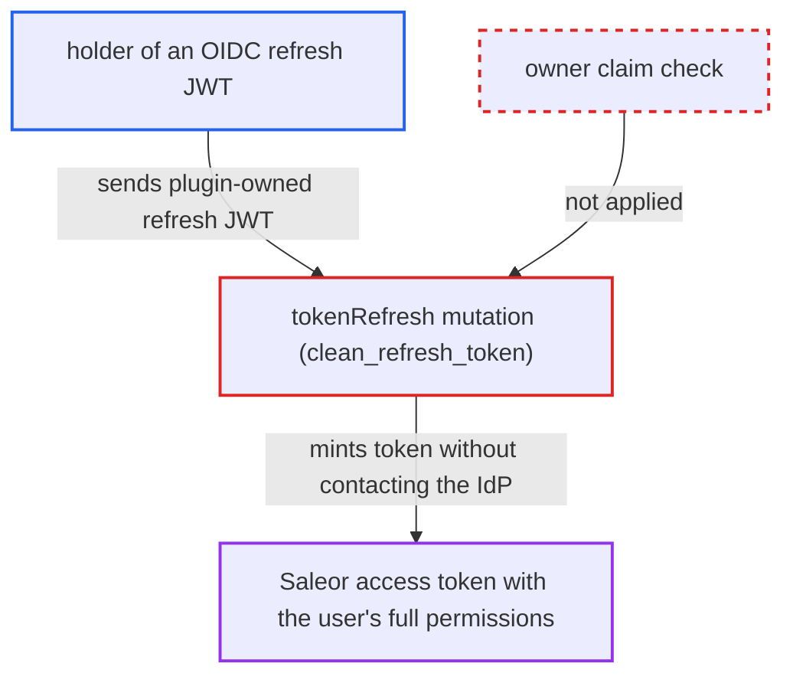

# tokenRefresh accepts plugin-owned OIDC refresh tokens, bypassing IdP refresh and expiry

| Field | Value |
|---|---|
| ID | `find_01DLTWDiDs1bVTLns5udhJfW` |
| Severity | **High** |
| Status | open |
| CWE | CWE-613 — Insufficient Session Expiration |
| Created | 2026-10-27T21:44:32.062082Z |
| Claude Security | https://claude.ai/security/findings/find_01DLTWDiDs1bVTLns5udhJfW |

## Description

A user who logged in through the OpenID Connect plugin, or anyone holding that user's OIDC refresh token, can keep minting Saleor access tokens with the user's full database permissions. This works after the identity provider has revoked or downgraded the user, and the refresh token never expires. It needs only a valid OIDC refresh JWT and the default `ENABLED` password login mode. The cause is that `tokenRefresh` checks only the signature and `type`, not the `owner` claim.

1. **OIDC plugin** issues a refresh JWT at login. `create_jwt_refresh_token` signs it with Saleor's key, sets `owner` to the plugin id and `type` to `refresh`, and gives it no `exp`, so it never expires. ([`saleor/plugins/openid_connect/utils.py:387-400`](https://github.com/cx-benchmark/saleor/blob/c982006cc04c77a97def93218dedac8d715eb041/saleor/plugins/openid_connect/utils.py#L387-L400))
2. **attacker** sends the OIDC refresh JWT to `tokenRefresh`. The attacker is a user later deprovisioned or demoted at the IdP, or anyone who obtained the token. It is passed as the `refreshToken` argument to `/graphql/`, so no CSRF token is needed. ([`saleor/graphql/account/mutations/authentication/refresh_token.py:124-145`](https://github.com/cx-benchmark/saleor/blob/c982006cc04c77a97def93218dedac8d715eb041/saleor/graphql/account/mutations/authentication/refresh_token.py#L124-L145))
3. **`clean_refresh_token`** accepts the token after checking only signature and type. It never reads the `owner` claim, so a plugin-owned token is treated as a first-party refresh token. ([`saleor/graphql/account/mutations/authentication/refresh_token.py:70-93`](https://github.com/cx-benchmark/saleor/blob/c982006cc04c77a97def93218dedac8d715eb041/saleor/graphql/account/mutations/authentication/refresh_token.py#L70-L93))
4. **`get_user_from_payload`** resolves the user by email and `jwt_token_key`. It only requires an active user whose `jwt_token_key` matches, and both hold for the OIDC refresh JWT. ([`saleor/core/jwt.py:125-137`](https://github.com/cx-benchmark/saleor/blob/c982006cc04c77a97def93218dedac8d715eb041/saleor/core/jwt.py#L125-L137))
5. **`tokenRefresh`** mints a Saleor access token with `create_access_token`. The token has no `permissions` claim, so the user gets their full database group permissions and `is_staff` flag. The IdP exchange that `external_refresh` performs is skipped entirely. ([`saleor/graphql/account/mutations/authentication/refresh_token.py:124-145`](https://github.com/cx-benchmark/saleor/blob/c982006cc04c77a97def93218dedac8d715eb041/saleor/graphql/account/mutations/authentication/refresh_token.py#L124-L145))
6. **attacker** repeats the call indefinitely. The refresh JWT has no `exp`, so each call returns a fresh 5-minute access token.

## Assessment

The attacker needs an OIDC refresh JWT issued by the OpenID Connect plugin. They may be a user (typically staff) who logged in through the plugin and was later deprovisioned or demoted at the IdP. They may also be anyone who got the token, for example from a compromised browser profile or a `refreshToken` cookie. They call `tokenRefresh` on `/graphql/` with the token as an argument. The default `PasswordLoginMode.ENABLED` mode gives no protection. `PasswordLoginMode.DISABLED` blocks the mutation. `CUSTOMERS_ONLY` strips staff rights from the minted token when it is used. Only a Saleor-side `jwt_token_key` rotation stops the attack, and only the user can trigger it with `tokensDeactivateAll`. Deactivating the account also stops it.

Impact: The attacker keeps access as the token's user with all of that user's Saleor permissions for an unbounded time. They can read and change whatever the user (or ex-staff account) could, after the IdP has revoked or downgraded the user. The report names no availability effect.

## Recommendation

(1) `tokenRefresh` validates only the signature and `type` of a refresh token, not its `owner` claim. Refresh tokens issued by authentication plugins can therefore be redeemed by the first-party flow, which skips the plugin's IdP exchange.

Fix criteria: `tokenRefresh` rejects any refresh token whose `owner` is not `saleor`. `externalRefresh` likewise rejects first-party refresh tokens, so plugin-issued credentials can only be renewed through the issuing plugin. Verify that an OIDC-minted refresh JWT passed to `tokenRefresh` yields `JWT_INVALID_TOKEN`.

(2) OIDC refresh JWTs are minted without `exp`, so any path that accepts them grants unbounded lifetime.

Fix criteria: Plugin-minted refresh JWTs carry a bounded Saleor-side expiry (for example `JWT_TTL_REFRESH`). A leaked or orphaned refresh credential then cannot be redeemed indefinitely, whichever mutation accepts it.

## Evidence

**https://github.com/cx-benchmark/saleor**

- [`saleor/graphql/account/mutations/authentication/refresh_token.py:70-93`](https://github.com/cx-benchmark/saleor/blob/c982006cc04c77a97def93218dedac8d715eb041/saleor/graphql/account/mutations/authentication/refresh_token.py#L70-L93)
- [`saleor/graphql/account/mutations/authentication/refresh_token.py:124-145`](https://github.com/cx-benchmark/saleor/blob/c982006cc04c77a97def93218dedac8d715eb041/saleor/graphql/account/mutations/authentication/refresh_token.py#L124-L145)
- [`saleor/plugins/openid_connect/utils.py:387-400`](https://github.com/cx-benchmark/saleor/blob/c982006cc04c77a97def93218dedac8d715eb041/saleor/plugins/openid_connect/utils.py#L387-L400)
- [`saleor/plugins/openid_connect/plugin.py:415-475`](https://github.com/cx-benchmark/saleor/blob/c982006cc04c77a97def93218dedac8d715eb041/saleor/plugins/openid_connect/plugin.py#L415-L475)
- [`saleor/core/jwt.py:125-137`](https://github.com/cx-benchmark/saleor/blob/c982006cc04c77a97def93218dedac8d715eb041/saleor/core/jwt.py#L125-L137)
- [`saleor/core/auth_backend.py:125-131`](https://github.com/cx-benchmark/saleor/blob/c982006cc04c77a97def93218dedac8d715eb041/saleor/core/auth_backend.py#L125-L131)

