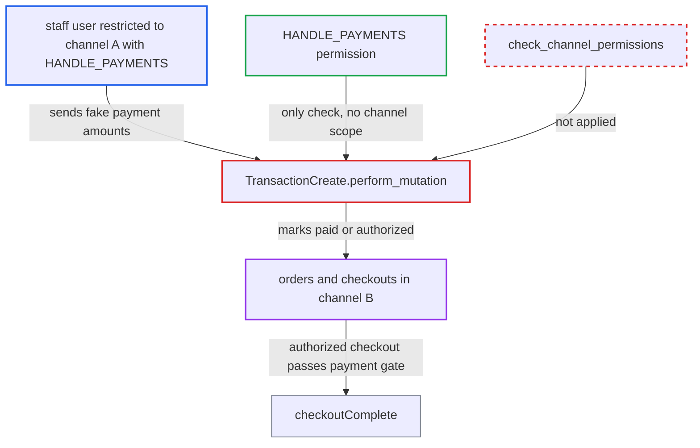

# transactionCreate ignores staff channel restrictions, letting restricted staff mark any order paid

| Field | Value |
|---|---|
| ID | `find_017VdACjW8PjZR14ArkBVgaX` |
| Severity | **High** |
| Status | open |
| CWE | CWE-285 — Missing authorization |
| Created | 2026-10-27T21:24:43.630704Z |
| Claude Security | https://claude.ai/security/findings/find_017VdACjW8PjZR14ArkBVgaX |

## Description

A staff user who is restricted to one channel but holds `HANDLE_PAYMENTS` can record fake payments, refunds or cancellations on orders and checkouts in other channels. Orders then show as paid or authorized, and checkouts can be completed into orders, with no money moving. `TransactionCreate.perform_mutation` checks only `HANDLE_PAYMENTS` and never calls `check_channel_permissions`.

1. **restricted staff user** gets the ID of a channel-B order or checkout. The user is in a group with `restricted_access_to_channels` limited to channel A and holds `HANDLE_PAYMENTS`. They can create a checkout in channel B through the public storefront API or use an existing channel-B order or checkout ID.
2. **restricted staff user** sends `transactionCreate` to `/graphql/` with chosen amounts. For example `transactionCreate(id, transaction:{amountCharged:{amount:<total>}})`, where the amount is the full total. ([`saleor/graphql/payment/mutations/transaction/transaction_create.py:330-391`](https://github.com/cx-benchmark/saleor/blob/c982006cc04c77a97def93218dedac8d715eb041/saleor/graphql/payment/mutations/transaction/transaction_create.py#L330-L391))
3. **mutation `TransactionCreate`** accepts the call after checking only `HANDLE_PAYMENTS`. The only guard is `permissions = (PaymentPermissions.HANDLE_PAYMENTS,)`, which has no channel scope, and `BaseMutation.mutate` does not call `check_channel_permissions` automatically. ([`saleor/graphql/payment/mutations/transaction/transaction_create.py:117-121`](https://github.com/cx-benchmark/saleor/blob/c982006cc04c77a97def93218dedac8d715eb041/saleor/graphql/payment/mutations/transaction/transaction_create.py#L117-L121))
4. **mutation `TransactionCreate`** loads the order or checkout by plain ID lookup and creates a `TransactionItem` with the caller's amounts. `perform_mutation` validates only currency, metadata and URL, then calls `process_order_or_checkout_with_transaction`. ([`saleor/graphql/payment/mutations/transaction/transaction_create.py:330-391`](https://github.com/cx-benchmark/saleor/blob/c982006cc04c77a97def93218dedac8d715eb041/saleor/graphql/payment/mutations/transaction/transaction_create.py#L330-L391))
5. **payment processing code** recalculates the payment status of the order or checkout. An order has its `charge_status` and `authorize_status` recomputed and may be confirmed. A checkout gets `authorize_status` FULL and fires `CHECKOUT_FULLY_PAID`. ([`saleor/payment/utils.py:1334-1386`](https://github.com/cx-benchmark/saleor/blob/c982006cc04c77a97def93218dedac8d715eb041/saleor/payment/utils.py#L1334-L1386))
6. **`checkoutComplete`** turns the fully authorized checkout into an order. The payment gate passes on the fake transaction, so an unpaid order is created. ([`saleor/checkout/complete_checkout.py:1745-1762`](https://github.com/cx-benchmark/saleor/blob/c982006cc04c77a97def93218dedac8d715eb041/saleor/checkout/complete_checkout.py#L1745-L1762))

## Assessment

The attacker is a staff user in a permission group with `restricted_access_to_channels` limited to channel A, and the group grants `HANDLE_PAYMENTS`. They need the ID of an order or checkout in channel B. They can create a checkout in channel B through the public storefront API or use an existing channel-B order or checkout ID. They then call `transactionCreate` on `/graphql/`.

Impact: The attacker can fabricate the payment state of orders and checkouts in channels they are excluded from. Orders become fully charged or authorized, and are confirmed when the channel auto-confirms. Checkouts become completable into orders with no money taken. Refunds and cancellations can also be recorded. Confidentiality is not affected, because `order(id:)` already returns the order, and availability is not affected.

## Recommendation

`TransactionCreate.perform_mutation` authorizes only on the `HANDLE_PAYMENTS` permission. It never checks the staff user's accessible channels against the channel of the target order or checkout.

Fix criteria: A staff requestor is denied when the target order's or checkout's channel is outside their accessible channels. Apps keep full access, matching `check_channel_permissions`. A test confirms that a staff user restricted to channel A calling `transactionCreate` on a channel-B order or checkout gets a permission error, no `TransactionItem` is created and no order status changes.

## Evidence

**https://github.com/cx-benchmark/saleor**

- [`saleor/graphql/payment/mutations/transaction/transaction_create.py:330-391`](https://github.com/cx-benchmark/saleor/blob/c982006cc04c77a97def93218dedac8d715eb041/saleor/graphql/payment/mutations/transaction/transaction_create.py#L330-L391)
- [`saleor/graphql/payment/mutations/transaction/transaction_create.py:117-121`](https://github.com/cx-benchmark/saleor/blob/c982006cc04c77a97def93218dedac8d715eb041/saleor/graphql/payment/mutations/transaction/transaction_create.py#L117-L121)
- [`saleor/graphql/core/mutations.py:585-598`](https://github.com/cx-benchmark/saleor/blob/c982006cc04c77a97def93218dedac8d715eb041/saleor/graphql/core/mutations.py#L585-L598)
- [`saleor/graphql/payment/mutations/transaction/transaction_request_action.py:264-276`](https://github.com/cx-benchmark/saleor/blob/c982006cc04c77a97def93218dedac8d715eb041/saleor/graphql/payment/mutations/transaction/transaction_request_action.py#L264-L276)
- [`saleor/payment/utils.py:1334-1386`](https://github.com/cx-benchmark/saleor/blob/c982006cc04c77a97def93218dedac8d715eb041/saleor/payment/utils.py#L1334-L1386)
- [`saleor/checkout/complete_checkout.py:1745-1762`](https://github.com/cx-benchmark/saleor/blob/c982006cc04c77a97def93218dedac8d715eb041/saleor/checkout/complete_checkout.py#L1745-L1762)

