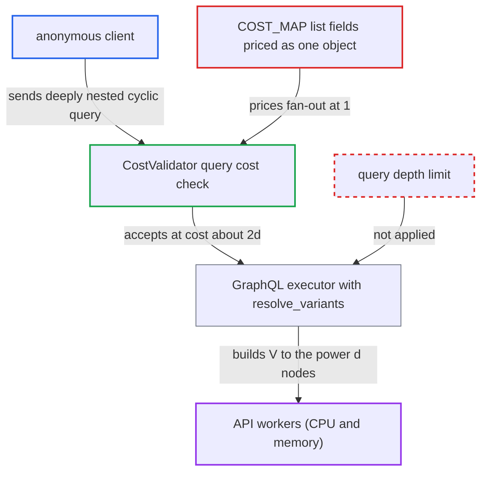

# Unpaginated list fields priced as scalars let type cycles bypass query cost limit

| Field | Value |
|---|---|
| ID | `find_01YPdU38x77sHzqDQpBfUiLi` |
| Severity | **High** |
| Status | open |
| CWE | CWE-770 — Allocation of Resources Without Limits |
| Created | 2026-10-27T21:59:17.335438Z |
| Claude Security | https://claude.ai/security/findings/find_01YPdU38x77sHzqDQpBfUiLi |

## Description

An anonymous visitor can take the whole GraphQL API offline with one small query. The query nests a list field and its back-reference to a large depth, so the cost check stays low while the server builds an exponentially large result. The weakness is in `COST_MAP`, which prices `Product.variants`, `Menu.items` and `MenuItem.children` as single objects, and no query-depth limit exists.

1. **anonymous client** picks a public product with two or more sellable variants. The same works with a menu that has two or more items, or with a menu item that has children.
2. **anonymous client** sends a query that repeats `variants { product { … } }` to a chosen depth d. The attacker picks d freely, and no login, victim action or special setting is needed. ([`saleor/graphql/views.py:478-499`](https://github.com/cx-benchmark/saleor/blob/c982006cc04c77a97def93218dedac8d715eb041/saleor/graphql/views.py#L478-L499))
3. **`COST_MAP`** prices `Product.variants` at `{"complexity": 1}` with no multiplier. `ProductVariant.product` is also priced 1, so each level of the cycle adds only a flat cost. ([`saleor/graphql/query_cost_map.py:353`](https://github.com/cx-benchmark/saleor/blob/c982006cc04c77a97def93218dedac8d715eb041/saleor/graphql/query_cost_map.py#L353))
4. **`compute_cost`** adds a flat 1 for a list field without `multipliers` and leaves the children's multiplier unchanged. The total cost is about 2d, far below `GRAPHQL_QUERY_MAX_COMPLEXITY` (50000), so the query is accepted. ([`saleor/graphql/core/validators/query_cost.py:197-205`](https://github.com/cx-benchmark/saleor/blob/c982006cc04c77a97def93218dedac8d715eb041/saleor/graphql/core/validators/query_cost.py#L197-L205))
5. **validators** run no depth check. Only the cost rule, `AliasCountLimitRule` and `MutationCountLimitRule` are applied, so nothing else limits nesting. ([`saleor/graphql/core/validators/__init__.py:43-56`](https://github.com/cx-benchmark/saleor/blob/c982006cc04c77a97def93218dedac8d715eb041/saleor/graphql/core/validators/__init__.py#L43-L56))
6. **the handler `resolve_variants`** returns the full variant list and the sub-selection runs for every element. With V variants the executor resolves and serialises about V^d `ProductVariant` nodes plus as many `Product` nodes. Dataloaders cache database rows but not the resolver calls or result objects. ([`saleor/graphql/product/types/products.py:1425-1447`](https://github.com/cx-benchmark/saleor/blob/c982006cc04c77a97def93218dedac8d715eb041/saleor/graphql/product/types/products.py#L1425-L1447))
7. **API worker** spends CPU and memory on the huge result. With V=2 and d=30 the cost is 60 but the result has about 2·10^9 nodes. With V=10 and d=7 the cost is 14 and the result has 2·10^7 nodes.

## Assessment

The attacker is any anonymous internet client who can reach `/graphql/`. Storefront traffic is allowed by default, and no privilege, victim action or unusual configuration is needed. They need a public product with two or more sellable variants. Alternatively, they can use a `menu` with two or more items, nesting `items` and `menu`. A `menuItem` with two or more children works too, nesting `children` and `parent`.

Impact: One request can use a worker's CPU indefinitely and exhaust its memory. The shipped image runs two uvicorn workers with no request timeout, so a handful of requests takes the API offline for every channel. No data is disclosed or modified.

## Recommendation

(1) List fields without pagination arguments (`Product.variants`, `Menu.items`, `MenuItem.children`) are priced as single objects. Nested selections are never multiplied by their fan-out, so a cycle through a back-reference costs little but does exponential work.

Fix criteria: Every list-returning field adds a multiplier to the cost of its sub-selection, either a conservative fixed upper bound for unpaginated lists or the actual page argument. The computed cost of a `variants{product{variants…}}` or `children{parent{children…}}` chain grows geometrically with depth. It exceeds `GRAPHQL_QUERY_MAX_COMPLEXITY` at a small depth.

(2) No maximum query depth is enforced, so a cycle of cheaply priced fields can be nested arbitrarily deep.

Fix criteria: Requests whose selection depth exceeds a documented bound are rejected at validation time, before execution, independently of the cost calculation. A 40-level nested selection is refused with a validation error.

## Evidence

**https://github.com/cx-benchmark/saleor**

- [`saleor/graphql/query_cost_map.py:353`](https://github.com/cx-benchmark/saleor/blob/c982006cc04c77a97def93218dedac8d715eb041/saleor/graphql/query_cost_map.py#L353)
- [`saleor/graphql/query_cost_map.py:378`](https://github.com/cx-benchmark/saleor/blob/c982006cc04c77a97def93218dedac8d715eb041/saleor/graphql/query_cost_map.py#L378)
- [`saleor/graphql/query_cost_map.py:290-300`](https://github.com/cx-benchmark/saleor/blob/c982006cc04c77a97def93218dedac8d715eb041/saleor/graphql/query_cost_map.py#L290-L300)
- [`saleor/graphql/core/validators/query_cost.py:197-205`](https://github.com/cx-benchmark/saleor/blob/c982006cc04c77a97def93218dedac8d715eb041/saleor/graphql/core/validators/query_cost.py#L197-L205)
- [`saleor/graphql/product/types/products.py:1425-1447`](https://github.com/cx-benchmark/saleor/blob/c982006cc04c77a97def93218dedac8d715eb041/saleor/graphql/product/types/products.py#L1425-L1447)
- [`saleor/graphql/product/types/products.py:984-992`](https://github.com/cx-benchmark/saleor/blob/c982006cc04c77a97def93218dedac8d715eb041/saleor/graphql/product/types/products.py#L984-L992)
- [`saleor/graphql/product/types/products.py:759-763`](https://github.com/cx-benchmark/saleor/blob/c982006cc04c77a97def93218dedac8d715eb041/saleor/graphql/product/types/products.py#L759-L763)
- [`saleor/graphql/menu/types.py:132-139`](https://github.com/cx-benchmark/saleor/blob/c982006cc04c77a97def93218dedac8d715eb041/saleor/graphql/menu/types.py#L132-L139)
- [`saleor/graphql/core/validators/__init__.py:43-56`](https://github.com/cx-benchmark/saleor/blob/c982006cc04c77a97def93218dedac8d715eb041/saleor/graphql/core/validators/__init__.py#L43-L56)
- [`saleor/graphql/views.py:478-499`](https://github.com/cx-benchmark/saleor/blob/c982006cc04c77a97def93218dedac8d715eb041/saleor/graphql/views.py#L478-L499)

