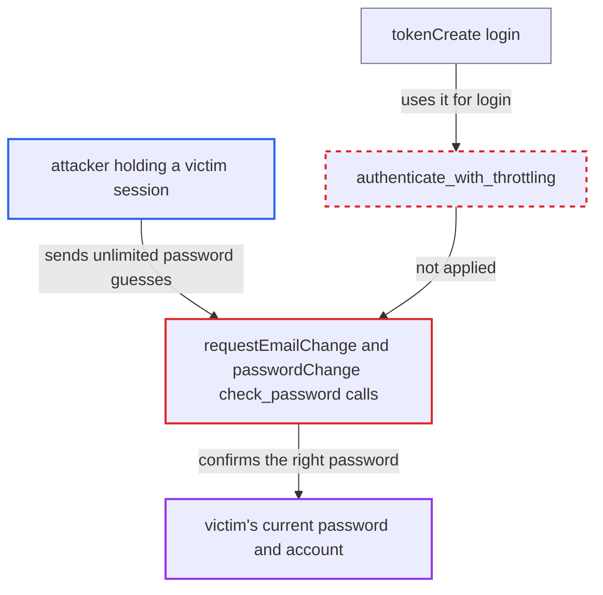

# Unthrottled current-password checks in requestEmailChange and passwordChange allow brute force from a session

| Field | Value |
|---|---|
| ID | `find_012HSvk5xCz3tYzbStsBSsS3` |
| Severity | **High** |
| Status | open |
| CWE | CWE-307 — Improper Restriction of Excessive Authentication Attempts |
| Created | 2026-10-27T21:27:25.451439Z |
| Claude Security | https://claude.ai/security/findings/find_012HSvk5xCz3tYzbStsBSsS3 |

## Description

Someone who already holds a victim's logged-in session can guess the account's current password without limit and then take the account over for good. This needs a valid user access token, for example a stolen token, a shared device or storefront XSS. `RequestEmailChange.perform_mutation` and `PasswordChange.perform_mutation` call `user.check_password()` directly, with no throttle or lockout.

1. **attacker** obtains a valid access or refresh token for the victim. The report names a leaked or stolen token, a shared device or a storefront XSS as ways to get it, and treats this as a precondition outside the attacker's control. ([`saleor/graphql/account/mutations/authentication/refresh_token.py:124-145`](https://github.com/cx-benchmark/saleor/blob/c982006cc04c77a97def93218dedac8d715eb041/saleor/graphql/account/mutations/authentication/refresh_token.py#L124-L145))
2. **attacker** calls `requestEmailChange` or `passwordChange` repeatedly with guessed passwords. Both mutations require only `AuthorizationFilters.AUTHENTICATED_USER`, and a stolen refresh token can mint fresh access tokens for 30 days because it is not rotated. ([`saleor/graphql/account/mutations/account/request_email_change.py:77-85`](https://github.com/cx-benchmark/saleor/blob/c982006cc04c77a97def93218dedac8d715eb041/saleor/graphql/account/mutations/account/request_email_change.py#L77-L85))
3. **the handler `perform_mutation`** checks each guess with `user.check_password()` and no throttle. A wrong guess returns a distinct `INVALID_CREDENTIALS` error and a right guess succeeds, so every call tells the attacker whether the guess was correct, and only the hash cost limits the rate. ([`saleor/graphql/account/mutations/authentication/password_change.py:66-67`](https://github.com/cx-benchmark/saleor/blob/c982006cc04c77a97def93218dedac8d715eb041/saleor/graphql/account/mutations/authentication/password_change.py#L66-L67))
4. **password policy** accepts weak passwords. The only validator is an 8-character minimum length, so common weak passwords fall to online guessing. ([`saleor/settings.py:477-482`](https://github.com/cx-benchmark/saleor/blob/c982006cc04c77a97def93218dedac8d715eb041/saleor/settings.py#L477-L482))
5. **attacker** calls `requestEmailChange` with the recovered password and their own new email. The confirmation token is mailed to the attacker-chosen address. ([`saleor/graphql/account/mutations/account/request_email_change.py:77-85`](https://github.com/cx-benchmark/saleor/blob/c982006cc04c77a97def93218dedac8d715eb041/saleor/graphql/account/mutations/account/request_email_change.py#L77-L85))
6. **attacker** calls `confirmEmailChange` with the token. The account's login email switches to the attacker's address, which completes the takeover without any action from the victim. ([`saleor/graphql/account/mutations/account/confirm_email_change.py:87-135`](https://github.com/cx-benchmark/saleor/blob/c982006cc04c77a97def93218dedac8d715eb041/saleor/graphql/account/mutations/account/confirm_email_change.py#L87-L135))

## Assessment

The attacker first needs a valid access or refresh token for the victim. The report lists a leaked or stolen token, a shared device and a storefront XSS as ways to get one. With it, the attacker can call `requestEmailChange(password, newEmail, redirectUrl)` or `passwordChange(oldPassword, ...)` as often as they like. Either mutation works as a password oracle. The victim has to do nothing.

Impact: The attacker learns the account's real password and can move the login email to their own address through `confirmEmailChange`. That turns bounded, revocable session access into permanent control, and `deactivateAllUserTokens` or token expiry no longer helps. This also applies to staff accounts. Only passwords guessable at the hash-bound online rate are exposed.

## Recommendation

The password re-checks in `requestEmailChange` and `passwordChange` call `user.check_password()` directly. They do not use the throttling that `tokenCreate` gets from `authenticate_with_throttling`, so wrong guesses are never delayed or locked out.

Fix criteria: Password checks in `requestEmailChange`, `passwordChange` and any other re-authentication point get the same or stricter attempt limiting as `tokenCreate`, per account and per source. Repeated wrong guesses are delayed or locked out. To confirm, submit a series of wrong passwords to `requestEmailChange` from one session. After a small number of failures, further attempts must be rejected with a throttling error, whether or not the password is correct.

## Evidence

**https://github.com/cx-benchmark/saleor**

- [`saleor/graphql/account/mutations/account/request_email_change.py:77-85`](https://github.com/cx-benchmark/saleor/blob/c982006cc04c77a97def93218dedac8d715eb041/saleor/graphql/account/mutations/account/request_email_change.py#L77-L85)
- [`saleor/graphql/account/mutations/authentication/password_change.py:66-67`](https://github.com/cx-benchmark/saleor/blob/c982006cc04c77a97def93218dedac8d715eb041/saleor/graphql/account/mutations/authentication/password_change.py#L66-L67)
- [`saleor/graphql/account/mutations/authentication/create_token.py:53`](https://github.com/cx-benchmark/saleor/blob/c982006cc04c77a97def93218dedac8d715eb041/saleor/graphql/account/mutations/authentication/create_token.py#L53)
- [`saleor/graphql/account/mutations/account/confirm_account.py:125-127`](https://github.com/cx-benchmark/saleor/blob/c982006cc04c77a97def93218dedac8d715eb041/saleor/graphql/account/mutations/account/confirm_account.py#L125-L127)
- [`saleor/account/throttling.py:21-69`](https://github.com/cx-benchmark/saleor/blob/c982006cc04c77a97def93218dedac8d715eb041/saleor/account/throttling.py#L21-L69)
- [`saleor/graphql/account/mutations/account/confirm_email_change.py:87-135`](https://github.com/cx-benchmark/saleor/blob/c982006cc04c77a97def93218dedac8d715eb041/saleor/graphql/account/mutations/account/confirm_email_change.py#L87-L135)
- [`saleor/graphql/account/mutations/authentication/refresh_token.py:124-145`](https://github.com/cx-benchmark/saleor/blob/c982006cc04c77a97def93218dedac8d715eb041/saleor/graphql/account/mutations/authentication/refresh_token.py#L124-L145)
- [`saleor/settings.py:477-482`](https://github.com/cx-benchmark/saleor/blob/c982006cc04c77a97def93218dedac8d715eb041/saleor/settings.py#L477-L482)

