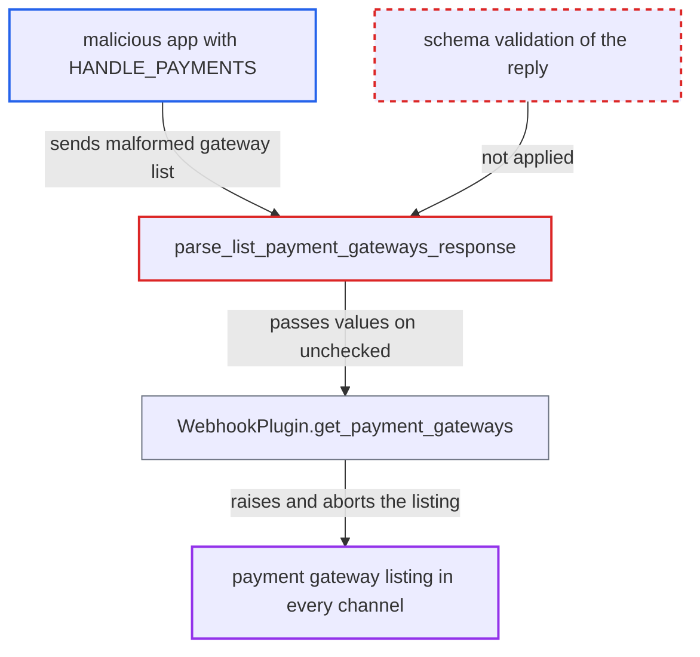

# Unvalidated PAYMENT_LIST_GATEWAYS reply from one app breaks payment gateway listing store-wide

| Field | Value |
|---|---|
| ID | `find_012opoHEaUqG2FCBk4sysrfN` |
| Severity | **High** |
| Status | open |
| CWE | CWE-1287 — Improper input validation |
| Created | 2026-10-27T21:28:48.593650Z |
| Claude Security | https://claude.ai/security/findings/find_012opoHEaUqG2FCBk4sysrfN |

## Description

An app that holds `HANDLE_PAYMENTS` can break payment gateway listing for every channel in the store. Checkout queries that request `availablePaymentGateways` then return a null checkout, and the legacy `checkoutPaymentCreate` fails for global gateways. The cause is that `parse_list_payment_gateways_response` does not validate the app's reply, and `get_payment_gateways` lets one app's error abort all gateways. Nothing is disclosed or modified.

1. **malicious or compromised app** registers a `PAYMENT_LIST_GATEWAYS` webhook. Only `HANDLE_PAYMENTS` is needed for an app's webhook to receive this event, and the app can create the webhook itself. ([`saleor/webhook/event_types.py:912-915`](https://github.com/cx-benchmark/saleor/blob/c982006cc04c77a97def93218dedac8d715eb041/saleor/webhook/event_types.py#L912-L915))
2. **the app** replies with a malformed gateway list. Examples are `["x"]`, `[{"id":"gw"}]` with no `currencies`, or `[{"id":"gw","name":null,"currencies":["USD"]}]`.
3. **the parser `parse_list_payment_gateways_response`** accepts the reply after checking only that it is a JSON list. It calls `.get()` on each element, which raises AttributeError on a non-dict, and passes `name`, `currencies` and `config` on unchecked. ([`saleor/webhook/transport/payment.py:14-36`](https://github.com/cx-benchmark/saleor/blob/c982006cc04c77a97def93218dedac8d715eb041/saleor/webhook/transport/payment.py#L14-L36))
4. **the plugin method `WebhookPlugin.get_payment_gateways`** raises inside the `process_responses` callback. The callback evaluates `currency in gtw.currencies` (TypeError when `currencies` is missing) and builds the transaction-app gateways. `Promise.all(...).then(process_responses).get()` re-raises the exception, so no gateways come back. ([`saleor/plugins/webhook/plugin.py:3338-3400`](https://github.com/cx-benchmark/saleor/blob/c982006cc04c77a97def93218dedac8d715eb041/saleor/plugins/webhook/plugin.py#L3338-L3400))
5. **the manager `list_payment_gateways`** lets the exception pass. The loop over payment plugins has no exception handling, so the gateways of every other plugin are lost too. ([`saleor/plugins/manager.py:2538-2573`](https://github.com/cx-benchmark/saleor/blob/c982006cc04c77a97def93218dedac8d715eb041/saleor/plugins/manager.py#L2538-L2573))
6. **the GraphQL field `availablePaymentGateways`** fails the request and nulls the whole `checkout` object. The field is `required=True`. A `null` name or a wrongly shaped value also breaks serialisation of the non-null `PaymentGateway` fields. ([`saleor/graphql/checkout/types.py:695-698`](https://github.com/cx-benchmark/saleor/blob/c982006cc04c77a97def93218dedac8d715eb041/saleor/graphql/checkout/types.py#L695-L698))
7. **the mutation `checkoutPaymentCreate`** fails for global gateways. It calls `is_currency_supported`, which runs the same listing. ([`saleor/graphql/payment/mutations/payment/checkout_payment_create.py:146-149`](https://github.com/cx-benchmark/saleor/blob/c982006cc04c77a97def93218dedac8d715eb041/saleor/graphql/payment/mutations/payment/checkout_payment_create.py#L146-L149))

## Assessment

The attacker is a malicious or compromised app with `HANDLE_PAYMENTS`, which the report treats as semi-trusted. It registers its own `PAYMENT_LIST_GATEWAYS` webhook and answers with a malformed list. The failure triggers whenever any customer's storefront resolves `checkout.availablePaymentGateways`, `shop.availablePaymentGateways` or `checkoutPaymentCreate`. No victim action or special deployment is needed. `WebhookPlugin` is global and active by default, and its webhook lookup is not channel-scoped, so every channel is affected.

Impact: While the app keeps replying this way, payment gateway discovery fails in every channel. This covers built-in plugins, other apps and the gift-card gateway. Any checkout query that requests `availablePaymentGateways` returns a null checkout, and `shop.availablePaymentGateways` fails. The legacy `checkoutPaymentCreate` fails for global gateways. It lasts until staff deactivate the app. A storefront that calls `transactionInitialize` directly with a known app identifier still works.

## Recommendation

`parse_list_payment_gateways_response` trusts the type and shape of each app-supplied gateway entry. `get_payment_gateways` lets an exception from one app's reply abort processing of every reply and every other plugin's gateways.

Fix criteria: Each `PAYMENT_LIST_GATEWAYS` reply is validated against a schema: string `id` and `name`, list-of-strings `currencies`, and a list of `{field, value}` for `config`. Invalid entries or replies are skipped and logged. Test by having one app return `["x"]`, `[{"id":"gw"}]` and `[{"id":"gw","name":null,"currencies":["USD"]}]`. In each case `checkout.availablePaymentGateways` still resolves with the other plugins' and apps' gateways and no error, and `checkoutPaymentCreate` still works.

## Evidence

**https://github.com/cx-benchmark/saleor**

- [`saleor/webhook/transport/payment.py:14-36`](https://github.com/cx-benchmark/saleor/blob/c982006cc04c77a97def93218dedac8d715eb041/saleor/webhook/transport/payment.py#L14-L36)
- [`saleor/plugins/webhook/plugin.py:3338-3400`](https://github.com/cx-benchmark/saleor/blob/c982006cc04c77a97def93218dedac8d715eb041/saleor/plugins/webhook/plugin.py#L3338-L3400)
- [`saleor/plugins/manager.py:2538-2573`](https://github.com/cx-benchmark/saleor/blob/c982006cc04c77a97def93218dedac8d715eb041/saleor/plugins/manager.py#L2538-L2573)
- [`saleor/graphql/checkout/types.py:695-698`](https://github.com/cx-benchmark/saleor/blob/c982006cc04c77a97def93218dedac8d715eb041/saleor/graphql/checkout/types.py#L695-L698)
- [`saleor/graphql/payment/types.py:958-970`](https://github.com/cx-benchmark/saleor/blob/c982006cc04c77a97def93218dedac8d715eb041/saleor/graphql/payment/types.py#L958-L970)
- [`saleor/graphql/payment/mutations/payment/checkout_payment_create.py:146-149`](https://github.com/cx-benchmark/saleor/blob/c982006cc04c77a97def93218dedac8d715eb041/saleor/graphql/payment/mutations/payment/checkout_payment_create.py#L146-L149)
- [`saleor/webhook/event_types.py:912-915`](https://github.com/cx-benchmark/saleor/blob/c982006cc04c77a97def93218dedac8d715eb041/saleor/webhook/event_types.py#L912-L915)

