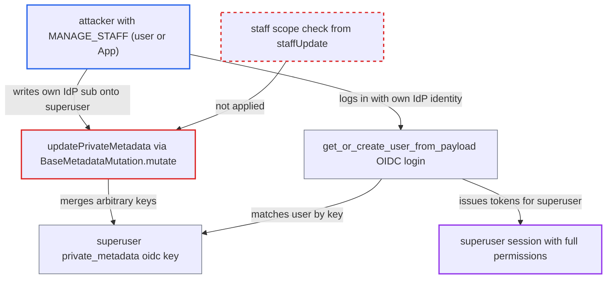

# User private metadata mutations skip staff scope check, letting MANAGE_STAFF holders hijack superusers via OIDC

| Field | Value |
|---|---|
| ID | `find_01J4hy9fAg1ZbrT37BcBsAS4` |
| Severity | **High** |
| Status | open |
| CWE | CWE-863 — Incorrect Authorization |
| Created | 2026-10-27T21:29:19.928465Z |
| Claude Security | https://claude.ai/security/findings/find_01J4hy9fAg1ZbrT37BcBsAS4 |

## Description

A staff user or App holding `MANAGE_STAFF` can take over a superuser account, or any higher-privileged staff account, when the built-in OpenID Connect plugin is active. They write their own identity-provider ID into the target's private metadata and then log in through OIDC. The metadata mutations check only `MANAGE_STAFF` and skip the scope rule that `staffUpdate` enforces, and the plugin trusts that writable metadata key to decide which account a login belongs to.

1. **attacker with `MANAGE_STAFF`** lists `staffUsers` to find the superuser's id. The attacker needs the target's id to address the metadata mutation.
2. **attacker with `MANAGE_STAFF`** sends `updatePrivateMetadata` for the superuser with the key `oidc:<authorization_url>` set to the attacker's IdP `sub`. `private_user_permissions` returns only `MANAGE_STAFF` for any staff target, superusers included, with no requester-scope comparison and no App exclusion. ([`saleor/graphql/meta/permissions.py:75-88`](https://github.com/cx-benchmark/saleor/blob/c982006cc04c77a97def93218dedac8d715eb041/saleor/graphql/meta/permissions.py#L75-L88))
3. **the handler `BaseMetadataMutation.mutate`** checks only the `MANAGE_STAFF` list and merges the key into `User.private_metadata`. It loads the target with no scope filter and never applies the `get_out_of_scope_users` rule used by `staffUpdate`. ([`saleor/graphql/meta/mutations/base.py:154-170`](https://github.com/cx-benchmark/saleor/blob/c982006cc04c77a97def93218dedac8d715eb041/saleor/graphql/meta/mutations/base.py#L154-L170))
4. **attacker with `MANAGE_STAFF`** clears the same key on their own account if needed. This is needed because a cached `sub` (cache lasts one hour) or a `sub` bound to two users makes the lookup fall back to email, so the `sub` must be uncached and bound to no other user; `MANAGE_STAFF` allows the clearing.
5. **attacker** completes a normal OIDC login with `externalAuthenticationUrl` and `externalObtainAccessTokens`. `get_or_create_user_from_payload` looks the user up by `private_metadata__contains` on the `oidc:` key and so matches the superuser. ([`saleor/plugins/openid_connect/utils.py:440-474`](https://github.com/cx-benchmark/saleor/blob/c982006cc04c77a97def93218dedac8d715eb041/saleor/plugins/openid_connect/utils.py#L440-L474))
6. **the method `external_obtain_access_tokens`** issues Saleor access and refresh tokens for the matched superuser. The tokens carry `permissions: []` unless OAuth scope permissions grant some, and there is no other proof that the IdP identity owns the account. ([`saleor/plugins/openid_connect/plugin.py:336-372`](https://github.com/cx-benchmark/saleor/blob/c982006cc04c77a97def93218dedac8d715eb041/saleor/plugins/openid_connect/plugin.py#L336-L372))
7. **the method `User.has_perm`** returns `True` for every permission. For an active superuser whose effective permissions are empty, which is the usual case for a superuser in no groups, every permission check passes. ([`saleor/account/models.py:350-357`](https://github.com/cx-benchmark/saleor/blob/c982006cc04c77a97def93218dedac8d715eb041/saleor/account/models.py#L350-L357))

## Assessment

The attacker is a staff user or an App holding `MANAGE_STAFF`, on a shop where the built-in OpenID Connect plugin is active. No victim action is needed. The attacker needs an IdP identity whose `sub` is not cached and is bound to no other user, or must first clear that key on their own account. A separate route to the same key write is `customerUpdate` with `MANAGE_USERS`. Even without OIDC, the same missing check lets any `MANAGE_STAFF` holder change staff metadata, both private (`updatePrivateMetadata`, `deletePrivateMetadata`) and public (`updateMetadata`, `deleteMetadata`).

Impact: The attacker gets access and refresh tokens for a superuser, or any higher-privileged staff account. That gives full read of customer PII, orders, app tokens and settings, and full write over the shop, including staff and permission groups. Without OIDC, the attacker can still rewrite or delete the metadata of staff outside their scope, such as gateway customer ids.

## Recommendation

(1) `private_user_permissions` and `public_user_permissions` let any `MANAGE_STAFF` holder, user or App, write metadata on any staff user. This ignores the staff-management scope rule that `staffUpdate` enforces.

Fix criteria: Metadata mutations on a `User` are refused when the requester could not edit that user through `staffUpdate`. That covers a requester lacking some of the target's permissions (`get_out_of_scope_users`), a non-superuser targeting a superuser, and an App acting on staff. To verify, a staff user with only `MANAGE_STAFF` gets a permission or out-of-scope error from `updatePrivateMetadata`, `deletePrivateMetadata` and `updateMetadata` on a superuser. A superuser still succeeds.

(2) The OIDC plugin treats a private metadata key that the API can write as the authoritative binding between an IdP subject and a Saleor account.

Fix criteria: Account-linking data used for authentication cannot be set through generic metadata or user-update APIs. To verify, after `oidc:<url>` is written onto another user through any GraphQL mutation, an OIDC login with that subject does not return tokens for that user.

## Evidence

**https://github.com/cx-benchmark/saleor**

- [`saleor/graphql/meta/permissions.py:75-88`](https://github.com/cx-benchmark/saleor/blob/c982006cc04c77a97def93218dedac8d715eb041/saleor/graphql/meta/permissions.py#L75-L88)
- [`saleor/graphql/meta/permissions.py:45-72`](https://github.com/cx-benchmark/saleor/blob/c982006cc04c77a97def93218dedac8d715eb041/saleor/graphql/meta/permissions.py#L45-L72)
- [`saleor/graphql/meta/mutations/base.py:154-170`](https://github.com/cx-benchmark/saleor/blob/c982006cc04c77a97def93218dedac8d715eb041/saleor/graphql/meta/mutations/base.py#L154-L170)
- [`saleor/graphql/account/mutations/staff/staff_update.py:71-78`](https://github.com/cx-benchmark/saleor/blob/c982006cc04c77a97def93218dedac8d715eb041/saleor/graphql/account/mutations/staff/staff_update.py#L71-L78)
- [`saleor/plugins/openid_connect/utils.py:440-474`](https://github.com/cx-benchmark/saleor/blob/c982006cc04c77a97def93218dedac8d715eb041/saleor/plugins/openid_connect/utils.py#L440-L474)
- [`saleor/plugins/openid_connect/plugin.py:336-372`](https://github.com/cx-benchmark/saleor/blob/c982006cc04c77a97def93218dedac8d715eb041/saleor/plugins/openid_connect/plugin.py#L336-L372)
- [`saleor/core/jwt.py:152-169`](https://github.com/cx-benchmark/saleor/blob/c982006cc04c77a97def93218dedac8d715eb041/saleor/core/jwt.py#L152-L169)
- [`saleor/account/models.py:350-357`](https://github.com/cx-benchmark/saleor/blob/c982006cc04c77a97def93218dedac8d715eb041/saleor/account/models.py#L350-L357)

