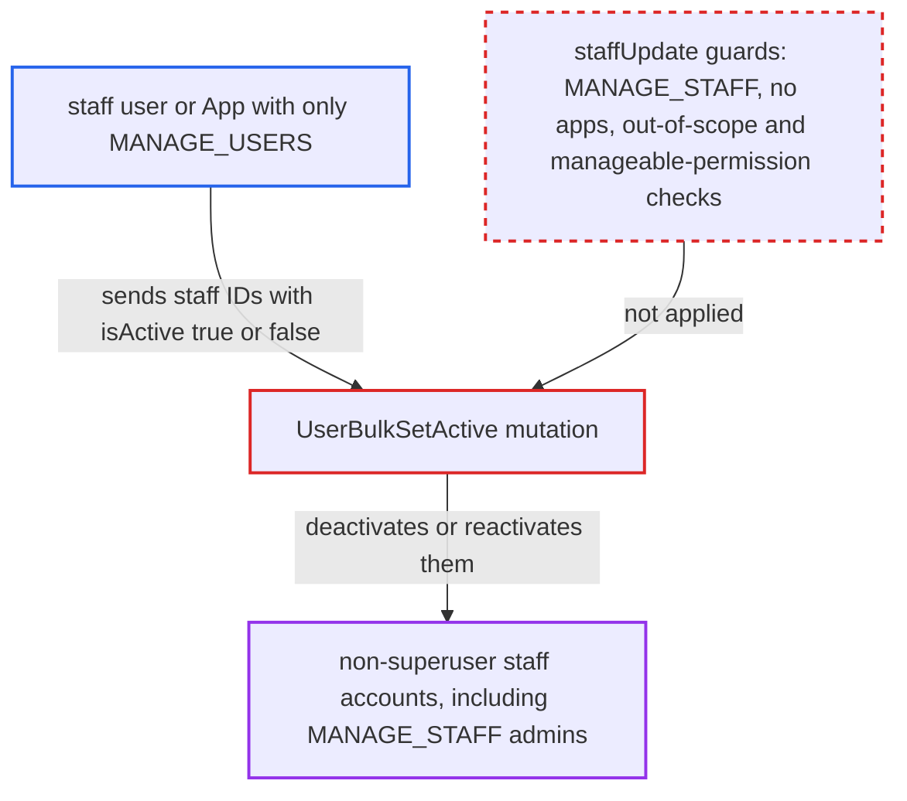

# userBulkSetActive lets MANAGE_USERS holders and apps deactivate or reactivate staff accounts

| Field | Value |
|---|---|
| ID | `find_01WCzhyPYju23rq4uKpaQMHT` |
| Severity | **High** |
| Status | open |
| CWE | CWE-863 — Improper Authorization |
| Created | 2026-10-27T21:14:52.253393Z |
| Claude Security | https://claude.ai/security/findings/find_01WCzhyPYju23rq4uKpaQMHT |

## Description

A staff user or App holding only the customer-level `MANAGE_USERS` permission can deactivate any non-superuser staff account, including administrators with `MANAGE_STAFF`. It can also reactivate staff accounts the owner disabled on purpose. The mutation `UserBulkSetActive` checks only `MANAGE_USERS` and skips the guards that `staffUpdate` enforces. It cannot take over accounts or read data, and superusers are protected.

1. **attacker with `MANAGE_USERS`** lists customer IDs with `customers` and infers staff IDs. User IDs are sequential (`User:<n>`), so the gaps between customer IDs are staff accounts.
2. **attacker** sends `userBulkSetActive` with the staff IDs and `isActive: false` to `/graphql/`. The same call with `isActive: true` re-enables staff accounts that were disabled. ([`saleor/graphql/account/bulk_mutations/user_bulk_set_active.py:25-59`](https://github.com/cx-benchmark/saleor/blob/c982006cc04c77a97def93218dedac8d715eb041/saleor/graphql/account/bulk_mutations/user_bulk_set_active.py#L25-L59))
3. **the base mutation `BaseBulkMutation.mutate`** checks only the permissions listed in `Meta.permissions`. For this mutation that list holds only `MANAGE_USERS`, and no object-level check runs beyond `clean_instance`. ([`saleor/graphql/core/mutations.py:1092-1139`](https://github.com/cx-benchmark/saleor/blob/c982006cc04c77a97def93218dedac8d715eb041/saleor/graphql/core/mutations.py#L1092-L1139))
4. **the helper `get_nodes`** resolves the IDs against every `User` row. The queryset has no `is_staff` filter, so staff IDs resolve like customer IDs. ([`saleor/graphql/utils/__init__.py:130-143`](https://github.com/cx-benchmark/saleor/blob/c982006cc04c77a97def93218dedac8d715eb041/saleor/graphql/utils/__init__.py#L130-L143))
5. **the mutation `UserBulkSetActive`** skips only the requestor and superusers, then runs `queryset.update(is_active=is_active)`. `clean_instance` refuses only the requestor's own account and `is_superuser` targets, and Apps are not excluded. ([`saleor/graphql/account/bulk_mutations/user_bulk_set_active.py:25-59`](https://github.com/cx-benchmark/saleor/blob/c982006cc04c77a97def93218dedac8d715eb041/saleor/graphql/account/bulk_mutations/user_bulk_set_active.py#L25-L59))
6. **the auth layer** rejects the deactivated staff members on every login and token path. `load_user_from_request` finds no active user, and `tokenCreate` and token refresh also refuse inactive users, so the lockout is immediate. ([`saleor/core/auth_backend.py:140-149`](https://github.com/cx-benchmark/saleor/blob/c982006cc04c77a97def93218dedac8d715eb041/saleor/core/auth_backend.py#L140-L149))

## Assessment

The attacker is a staff user or a third-party App that holds only `MANAGE_USERS`. No victim action is needed. The attacker finds staff IDs from the gaps in the customer ID sequence and sends `userBulkSetActive` to `/graphql/`. Sending `isActive: false` locks staff out, and sending `isActive: true` re-enables disabled staff.

Impact: One call can disable every non-superuser staff account, including the `MANAGE_STAFF` administrators who would normally undo it. Their tokens stop working at once, which halts order, payment and catalog administration until a superuser steps in, and the attacker can repeat the call. The attacker can also re-enable staff they may not manage, such as off-boarded admins. The mutation alone gives no account takeover or data read, and superusers are protected.

## Recommendation

`UserBulkSetActive` applies the customer-level `MANAGE_USERS` permission to every `User` row. It can therefore change the active state of staff without the `MANAGE_STAFF`, app-exclusion, requestor-scope and manageable-permission guards that `staffUpdate` enforces.

Fix criteria: A requestor without `MANAGE_STAFF`, and any App, cannot change `is_active` of a user with `is_staff=True`. Where staff targets are allowed, the same out-of-scope and left-not-manageable-permission checks as `staffUpdate` apply, for activation as well as deactivation. To verify, call `userBulkSetActive` with a staff ID from a `MANAGE_USERS`-only staff user or app. It must return an error and leave the target's `is_active` unchanged.

## Evidence

**https://github.com/cx-benchmark/saleor**

- [`saleor/graphql/account/bulk_mutations/user_bulk_set_active.py:25-59`](https://github.com/cx-benchmark/saleor/blob/c982006cc04c77a97def93218dedac8d715eb041/saleor/graphql/account/bulk_mutations/user_bulk_set_active.py#L25-L59)
- [`saleor/graphql/core/mutations.py:1092-1139`](https://github.com/cx-benchmark/saleor/blob/c982006cc04c77a97def93218dedac8d715eb041/saleor/graphql/core/mutations.py#L1092-L1139)
- [`saleor/graphql/utils/__init__.py:130-143`](https://github.com/cx-benchmark/saleor/blob/c982006cc04c77a97def93218dedac8d715eb041/saleor/graphql/utils/__init__.py#L130-L143)
- [`saleor/graphql/account/mutations/staff/staff_update.py:49-168`](https://github.com/cx-benchmark/saleor/blob/c982006cc04c77a97def93218dedac8d715eb041/saleor/graphql/account/mutations/staff/staff_update.py#L49-L168)
- [`saleor/graphql/account/resolvers.py:75-109`](https://github.com/cx-benchmark/saleor/blob/c982006cc04c77a97def93218dedac8d715eb041/saleor/graphql/account/resolvers.py#L75-L109)
- [`saleor/graphql/account/mutations/base.py:468-483`](https://github.com/cx-benchmark/saleor/blob/c982006cc04c77a97def93218dedac8d715eb041/saleor/graphql/account/mutations/base.py#L468-L483)
- [`saleor/core/auth_backend.py:140-149`](https://github.com/cx-benchmark/saleor/blob/c982006cc04c77a97def93218dedac8d715eb041/saleor/core/auth_backend.py#L140-L149)

