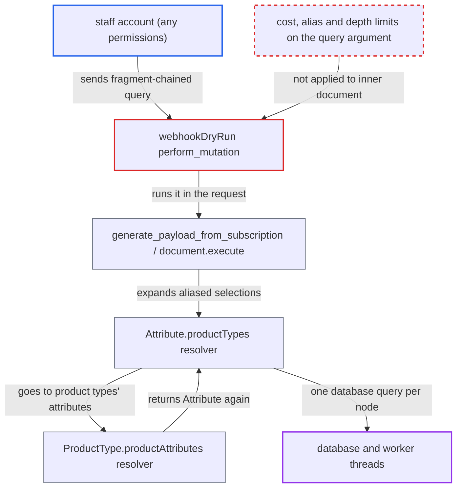

# webhookDryRun executes staff-supplied subscription documents with no cost, alias or depth limit

| Field | Value |
|---|---|
| ID | `find_015nj5151myV73cLsVAXQkBL` |
| Severity | **High** |
| Status | open |
| CWE | CWE-770 — Uncontrolled resource consumption |
| Created | 2026-10-27T21:23:06.944485Z |
| Claude Security | https://claude.ai/security/findings/find_015nj5151myV73cLsVAXQkBL |

## Description

Any staff account, even one with no permissions, can make the API do exponentially large amounts of work from one request. This can exhaust workers and the database and take the GraphQL API down. The mutation `webhookDryRun` runs the caller's `query` document in the request without the platform's cost, alias or depth limits. Only default GraphQL rules are applied to it.

1. **staff attacker** calls `webhookDryRun` with an `Attribute` ID and an `AttributeUpdated` subscription as `query`. The mutation only needs a staff login, and `validate_permissions` requires no permission for `ATTRIBUTE_*` events, so a staff account with no permissions passes. ([`saleor/graphql/webhook/mutations/webhook_dry_run.py:48-62`](https://github.com/cx-benchmark/saleor/blob/c982006cc04c77a97def93218dedac8d715eb041/saleor/graphql/webhook/mutations/webhook_dry_run.py#L48-L62))
2. **outer request validators** check only the outer mutation document. The cost, `AliasCountLimitRule` and `MutationCountLimitRule` checks see the `query` argument as an opaque string and never look inside it. ([`saleor/graphql/views.py:478-483`](https://github.com/cx-benchmark/saleor/blob/c982006cc04c77a97def93218dedac8d715eb041/saleor/graphql/views.py#L478-L483))
3. **`SubscriptionQuery.validate_query`** accepts the attacker's document after default checks. It runs only `graphql.validate` with the default rules plus structural checks, so a chain of fragments with many aliased `productTypes` selections passes. ([`saleor/graphql/webhook/subscription_query.py:81-123`](https://github.com/cx-benchmark/saleor/blob/c982006cc04c77a97def93218dedac8d715eb041/saleor/graphql/webhook/subscription_query.py#L81-L123))
4. **`perform_mutation`** executes the document inside the HTTP request and returns the whole result. It goes through `generate_payload_from_subscription` and `document.execute(...)`, with no cost map or middleware. ([`saleor/graphql/webhook/mutations/webhook_dry_run.py:124-147`](https://github.com/cx-benchmark/saleor/blob/c982006cc04c77a97def93218dedac8d715eb041/saleor/graphql/webhook/mutations/webhook_dry_run.py#L124-L147))
5. **resolvers for `Attribute.productTypes` and `ProductType.productAttributes`** expand the fragment chain through a cycle. `Attribute.productTypes` runs a fresh database query for every `Attribute` node, and `ProductType.productAttributes` returns `Attribute` nodes again, so work grows on the order of k^d for k aliases and depth d. ([`saleor/graphql/attribute/types.py:436-444`](https://github.com/cx-benchmark/saleor/blob/c982006cc04c77a97def93218dedac8d715eb041/saleor/graphql/attribute/types.py#L436-L444))
6. **API server** keeps a worker thread and database connection busy until the call ends. The shipped uvicorn server sets no per-request timeout, so a few concurrent calls can tie up the workers and the database.

## Assessment

The attacker is any staff account, including one with no permissions. They take any `Attribute` ID, for example from the `attributes` query. They call `webhookDryRun(objectId: <Attribute ID>, query: <AttributeUpdated subscription>)`. The subscription is a chain of fragments `F0..Fd`, each with k aliased `productTypes { edges { node { productAttributes { ...F(i+1) } } } }` selections. Only one storefront-visible attribute assigned to one product type is needed. Larger catalogs add the `first: 100` fan-out on top. The same validation gap affects stored webhook queries, but that is a separate entry point. This finding covers only the in-request dry-run path.

Impact: The attacker can deny service to the GraphQL API and the shared database. One small document causes exponentially many resolver calls and database queries, limited only by `first <= 100` per connection. Nothing is disclosed or modified, because resolvers still run as the caller.

## Recommendation

The subscription document passed to `webhookDryRun` is validated by `SubscriptionQuery.validate_query` with only the default GraphQL rules and executed in the request. This skips the platform's query cost, alias-count and depth protections.

Fix criteria: Before execution, the dry-run document must meet a resource budget at least as strict as a normal API request. That means the cost map with `GRAPHQL_QUERY_MAX_COMPLEXITY`, an alias limit, and a bound on nesting through fragments. Over-budget documents are refused with a validation error. A `webhookDryRun` whose `query` would exceed the cost or alias limit as a normal query returns an error and never reaches `document.execute`. This includes a fragment-chained aliased `productTypes`/`productAttributes` cycle.

## Evidence

**https://github.com/cx-benchmark/saleor**

- [`saleor/graphql/webhook/mutations/webhook_dry_run.py:124-147`](https://github.com/cx-benchmark/saleor/blob/c982006cc04c77a97def93218dedac8d715eb041/saleor/graphql/webhook/mutations/webhook_dry_run.py#L124-L147)
- [`saleor/graphql/webhook/mutations/webhook_dry_run.py:48-62`](https://github.com/cx-benchmark/saleor/blob/c982006cc04c77a97def93218dedac8d715eb041/saleor/graphql/webhook/mutations/webhook_dry_run.py#L48-L62)
- [`saleor/graphql/webhook/mutations/webhook_dry_run.py:86-98`](https://github.com/cx-benchmark/saleor/blob/c982006cc04c77a97def93218dedac8d715eb041/saleor/graphql/webhook/mutations/webhook_dry_run.py#L86-L98)
- [`saleor/graphql/webhook/subscription_query.py:81-123`](https://github.com/cx-benchmark/saleor/blob/c982006cc04c77a97def93218dedac8d715eb041/saleor/graphql/webhook/subscription_query.py#L81-L123)
- [`saleor/graphql/webhook/subscription_payload.py:212-224`](https://github.com/cx-benchmark/saleor/blob/c982006cc04c77a97def93218dedac8d715eb041/saleor/graphql/webhook/subscription_payload.py#L212-L224)
- [`saleor/graphql/views.py:478-483`](https://github.com/cx-benchmark/saleor/blob/c982006cc04c77a97def93218dedac8d715eb041/saleor/graphql/views.py#L478-L483)
- [`saleor/graphql/core/validators/__init__.py:36-59`](https://github.com/cx-benchmark/saleor/blob/c982006cc04c77a97def93218dedac8d715eb041/saleor/graphql/core/validators/__init__.py#L36-L59)
- [`saleor/webhook/event_types.py:282-305`](https://github.com/cx-benchmark/saleor/blob/c982006cc04c77a97def93218dedac8d715eb041/saleor/webhook/event_types.py#L282-L305)
- [`saleor/graphql/attribute/types.py:436-444`](https://github.com/cx-benchmark/saleor/blob/c982006cc04c77a97def93218dedac8d715eb041/saleor/graphql/attribute/types.py#L436-L444)
- [`saleor/graphql/product/types/products.py:1782-1801`](https://github.com/cx-benchmark/saleor/blob/c982006cc04c77a97def93218dedac8d715eb041/saleor/graphql/product/types/products.py#L1782-L1801)
- [`saleor/graphql/query_cost_map.py:230-232`](https://github.com/cx-benchmark/saleor/blob/c982006cc04c77a97def93218dedac8d715eb041/saleor/graphql/query_cost_map.py#L230-L232)

