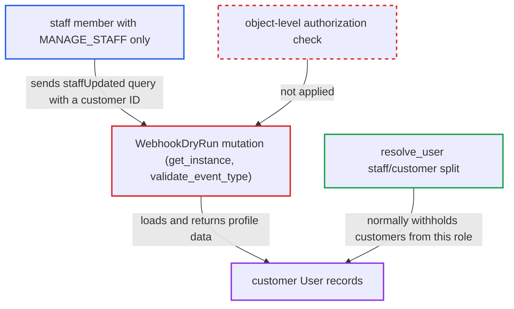

# webhookDryRun loads any User by ID, letting MANAGE_STAFF staff read customers

| Field | Value |
|---|---|
| ID | `find_019oW2AoazQLrdGZP2eaAiq3` |
| Severity | **High** |
| Status | open |
| CWE | CWE-639 — Insecure direct object reference |
| Created | 2026-10-27T21:19:05.736451Z |
| Claude Security | https://claude.ai/security/findings/find_019oW2AoazQLrdGZP2eaAiq3 |

## Description

A staff member who holds only `MANAGE_STAFF` can read any customer's profile through the `webhookDryRun` mutation. This includes e-mail, names, addresses with phone numbers, public metadata, notes, gift cards and open checkouts. The reverse also works: a `MANAGE_USERS`-only staff member can read staff accounts. The cause is that `WebhookDryRun` checks the event's permission and the object's type name (`User`), but never checks whether the caller may read that particular user.

1. **attacker with `MANAGE_STAFF` only** sends `webhookDryRun` with a `staffUpdated` subscription query and a customer's `User:N` ID. The query asks for fields such as `email`, `addresses`, `checkoutIds` and `metadata`, and the ID can be stepped through sequential values of N.
2. **the check `validate_event_type`** accepts the ID because its type name is `User`. It only compares the type name in `objectId` with the event's `root_type`, and all `Staff*` and `Customer*` events use `root_type = "User"`. ([`saleor/graphql/webhook/mutations/webhook_dry_run.py:65-98`](https://github.com/cx-benchmark/saleor/blob/c982006cc04c77a97def93218dedac8d715eb041/saleor/graphql/webhook/mutations/webhook_dry_run.py#L65-L98))
3. **the check `validate_permissions`** passes on `MANAGE_STAFF`. It checks only the permission mapped to the event, and `staff_*` events need only `MANAGE_STAFF`. ([`saleor/webhook/event_types.py:779-790`](https://github.com/cx-benchmark/saleor/blob/c982006cc04c77a97def93218dedac8d715eb041/saleor/webhook/event_types.py#L779-L790))
4. **the method `get_instance`** loads the user by primary key. It calls `get_node_or_error` without a `qs`, so customers and staff are both loadable and nothing checks the caller's right to that row. ([`saleor/graphql/webhook/mutations/webhook_dry_run.py:113-121`](https://github.com/cx-benchmark/saleor/blob/c982006cc04c77a97def93218dedac8d715eb041/saleor/graphql/webhook/mutations/webhook_dry_run.py#L113-L121))
5. **the method `perform_mutation`** runs the caller's subscription query over the loaded user and returns the result in `payload`. The `User` type has no field-level checks on most of these fields, so the data goes back to the caller. ([`saleor/graphql/webhook/mutations/webhook_dry_run.py:124-147`](https://github.com/cx-benchmark/saleor/blob/c982006cc04c77a97def93218dedac8d715eb041/saleor/graphql/webhook/mutations/webhook_dry_run.py#L124-L147))

## Assessment

The attacker is a staff user with `MANAGE_STAFF` but without `MANAGE_USERS`. They call `/graphql/` and need no victim action. The mirror case works too: a staff member with only `MANAGE_USERS` dry-runs `customerUpdated` with a staff `User` ID and reads the staff member's e-mail, `userPermissions`, `permissionGroups` and `accessibleChannels`. A second entry point is `webhookTrigger`. It has the same type-name-only check and unrestricted lookup in `validate_event_type` and `get_instance`. The payload there is built from the target webhook's own query with that app's permissions. It is readable through `delivery.payload` only when delivery fails, so it is the weaker path.

Impact: The attacker can bulk-read every customer's profile, which the regular `resolve_user` and `customers` queries deny to this role. Checkout IDs act as bearer handles for active channels, so the attacker can also change customers' open checkouts. Orders and private metadata stay protected by their own field checks.

## Recommendation

(1) `WebhookDryRun.get_instance` and `validate_event_type` authorize only the event type, not the object. Any node whose type name matches `root_type` is loaded and rendered, which bypasses the staff/customer split in `resolve_user`.

Fix criteria: An object loaded for a dry run is one the requestor could read through the regular query for its type. Customers need `MANAGE_USERS` (or a role `resolve_user` allows), and staff accounts need `MANAGE_STAFF`. `staff_*` events reject non-staff users and `customer_*` events reject staff. A `MANAGE_STAFF`-only staff member who dry-runs `staffUpdated` with a customer ID gets a permission or not-found error. A `MANAGE_USERS`-only member who dry-runs `customerUpdated` with a staff ID gets the same.

(2) `WebhookTrigger.validate_event_type` and `get_instance` use the same type-name-only check and unrestricted lookup. The payload is built with the recipient app's permissions and can come back to the caller in `delivery.payload`.

Fix criteria: The same object-level authorization is applied to `webhookTrigger`. The response never exposes a payload built with permissions the caller lacks. A staff user who cannot query a customer directly cannot get that customer's data from `delivery.payload`.

## Evidence

**https://github.com/cx-benchmark/saleor**

- [`saleor/graphql/webhook/mutations/webhook_dry_run.py:113-121`](https://github.com/cx-benchmark/saleor/blob/c982006cc04c77a97def93218dedac8d715eb041/saleor/graphql/webhook/mutations/webhook_dry_run.py#L113-L121)
- [`saleor/graphql/webhook/mutations/webhook_dry_run.py:65-98`](https://github.com/cx-benchmark/saleor/blob/c982006cc04c77a97def93218dedac8d715eb041/saleor/graphql/webhook/mutations/webhook_dry_run.py#L65-L98)
- [`saleor/graphql/webhook/mutations/webhook_dry_run.py:124-147`](https://github.com/cx-benchmark/saleor/blob/c982006cc04c77a97def93218dedac8d715eb041/saleor/graphql/webhook/mutations/webhook_dry_run.py#L124-L147)
- [`saleor/graphql/webhook/subscription_types.py:2006-2028`](https://github.com/cx-benchmark/saleor/blob/c982006cc04c77a97def93218dedac8d715eb041/saleor/graphql/webhook/subscription_types.py#L2006-L2028)
- [`saleor/webhook/event_types.py:779-790`](https://github.com/cx-benchmark/saleor/blob/c982006cc04c77a97def93218dedac8d715eb041/saleor/webhook/event_types.py#L779-L790)
- [`saleor/graphql/account/resolvers.py:76-116`](https://github.com/cx-benchmark/saleor/blob/c982006cc04c77a97def93218dedac8d715eb041/saleor/graphql/account/resolvers.py#L76-L116)
- [`saleor/graphql/account/types.py:448-520`](https://github.com/cx-benchmark/saleor/blob/c982006cc04c77a97def93218dedac8d715eb041/saleor/graphql/account/types.py#L448-L520)
- [`saleor/graphql/webhook/mutations/webhook_trigger.py:80-98`](https://github.com/cx-benchmark/saleor/blob/c982006cc04c77a97def93218dedac8d715eb041/saleor/graphql/webhook/mutations/webhook_trigger.py#L80-L98)

