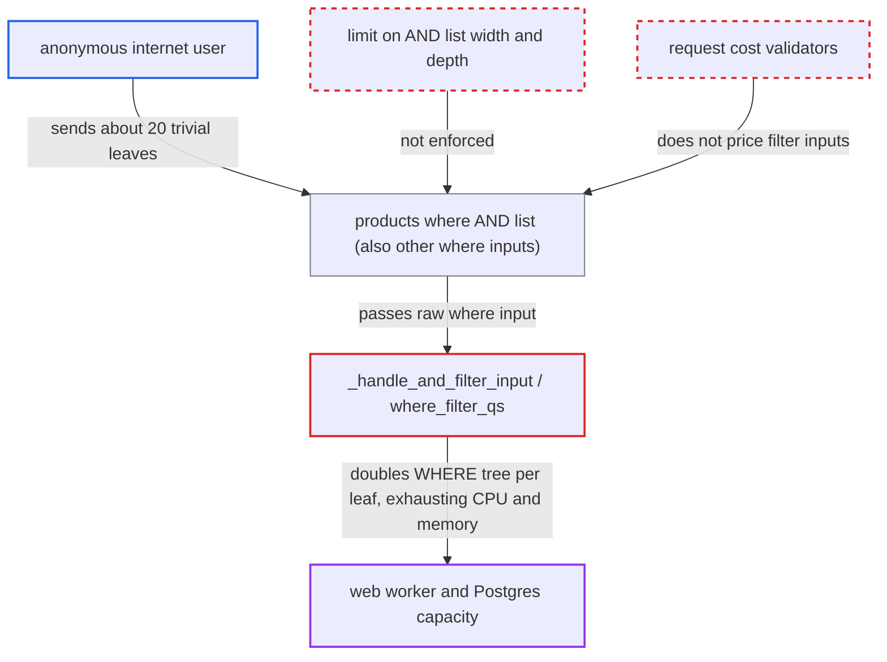

# where AND operator doubles the WHERE clause per leaf: exponential query blowup from small anonymous request

| Field | Value |
|---|---|
| ID | `find_018w7Gbb6QcTe37agVZKa8kX` |
| Severity | **High** |
| Status | open |
| CWE | CWE-407 — Algorithmic complexity |
| Created | 2026-10-27T21:59:22.977492Z |
| Claude Security | https://claude.ai/security/findings/find_018w7Gbb6QcTe37agVZKa8kX |

## Description

An anonymous internet user can exhaust CPU and memory on the web workers and the shared Postgres with one small GraphQL request (under 1 KB), denying service to every channel. The request needs only a long `AND` list in a `where` input, for example on `products`. `_handle_and_filter_input` and `where_filter_qs` copy the accumulated WHERE tree on every list element, so its size doubles per element, and nothing limits list length or nesting depth.

1. **anonymous attacker** sends a `products` query with a long `AND` list in `where`. About 20 trivial leaves such as `{slug:{eq:"a"}}` fit in under 1 KB, and the report says 18 to 25 leaves are enough. ([`saleor/graphql/core/filters/where_input.py:27-51`](https://github.com/cx-benchmark/saleor/blob/c982006cc04c77a97def93218dedac8d715eb041/saleor/graphql/core/filters/where_input.py#L27-L51))
2. **request validators** accept the request as cheap. They price only the selection set, so a 20-element `AND` list costs the same as `products(first:1)`. ([`saleor/graphql/core/validators/__init__.py:48-56`](https://github.com/cx-benchmark/saleor/blob/c982006cc04c77a97def93218dedac8d715eb041/saleor/graphql/core/validators/__init__.py#L48-L56))
3. **the function `_handle_and_filter_input`** filters each `AND` element on the already accumulated queryset. The result of `filter_qs` or `where_filter_qs` therefore already holds every condition collected so far. ([`saleor/graphql/core/connection.py:519-552`](https://github.com/cx-benchmark/saleor/blob/c982006cc04c77a97def93218dedac8d715eb041/saleor/graphql/core/connection.py#L519-L552))
4. **the function `_handle_and_filter_input`** combines the result back with `queryset &= ...`. Django's `Query.combine` clones the right-hand WHERE tree and adds it without deduplication, so the tree doubles per element and reaches `(k+1)·2^N − 1` conditions after N leaves. ([`saleor/graphql/core/connection.py:637-652`](https://github.com/cx-benchmark/saleor/blob/c982006cc04c77a97def93218dedac8d715eb041/saleor/graphql/core/connection.py#L637-L652))
5. **the function `where_filter_qs`** repeats the doubling for nested operators. Nested `AND`s use the same accumulated queryset and multiply the growth further, with no limit on depth. ([`saleor/graphql/core/connection.py:554-634`](https://github.com/cx-benchmark/saleor/blob/c982006cc04c77a97def93218dedac8d715eb041/saleor/graphql/core/connection.py#L554-L634))
6. **the anonymous base queryset** adds correlated `EXISTS` subqueries to every copy. For an anonymous `products` query `k` is 3, so 20 leaves give about 4 million conditions, 3 million of them `EXISTS` subqueries. ([`saleor/graphql/product/resolvers.py:135-158`](https://github.com/cx-benchmark/saleor/blob/c982006cc04c77a97def93218dedac8d715eb041/saleor/graphql/product/resolvers.py#L135-L158))
7. **web worker and Postgres** spend CPU and memory on cloning the tree and compiling a huge SQL string. The Python work comes first, producing a SQL string of hundreds of MB to GB. Postgres is hit only if the statement gets that far, and no `statement_timeout` is set in `saleor/settings.py`.

## Assessment

The attacker is any anonymous internet user who can reach the public `/graphql/` storefront endpoint. No login, special setting or deployment state is needed. The attacker sends `products(where:{AND:[...]})` with about 18 to 25 trivial leaves. Any other connection with a `*WhereInput` works too, such as `productVariants`, `categories`, `collections`, `attributes` or `pages`. For `categories` (`resolve_categories`, no channel needed) `k` is 0, and growth is still `2^N − 1`. At 25 to 27 leaves the where-tree's child list alone reaches gigabytes. A handful of requests is enough. `OR` folds into a separate `none()` queryset and grows only linearly, so only `AND` doubles.

Impact: The attacker can exhaust CPU and memory on the web workers and cause long, memory-hungry query planning on the shared Postgres. This denies service to all channels of the deployment. The report finds no confidentiality or integrity impact.

## Recommendation

(1) Each `AND` element is filtered on the already accumulated queryset and then `&`-combined back into it. This copies the accumulated conditions on every step, so growth is exponential. Each leaf should be applied once, to the base queryset, or filters should be chained.

Fix criteria: The size of the generated WHERE clause grows linearly with the number of leaves in the `where` input. A leaf's conditions appear once in the final query, however many siblings or ancestors it has. To check, capture the SQL for an `AND` list of 20 trivial leaves and assert that the number of `EXISTS` subqueries and conditions is O(20), not O(2^20).

(2) No limit is enforced on the width or nesting depth of `AND`/`OR` lists in `*WhereInput`. Query cost validation also ignores filter inputs.

Fix criteria: Requests whose `where` input exceeds a documented bound on total leaves and nesting depth are rejected before any queryset is built. To check, send an oversized `where` input and confirm it returns a validation error without touching the database.

## Evidence

**https://github.com/cx-benchmark/saleor**

- [`saleor/graphql/core/connection.py:637-652`](https://github.com/cx-benchmark/saleor/blob/c982006cc04c77a97def93218dedac8d715eb041/saleor/graphql/core/connection.py#L637-L652)
- [`saleor/graphql/core/connection.py:519-552`](https://github.com/cx-benchmark/saleor/blob/c982006cc04c77a97def93218dedac8d715eb041/saleor/graphql/core/connection.py#L519-L552)
- [`saleor/graphql/core/connection.py:554-634`](https://github.com/cx-benchmark/saleor/blob/c982006cc04c77a97def93218dedac8d715eb041/saleor/graphql/core/connection.py#L554-L634)
- [`saleor/graphql/core/filters/where_input.py:27-51`](https://github.com/cx-benchmark/saleor/blob/c982006cc04c77a97def93218dedac8d715eb041/saleor/graphql/core/filters/where_input.py#L27-L51)
- [`saleor/graphql/product/resolvers.py:135-158`](https://github.com/cx-benchmark/saleor/blob/c982006cc04c77a97def93218dedac8d715eb041/saleor/graphql/product/resolvers.py#L135-L158)
- [`saleor/graphql/core/validators/__init__.py:48-56`](https://github.com/cx-benchmark/saleor/blob/c982006cc04c77a97def93218dedac8d715eb041/saleor/graphql/core/validators/__init__.py#L48-L56)

