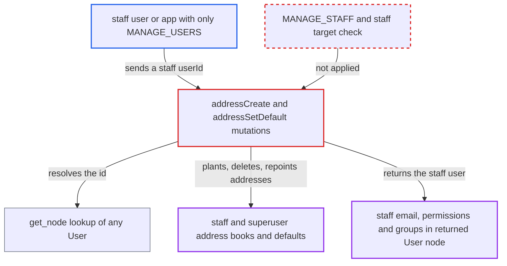

# addressCreate/addressSetDefault let MANAGE_USERS holders alter staff and superuser address books

| Field | Value |
|---|---|
| ID | `find_01Bh2mAkhgrXjvyw8cfKqoNs` |
| Severity | **Medium** |
| Status | open |
| CWE | CWE-863 — Improper Authorization |
| Created | 2026-10-27T21:45:21.782515Z |
| Claude Security | https://claude.ai/security/findings/find_01Bh2mAkhgrXjvyw8cfKqoNs |

## Description

A staff user or app holding only `MANAGE_USERS` can change the address books of staff and superuser accounts. They can plant addresses, delete older ones and change the default billing or shipping address. They can also read the staff member's email, permissions and groups. The mutations `addressCreate` and `addressSetDefault` load any user by id and never check `is_staff`, `is_superuser` or `MANAGE_STAFF`.

1. **attacker with only `MANAGE_USERS`** sends `addressCreate` with the `userId` of a staff or superuser account. The only gate is `permissions = (AccountPermissions.MANAGE_USERS,)`, and apps are not excluded. ([`saleor/graphql/account/mutations/staff/address_create.py:35-42`](https://github.com/cx-benchmark/saleor/blob/c982006cc04c77a97def93218dedac8d715eb041/saleor/graphql/account/mutations/staff/address_create.py#L35-L42))
2. **`get_node`** loads the target with `User.objects.get(pk=id)`. There is no `is_staff` or `is_superuser` filter, and the `User` type has no override, so staff ids resolve like customer ids. ([`saleor/graphql/core/types/model.py:62-81`](https://github.com/cx-benchmark/saleor/blob/c982006cc04c77a97def93218dedac8d715eb041/saleor/graphql/core/types/model.py#L62-L81))
3. **`AddressCreate.perform_mutation`** attaches the attacker's address to the target and returns the target as `user`. If the target already holds `MAX_USER_ADDRESSES` (100 by default) addresses, it first deletes the target's oldest non-default address, so many creates erase the saved addresses. ([`saleor/graphql/account/mutations/staff/address_create.py:50-67`](https://github.com/cx-benchmark/saleor/blob/c982006cc04c77a97def93218dedac8d715eb041/saleor/graphql/account/mutations/staff/address_create.py#L50-L67))
4. **the returned `User` node** exposes the staff member's data to the attacker. `email`, `addresses`, `userPermissions` and `permissionGroups` have no field-level permission check, and staff who never ordered are otherwise hidden from a `MANAGE_USERS`-only requestor. ([`saleor/graphql/account/types.py:654-657`](https://github.com/cx-benchmark/saleor/blob/c982006cc04c77a97def93218dedac8d715eb041/saleor/graphql/account/types.py#L654-L657))
5. **attacker with only `MANAGE_USERS`** calls `addressSetDefault` with the staff `userId`, the planted `addressId` and a `type`. The mutation only checks that the address is in the target's book, then `change_user_default_address` rewrites the default billing or shipping address. ([`saleor/graphql/account/mutations/staff/address_set_default.py:29-68`](https://github.com/cx-benchmark/saleor/blob/c982006cc04c77a97def93218dedac8d715eb041/saleor/graphql/account/mutations/staff/address_set_default.py#L29-L68))

## Assessment

The attacker is a staff user or an App that holds `MANAGE_USERS` and nothing stronger. User ids are sequential, so a staff or superuser id is easy to find. The attacker sends `addressCreate(userId: "User:<superuser>", input: {...})` to `/graphql/`. Then they can send `addressSetDefault(userId, addressId: <planted>, type: SHIPPING)`. No victim action is needed. For staff who have never placed an order, the `addressCreate` payload is also the only way for this requestor to read their data.

Impact: The attacker can plant addresses in staff and superuser address books, change their default billing and shipping addresses, and erase their saved addresses by creating more than 100. They can also read the staff member's email, address book, permissions and groups. The report finds no path that changes credentials or permissions, and says checkout does not use default addresses server-side.

## Recommendation

`addressCreate` and `addressSetDefault` resolve `userId` from the full `User` table under the customer-level `MANAGE_USERS` permission. They ignore the staff/customer boundary that the project enforces for staff addresses (`MANAGE_STAFF`) and staff accounts.

Fix criteria: A requestor without `MANAGE_STAFF` cannot create, prune or set default addresses for a user with `is_staff` or `is_superuser`, and the mutation does not return such a user's node. Where staff targets are allowed, the normal staff scope checks and app exclusion apply. To verify, run `addressCreate(userId: <staff>)` and `addressSetDefault(userId: <staff>)` as a `MANAGE_USERS`-only user and as an app. Both must fail, and the staff account's addresses and defaults must stay unchanged.

## Evidence

**https://github.com/cx-benchmark/saleor**

- [`saleor/graphql/account/mutations/staff/address_create.py:50-67`](https://github.com/cx-benchmark/saleor/blob/c982006cc04c77a97def93218dedac8d715eb041/saleor/graphql/account/mutations/staff/address_create.py#L50-L67)
- [`saleor/graphql/account/mutations/staff/address_create.py:35-42`](https://github.com/cx-benchmark/saleor/blob/c982006cc04c77a97def93218dedac8d715eb041/saleor/graphql/account/mutations/staff/address_create.py#L35-L42)
- [`saleor/graphql/account/mutations/staff/address_set_default.py:29-68`](https://github.com/cx-benchmark/saleor/blob/c982006cc04c77a97def93218dedac8d715eb041/saleor/graphql/account/mutations/staff/address_set_default.py#L29-L68)
- [`saleor/graphql/core/types/model.py:62-81`](https://github.com/cx-benchmark/saleor/blob/c982006cc04c77a97def93218dedac8d715eb041/saleor/graphql/core/types/model.py#L62-L81)
- [`saleor/account/utils.py:104-124`](https://github.com/cx-benchmark/saleor/blob/c982006cc04c77a97def93218dedac8d715eb041/saleor/account/utils.py#L104-L124)
- [`saleor/graphql/meta/permissions.py:91-125`](https://github.com/cx-benchmark/saleor/blob/c982006cc04c77a97def93218dedac8d715eb041/saleor/graphql/meta/permissions.py#L91-L125)
- [`saleor/graphql/account/resolvers.py:75-116`](https://github.com/cx-benchmark/saleor/blob/c982006cc04c77a97def93218dedac8d715eb041/saleor/graphql/account/resolvers.py#L75-L116)
- [`saleor/graphql/account/types.py:654-657`](https://github.com/cx-benchmark/saleor/blob/c982006cc04c77a97def93218dedac8d715eb041/saleor/graphql/account/types.py#L654-L657)
- [`saleor/graphql/account/mutations/base.py:468-483`](https://github.com/cx-benchmark/saleor/blob/c982006cc04c77a97def93218dedac8d715eb041/saleor/graphql/account/mutations/base.py#L468-L483)

