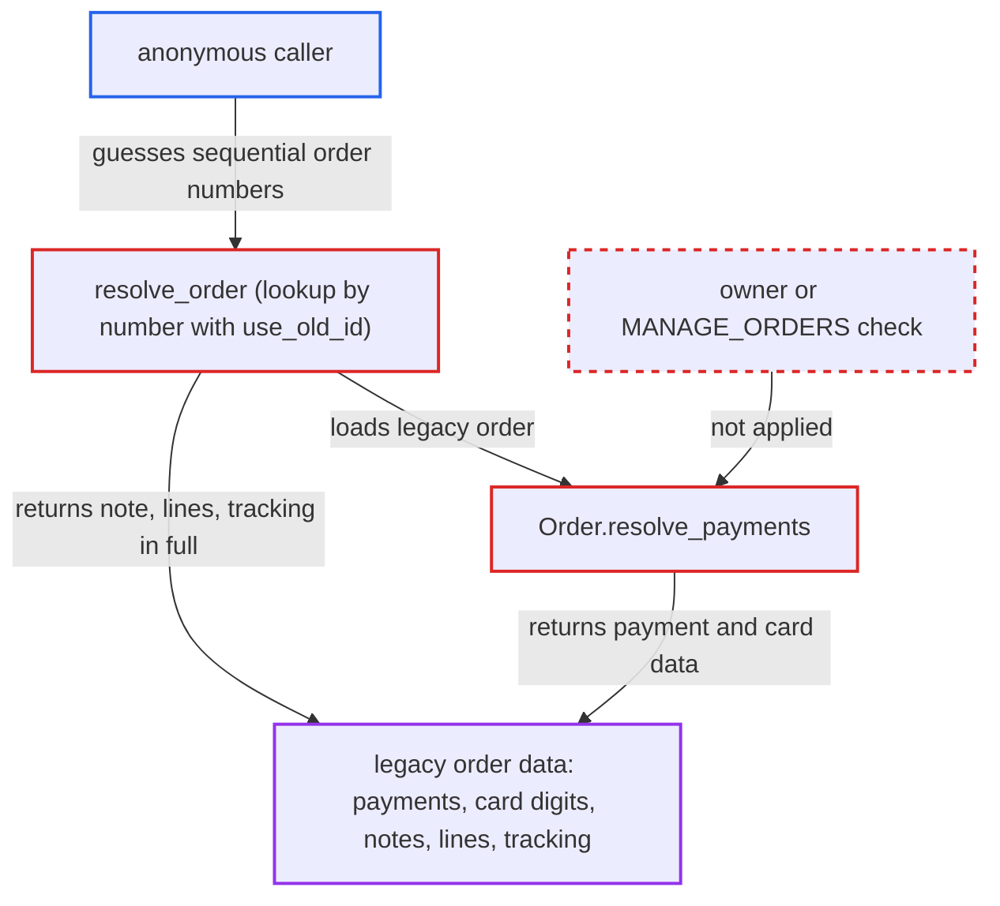

# Anonymous enumeration of pre-3.2 orders by sequential number exposes unmasked payment and order data

| Field | Value |
|---|---|
| ID | `find_01Aw7BwnjMFCxRSqvLZhJMSS` |
| Severity | **Medium** |
| Status | open |
| CWE | CWE-639 — Insecure direct object reference |
| Created | 2026-10-27T21:18:15.132472Z |
| Claude Security | https://claude.ai/security/findings/find_01Aw7BwnjMFCxRSqvLZhJMSS |

## Description

An anonymous internet user can read payment and order details for every order that existed when a store upgraded to Saleor 3.2. This only affects installations upgraded across migration `0128_set_order_number.py`. The public `order(id:)` query looks up these old orders by their sequential number with no permission check. `Order.resolve_payments` and other fields then return data unmasked.

1. **anonymous caller** sends an `order(id:)` query with a global id of the form `Order:<n>`. `OrderQueries.resolve_order` demands `MANAGE_ORDERS` only for the `externalReference` path, so a query by `id` runs for any caller. ([`saleor/graphql/order/schema.py:216-236`](https://github.com/cx-benchmark/saleor/blob/c982006cc04c77a97def93218dedac8d715eb041/saleor/graphql/order/schema.py#L216-L236))
2. **the resolver `resolve_order`** matches the number against old orders. A non-UUID id is resolved with `Q(number=n) & Q(use_old_id=True)`, so a guessable sequential number loads the legacy order. ([`saleor/graphql/order/resolvers.py:90-101`](https://github.com/cx-benchmark/saleor/blob/c982006cc04c77a97def93218dedac8d715eb041/saleor/graphql/order/resolvers.py#L90-L101))
3. **migration `0128_set_order_number.py`** is the reason such orders exist. It copied every existing order's integer id into `number` and set `use_old_id=True`, so the guessable number is the only key to those orders. ([`saleor/order/migrations/0128_set_order_number.py:7-9`](https://github.com/cx-benchmark/saleor/blob/c982006cc04c77a97def93218dedac8d715eb041/saleor/order/migrations/0128_set_order_number.py#L7-L9))
4. **the field `Order.resolve_payments`** returns the order's legacy `Payment` objects. It has no owner or permission check, so `token`, `pspReference`, `gateway` and `creditCard` (brand, first digits, last digits, expiry month and year) go to the caller. ([`saleor/graphql/order/types.py:2575-2585`](https://github.com/cx-benchmark/saleor/blob/c982006cc04c77a97def93218dedac8d715eb041/saleor/graphql/order/types.py#L2575-L2585))
5. **the resolvers for `customerNote`, `lines` and `fulfillments.trackingNumber`** return their data in full. The masking for `use_old_id` orders is applied only to the addresses, the email and the invoices, so the other fields are served by default resolvers. ([`saleor/graphql/order/types.py:1811-1814`](https://github.com/cx-benchmark/saleor/blob/c982006cc04c77a97def93218dedac8d715eb041/saleor/graphql/order/types.py#L1811-L1814))
6. **anonymous caller** increments `n` and repeats the query. Walking `1..N` loads every order that existed at upgrade time.

## Assessment

The attacker is an anonymous user who can reach the `/graphql/` endpoint, and no login is needed. The target must be an installation upgraded across migration `0128`, because only those hold orders with `use_old_id=True`. Fresh installs have none. The attacker sends `order(id:)` with the base64 form of `Order:<n>` and asks for `customerNote`, `payments`, `lines` and `fulfillments { trackingNumber }`. They then increment `n`.

Impact: The attacker can bulk-read every legacy order's payment records, including the gateway token, `pspReference` and truncated card data (brand, first and last digits, expiry). They also get customer notes, purchased items and amounts, tracking numbers, `voucherCode` and public metadata. Names, street, phone and the email local part stay obfuscated, card numbers are truncated, and nothing can be written.

## Recommendation

(1) `resolve_order` lets unauthenticated callers load orders by the guessable sequential `number` (the legacy `use_old_id` path) and then treats the whole `Order` graph as visible to them. Only four fields apply the `use_old_id` masking.

Fix criteria: An anonymous or non-owner request that reaches an order through the legacy integer-number path gets no payment records, card details, customer note, tracking numbers, metadata, line items or other order content. This can be done either by requiring `MANAGE_ORDERS` or ownership for the number-based lookup entirely, or by applying the same owner/`MANAGE_ORDERS` gate used by `resolve_billing_address` to every data-bearing field. To check, query `order(id: 'Order:<n>')` without logging in for a `use_old_id=True` order and confirm those fields are null or denied.

(2) `Order.resolve_payments` returns legacy `Payment` objects, including `creditCard`, `token` and `pspReference`, with no permission check. This is inconsistent with `Order.transactions` and `TransactionSummary`.

Fix criteria: `Order.payments`, or at least its sensitive `Payment` sub-fields, requires `MANAGE_ORDERS`/`HANDLE_PAYMENTS` or order ownership, matching `resolve_transactions`. An unauthenticated query selecting `payments { token pspReference creditCard { lastDigits expMonth } }` on any order is denied.

## Evidence

**https://github.com/cx-benchmark/saleor**

- [`saleor/graphql/order/resolvers.py:90-101`](https://github.com/cx-benchmark/saleor/blob/c982006cc04c77a97def93218dedac8d715eb041/saleor/graphql/order/resolvers.py#L90-L101)
- [`saleor/graphql/order/schema.py:216-236`](https://github.com/cx-benchmark/saleor/blob/c982006cc04c77a97def93218dedac8d715eb041/saleor/graphql/order/schema.py#L216-L236)
- [`saleor/graphql/order/types.py:2575-2585`](https://github.com/cx-benchmark/saleor/blob/c982006cc04c77a97def93218dedac8d715eb041/saleor/graphql/order/types.py#L2575-L2585)
- [`saleor/graphql/payment/types.py:143-215`](https://github.com/cx-benchmark/saleor/blob/c982006cc04c77a97def93218dedac8d715eb041/saleor/graphql/payment/types.py#L143-L215)
- [`saleor/graphql/payment/types.py:274-284`](https://github.com/cx-benchmark/saleor/blob/c982006cc04c77a97def93218dedac8d715eb041/saleor/graphql/payment/types.py#L274-L284)
- [`saleor/graphql/order/types.py:2163-2183`](https://github.com/cx-benchmark/saleor/blob/c982006cc04c77a97def93218dedac8d715eb041/saleor/graphql/order/types.py#L2163-L2183)
- [`saleor/graphql/order/types.py:1811-1814`](https://github.com/cx-benchmark/saleor/blob/c982006cc04c77a97def93218dedac8d715eb041/saleor/graphql/order/types.py#L1811-L1814)
- [`saleor/order/migrations/0128_set_order_number.py:7-9`](https://github.com/cx-benchmark/saleor/blob/c982006cc04c77a97def93218dedac8d715eb041/saleor/order/migrations/0128_set_order_number.py#L7-L9)

