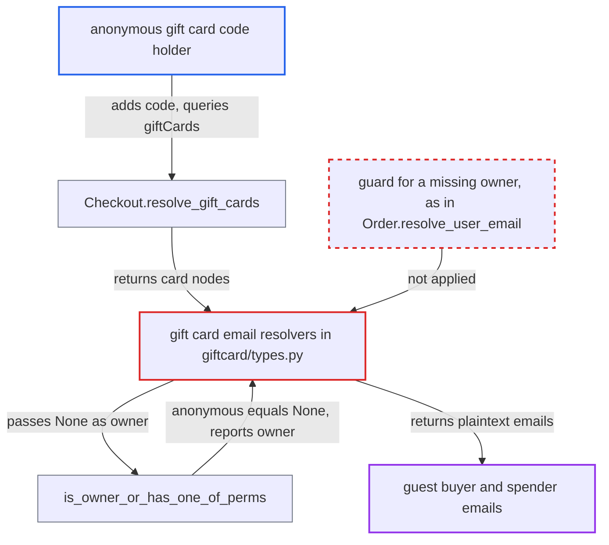

# Anonymous gift card holders get unobfuscated buyer/spender emails when owner FK is null

| Field | Value |
|---|---|
| ID | `find_01VMo5aLLnbm7pZiRhv74aHt` |
| Severity | **Medium** |
| Status | open |
| CWE | CWE-863 — Incorrect authorization |
| Created | 2026-10-27T21:24:43.285087Z |
| Claude Security | https://claude.ai/security/findings/find_01VMo5aLLnbm7pZiRhv74aHt |

## Description

An anonymous internet user who holds a gift card code can read the full email of the guest who bought the card and of the last guest who spent it. The project means to show these only as obfuscated, such as `j...@domain`. It works only when the card's user link is null, which happens for guest-bought or guest-spent cards and for deleted users. The resolvers in `saleor/graphql/giftcard/types.py` call `is_owner_or_has_one_of_perms` with `None`, and an anonymous requester compares equal to `None`.

1. **anonymous attacker** creates a checkout and adds the gift card code. The attacker calls `checkoutCreate` and then `checkoutAddPromoCode` with the code, and sends no auth header. ([`saleor/giftcard/utils.py:55-84`](https://github.com/cx-benchmark/saleor/blob/c982006cc04c77a97def93218dedac8d715eb041/saleor/giftcard/utils.py#L55-L84))
2. **`Checkout.resolve_gift_cards`** returns the attached gift card nodes to the caller. It does no permission check, so the email fields of each card are resolved for the anonymous caller. ([`saleor/graphql/checkout/types.py:1173-1175`](https://github.com/cx-benchmark/saleor/blob/c982006cc04c77a97def93218dedac8d715eb041/saleor/graphql/checkout/types.py#L1173-L1175))
3. **request context** sets the requester to a lazy wrapper around `None`. For an anonymous call without an app token, `context.user` is a `SimpleLazyObject` wrapping `None`, and `get_user_or_app_from_context` returns it as the requester. ([`saleor/graphql/context.py:88-96`](https://github.com/cx-benchmark/saleor/blob/c982006cc04c77a97def93218dedac8d715eb041/saleor/graphql/context.py#L88-L96))
4. **resolvers `resolve_created_by_email` and `resolve_used_by_email`** call `is_owner_or_has_one_of_perms(requester, None, MANAGE_GIFT_CARD)` when the user link is null. The user link is null for guest buyers and guest spenders, so the owner is `None`. ([`saleor/graphql/giftcard/types.py:535-571`](https://github.com/cx-benchmark/saleor/blob/c982006cc04c77a97def93218dedac8d715eb041/saleor/graphql/giftcard/types.py#L535-L571))
5. **helper `is_owner_or_has_one_of_perms`** treats the anonymous requester as the owner. The test `requestor == owner` compares the lazy `None` with `None`, which is True, so the permission check is skipped. ([`saleor/graphql/account/utils.py:364-376`](https://github.com/cx-benchmark/saleor/blob/c982006cc04c77a97def93218dedac8d715eb041/saleor/graphql/account/utils.py#L364-L376))
6. **resolvers** return the stored plaintext email. The attacker reads `createdByEmail` and `usedByEmail` from `checkout { giftCards { ... } }` without obfuscation. ([`saleor/graphql/giftcard/types.py:535-571`](https://github.com/cx-benchmark/saleor/blob/c982006cc04c77a97def93218dedac8d715eb041/saleor/graphql/giftcard/types.py#L535-L571))

## Assessment

The attacker is an anonymous internet user who holds a gift card code. They may be a recipient, a buyer of a resold card, or anyone the code was shared with. They need no login and no victim action. It works only for cards bought or last spent by a guest with no matching account, or whose user was deleted. The attacker does not control that data state. The `assignedToEmail` case is narrower. An orphaned assigned card is deactivated by `deactivate_assigned_gift_cards`, and `usage_restriction_reason` refuses it at checkout. So it is exposed only where the card is reachable through `Order.giftCards`. A logged-in customer gets the obfuscated form, because `User == None` is False.

Impact: The attacker learns the full email address of the guest who bought the card and of the last guest who spent it. That is one or two addresses per card they hold. The code, balance and other fields are not affected, and nothing can be changed.

## Recommendation

The gift card email resolvers call `is_owner_or_has_one_of_perms(requester, None, ...)` when the user link is null. The check `requestor == owner` compares an anonymous lazy `None` requester with `None`, which is True. The obfuscation branch is skipped and the stored email is returned in plaintext.

Fix criteria: An unauthenticated requester never counts as the owner. When the referenced user is null, only `MANAGE_GIFT_CARD` yields the plaintext `createdByEmail`, `usedByEmail` or `assignedToEmail`, and every other caller gets the obfuscated value. To verify, an anonymous `checkout { giftCards { createdByEmail usedByEmail } }` query on a guest-bought, guest-used card returns obfuscated addresses. `MANAGE_GIFT_CARD` holders still see plaintext.

## Evidence

**https://github.com/cx-benchmark/saleor**

- [`saleor/graphql/giftcard/types.py:535-571`](https://github.com/cx-benchmark/saleor/blob/c982006cc04c77a97def93218dedac8d715eb041/saleor/graphql/giftcard/types.py#L535-L571)
- [`saleor/graphql/account/utils.py:364-376`](https://github.com/cx-benchmark/saleor/blob/c982006cc04c77a97def93218dedac8d715eb041/saleor/graphql/account/utils.py#L364-L376)
- [`saleor/graphql/context.py:88-96`](https://github.com/cx-benchmark/saleor/blob/c982006cc04c77a97def93218dedac8d715eb041/saleor/graphql/context.py#L88-L96)
- [`saleor/graphql/utils/__init__.py:204-207`](https://github.com/cx-benchmark/saleor/blob/c982006cc04c77a97def93218dedac8d715eb041/saleor/graphql/utils/__init__.py#L204-L207)
- [`saleor/giftcard/utils.py:55-84`](https://github.com/cx-benchmark/saleor/blob/c982006cc04c77a97def93218dedac8d715eb041/saleor/giftcard/utils.py#L55-L84)
- [`saleor/graphql/checkout/types.py:1173-1175`](https://github.com/cx-benchmark/saleor/blob/c982006cc04c77a97def93218dedac8d715eb041/saleor/graphql/checkout/types.py#L1173-L1175)
- [`saleor/order/utils.py:514-526`](https://github.com/cx-benchmark/saleor/blob/c982006cc04c77a97def93218dedac8d715eb041/saleor/order/utils.py#L514-L526)
- [`saleor/giftcard/utils.py:292-320`](https://github.com/cx-benchmark/saleor/blob/c982006cc04c77a97def93218dedac8d715eb041/saleor/giftcard/utils.py#L292-L320)
- [`saleor/graphql/order/types.py:2638-2656`](https://github.com/cx-benchmark/saleor/blob/c982006cc04c77a97def93218dedac8d715eb041/saleor/graphql/order/types.py#L2638-L2656)

