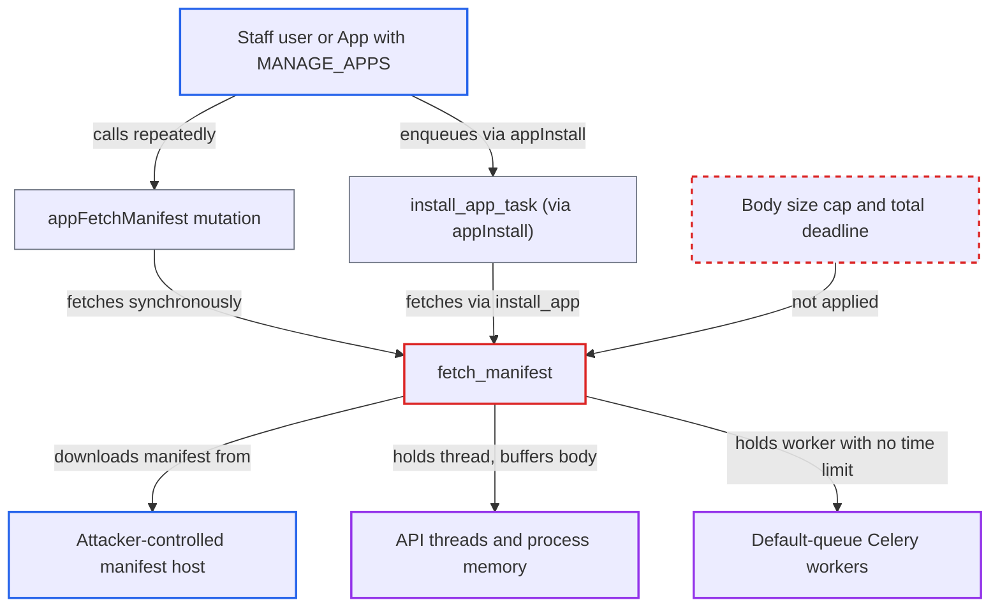

# App manifest fetch has no size cap or wall-clock deadline, letting a manifest host exhaust workers

| Field | Value |
|---|---|
| ID | `find_01ANGNEGmaRW2RorFxxVPbMj` |
| Severity | **Medium** |
| Status | open |
| CWE | CWE-770 — Allocation of resources without limits |
| Created | 2026-10-27T21:27:50.774443Z |
| Claude Security | https://claude.ai/security/findings/find_01ANGNEGmaRW2RorFxxVPbMj |

## Description

A staff user, or an App holding the `MANAGE_APPS` permission, can tie up API threads, exhaust API process memory and block Celery workers by pointing the app manifest fetch at a slow or huge response. No data is read or changed. The cause is `fetch_manifest()`, which reads the whole manifest with no size cap and no total time limit. Its only limits are per-read timeouts.

1. **attacker** hosts a manifest URL that answers 200 and then misbehaves. The host either sends one byte every few seconds or streams a multi-gigabyte body quickly.
2. **attacker** calls `appFetchManifest` with that URL, repeatedly if wanted. The mutation needs only `MANAGE_APPS`, so an App can call it as well as staff, and it runs `fetch_manifest(manifest_url)` inside the API request. ([`saleor/graphql/app/mutations/app_fetch_manifest.py:27-43`](https://github.com/cx-benchmark/saleor/blob/c982006cc04c77a97def93218dedac8d715eb041/saleor/graphql/app/mutations/app_fetch_manifest.py#L27-L43))
3. **attacker** or calls `appInstall` for the URL, which enqueues `install_app_task`. `appInstall` checks only the URL format and queues one task per call on the default queue; `appRetryInstall` re-enqueues failed installs. ([`saleor/graphql/app/mutations/app_install.py:59-86`](https://github.com/cx-benchmark/saleor/blob/c982006cc04c77a97def93218dedac8d715eb041/saleor/graphql/app/mutations/app_install.py#L59-L86))
4. **`fetch_manifest()`** sends a non-streamed GET and waits for the full body. The only limits are the connect and read timeouts of `COMMON_REQUESTS_TIMEOUT = (2, 18)`. The read timeout restarts whenever a byte arrives, so it limits neither total time nor size. ([`saleor/app/installation_utils.py:207-237`](https://github.com/cx-benchmark/saleor/blob/c982006cc04c77a97def93218dedac8d715eb041/saleor/app/installation_utils.py#L207-L237))
5. **manifest host** keeps the connection open or sends a huge body. A slow drip holds the caller for as long as the host likes. A fast huge body is buffered in memory and then decoded by `response.json()`. ([`saleor/app/installation_utils.py:207-237`](https://github.com/cx-benchmark/saleor/blob/c982006cc04c77a97def93218dedac8d715eb041/saleor/app/installation_utils.py#L207-L237))
6. **`install_app_task`** stays blocked in `fetch_manifest` with no time limit. The task has no `time_limit` or `soft_time_limit`, and none is configured in settings, so it holds a prefork worker on the shared default queue. ([`saleor/app/tasks.py:21-33`](https://github.com/cx-benchmark/saleor/blob/c982006cc04c77a97def93218dedac8d715eb041/saleor/app/tasks.py#L21-L33))

## Assessment

The attacker is a staff user, or a third-party App, with the `MANAGE_APPS` permission. They host a manifest URL that answers 200 and then drips a byte every few seconds or streams gigabytes fast. They call `appFetchManifest` repeatedly, or call `appInstall` to start one `install_app_task` per call, so each install blocks a Celery worker process. No victim action and no non-default setting is needed. A malicious app vendor whose URL a staff member installs can also trigger this path, but only once per staff action. The report assumes `requests-hardened` 1.3.0 adds no size or total-time limit beyond `default_timeout`. That package was not installed in the scanning sandbox.

Impact: With enough stalled installs, every worker process on the shared default Celery queue is blocked. Async webhooks, emails and order and catalog background tasks stop for as long as the host keeps the connections open. Large bodies sent to `appFetchManifest` can push API processes out of memory and kill other in-flight requests, and the attacker can repeat this at will. No data is read or modified.

## Recommendation

(1) `fetch_manifest` trusts the remote host to finish the response in reasonable size and time. It buffers the whole non-streamed body for `response.json()` and has only per-read timeouts, so memory and duration are unbounded for every caller (`appFetchManifest`, `install_app_task`, the `install_app` command).

Fix criteria: Every manifest download enforces a maximum body size and a total wall-clock deadline. When either is exceeded it fails cleanly, with a validation or timeout error returned to the caller or recorded on the `AppInstallation`. Test: a host that drips one byte per second, or streams past the size cap, makes `appFetchManifest` and `install_app_task` fail within the deadline without buffering beyond the cap.

(2) `install_app_task` runs on the shared default Celery queue with no task time limit, so any stall in it removes a worker from all other background processing.

Fix criteria: The install task has a bounded run time, for example a hard or soft time limit as a backstop, so a stalled installation releases its worker. Test: a hung manifest host cannot keep a worker beyond that bound.

## Evidence

**https://github.com/cx-benchmark/saleor**

- [`saleor/app/installation_utils.py:207-237`](https://github.com/cx-benchmark/saleor/blob/c982006cc04c77a97def93218dedac8d715eb041/saleor/app/installation_utils.py#L207-L237)
- [`saleor/graphql/app/mutations/app_fetch_manifest.py:27-43`](https://github.com/cx-benchmark/saleor/blob/c982006cc04c77a97def93218dedac8d715eb041/saleor/graphql/app/mutations/app_fetch_manifest.py#L27-L43)
- [`saleor/graphql/app/mutations/app_install.py:59-86`](https://github.com/cx-benchmark/saleor/blob/c982006cc04c77a97def93218dedac8d715eb041/saleor/graphql/app/mutations/app_install.py#L59-L86)
- [`saleor/app/tasks.py:21-33`](https://github.com/cx-benchmark/saleor/blob/c982006cc04c77a97def93218dedac8d715eb041/saleor/app/tasks.py#L21-L33)
- [`saleor/settings.py:1155-1158`](https://github.com/cx-benchmark/saleor/blob/c982006cc04c77a97def93218dedac8d715eb041/saleor/settings.py#L1155-L1158)
- [`saleor/core/http_client.py:6-14`](https://github.com/cx-benchmark/saleor/blob/c982006cc04c77a97def93218dedac8d715eb041/saleor/core/http_client.py#L6-L14)
- [`saleor/app/installation_utils.py:78-115`](https://github.com/cx-benchmark/saleor/blob/c982006cc04c77a97def93218dedac8d715eb041/saleor/app/installation_utils.py#L78-L115)

